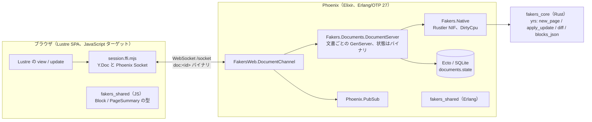

# Fakers Notion アーキテクチャ

- 版: v1（2026-10-22、S002）。S001 の設計を S002 で実装し、実装で分かった点を直した。
- 判断の理由は [adr/](adr/) に、機能の一覧は [features.md](features.md) に、順序は [roadmap.md](roadmap.md) にある。版と API の根拠は [research/stack.md](research/stack.md)。

## 1. 全体像

計算（文書モデル、CRDT のマージ、将来のフォーミュラ評価と検索）は Rust のコアで行う。Elixir はプロセス・監視・配信・永続化を受け持ち、Rust を**純関数の NIF** として呼ぶ。型はクライアントとサーバで Gleam の 1 つのパッケージを共有する。



## 2. 配置

### 2.1 ディレクトリ

ユーザーが作った言語別の構成（`src/<言語>/`）に合わせる。

```text
mise.toml / mise.lock           ツールの版（erlang / elixir / gleam / node / uv）とタスク。rust と python は書かない
pyproject.toml / uv.lock        Python の依存（uv）。ツール用途のみ
src/Rust/Cargo.toml             workspace（crates/*）。target は src/Rust/target に 1 つ
src/Rust/crates/fakers_core/    純 Rust。yrs の上のブロック文書モデル。rustler に依存しない
src/Rust/crates/fakers_nif/     Rustler の皮（cdylib）。core を 1 対 1 で包む
src/Gleam/fakers_shared/        両ターゲットで共有する型（Block、PageSummary）。FFI を置かない
src/Gleam/fakers_web/           Lustre の SPA（JavaScript ターゲット）。package.json（yjs、phoenix、esbuild）
src/Elixir/fakers/              Phoenix アプリ。lib/fakers/native.ex が ../../Rust/crates/fakers_nif を指す
src/Python/mod/fakers_notion/   Python パッケージ（ツール用途）
doc/  log/                      文書と記録
```

### 2.2 層の責務

| 層 | 置くもの | 置かないもの |
| --- | --- | --- |
| Rust `fakers_core` | 文書モデル、CRDT のマージ、JSON への投影、将来のフォーミュラ・検索・エクスポート | プロセス、I/O、Erlang の型 |
| Rust `fakers_nif` | `fakers_core` の関数を Rustler で包むだけ。全部 `schedule = "DirtyCpu"` | ロジック、状態（`ResourceArc` を持たない。[ADR-0003](adr/0003-crdt-yjs-yrs.md)） |
| Elixir | Channel、文書ごとの GenServer、Registry / DynamicSupervisor、PubSub、Ecto、API | CRDT の計算、ブロックの解釈 |
| Gleam `fakers_shared` | 型とデコーダ・エンコーダ（純粋） | FFI、I/O |
| Gleam `fakers_web` | Lustre の model / update / view、HTTP、FFI の呼び出し | CRDT のバイト列を Gleam の型に持ち込むこと（FFI の Session が `Y.Doc` を所有する） |

## 3. データの流れ（P1 の縦スライス）

1. **作成**: `POST /api/pages {title}` → `Fakers.Documents.create_page/1` が見出しと段落の UUID を作り、`Native.new_page(title, heading_id, para_id)` で初期状態（update v1 のバイナリ）を得て `documents` に insert する。サーバがシードするので、クライアントが最初のブロック作成で競合しない。
2. **開く**: クライアントが `"doc:" <> id` に join → ページの存在を確認 → `ensure_server(id)`（DynamicSupervisor、`already_started` は成功扱い）→ `send(self(), :after_join)` → `push(socket, "sync", {:binary, state})`。topic の購読が済んだ後に送るので、snapshot と購読の間に update を取りこぼさない。
3. **編集**: クライアントの `Y.Doc` が update を出す → `push("update", binary)` → `DocumentServer.apply_update/2` → NIF が decode → apply → encode → 成功なら `broadcast_from!(socket, "update", {:binary, u})`（クライアントが送った元のバイト列をそのまま配る。全員が CRDT なので重複と順序の入れ替わりは無害）→ `{:reply, :ok}`。
4. **永続化**: 更新で `dirty: true` にし、タイマーが無ければ 1000 ms 後の `:flush` で `Repo.update_all`。アイドル 10 分で flush して `:normal` 停止。`terminate/2` でも flush。
5. **再接続**: `sync` を受けるたびに状態を適用し、`Y.encodeStateVectorFromUpdate(state)` から `Y.encodeStateAsUpdate(doc, sv)` を計算して空でなければ push する。切断中の編集が回復する。

## 4. ブロックモデルと JSON の契約

- CRDT: 根の `Y.Array("blocks")` に `Y.Map{ "id": string, "type": string, "text": Y.Text, "checked"?: bool, "indent"?: int }` を並べる（S008）。
  - `type` は `paragraph` `heading` `bulleted` `todo` `code` `quote` `divider` `toggle` のどれか。
  - `checked` は ToDo のチェック、`indent` は入れ子の深さ（0 から）。どちらも無ければ false と 0（S007 までの文書はキーを持たない）。
  - 入れ子は木にせず、平らな配列の `indent` で表す。トグルを畳むと、すぐ後ろにある自分より深いブロックを隠す。畳んだ状態は各自の画面だけに持ち、文書には書かない（Notion と同じ）。
  - `type: "database"`（S011、[ADR-0008](adr/0008-database-in-page-doc.md)）は `text` が表の題名で、さらに `columns: Y.Array<Y.Map{id, name, type}>` と `rows: Y.Array<Y.Map{id, <列の id>: 値}>` を持つ。列の `type` は `text` / `number` / `checkbox`。値は列の型と合うときだけ読む。Rust の `blocks_json` は表を出さず、クライアントの FFI がブロックの JSON に `"table": {"columns": [...], "rows": [{"id", "cells": {...}}]}` を足す（`fakers_shared/database` の `decode_tables` が読む）。
- 位置は **UTF-16** で数える（yjs の規則）。yrs 側は `Options { offset_kind: OffsetKind::Utf16 }` で `Doc` を作る。
- JSON の形は Rust の `blocks_json` と JS の FFI の両方が同じものを出す（キーの順は問わない。Rust は `id, text, type` の辞書順で出す）:

  ```json
  [{"id":"…","type":"heading","text":"My page","checked":false,"indent":0},{"id":"…","type":"todo","text":"","checked":true,"indent":1}]
  ```

- Gleam の型（`fakers_shared/src/fakers_shared/block.gleam`）:

  ```gleam
  pub type BlockKind { Paragraph Heading Bulleted Todo Code Quote Divider Toggle Database }
  pub type Block { Block(id: String, kind: BlockKind, text: String, checked: Bool, indent: Int) }
  pub fn decode_blocks(json: String) -> Result(List(Block), json.DecodeError)
  pub fn block_to_json(Block) -> json.Json
  ```

  Erlang 側では `{block, Id, heading, Text, Checked, Indent}`。Elixir からは `:fakers_shared@block.decode_blocks(json)`。

## 5. Rust のコアと NIF の面

```rust
pub const ROOT: &str = "blocks";
pub fn new_page(title: &str, heading_id: &str, para_id: &str) -> Vec<u8>;        // 全状態（update v1）
pub fn apply_update(state: &[u8], update: &[u8]) -> Result<Vec<u8>, CoreError>;  // 新しい全状態
pub fn state_vector(state: &[u8]) -> Result<Vec<u8>, CoreError>;
pub fn diff(state: &[u8], sv: &[u8]) -> Result<Vec<u8>, CoreError>;
pub fn blocks_json(state: &[u8]) -> Result<String, CoreError>;
pub fn edit_text(state: &[u8], block_id: &str, utf16_index: u32, insert: &str)
    -> Result<(Vec<u8>, Vec<u8>), CoreError>;                                    // (new_state, update) テストとシード用

// fakers_core::formula（S009、ADR-0007）。NIF にはまだ出していない
pub fn compile(src: &str, schema: &HashMap<String, Type>) -> Result<Formula, FormulaError>;
impl Formula { pub fn ty(&self) -> Type; pub fn eval(&self, row: &HashMap<String, Value>) -> Result<Value, FormulaError>; }
```

- `fakers_nif` は 1 対 1 で包む。戻り値は `Result<T, String>`（`{:ok, t} | {:error, msg}`）。
- 毎回 decode → apply → encode するので費用は O(文書サイズ)。P1 の規模では十分速い見込み（S002 で実測する）。速くしたくなったら、バイナリと並べて `ResourceArc<Mutex<Doc>>` をキャッシュし、アップグレード後にバイナリから作り直す。

## 6. プロセス設計（Elixir）

- `Fakers.Application` の children: `Repo`、`Phoenix.PubSub`、`{Registry, keys: :unique, name: Fakers.Documents.Registry}`、`{DynamicSupervisor, name: Fakers.Documents.Supervisor}`、`Endpoint`。
- `DocumentServer`: `restart: :transient`、`{:via, Registry, {Fakers.Documents.Registry, id}}`。`init` で DB から状態を読み、`Process.flag(:trap_exit, true)`。API は `get_state/1`、`apply_update/2`、`flush/1`、`stop/1`。状態の map に `:vsn` を持ち、`code_change/3` を実装する（ホットスワップの足場）。
- `DocumentChannel`: `"doc:*"`。認証は P4 まで無し。`join` は UUID でない id や無いページを `not_found` で断る。
- `Fakers.Documents` の `apply_update/2` と `document_state/1` は毎回 `ensure_server/1` を通る（idle で止まった直後の呼び出しも起動し直す）。
- `UserSocket`: `channel "doc:*", FakersWeb.DocumentChannel`。`endpoint.ex` に `socket "/socket", FakersWeb.UserSocket, websocket: true`。

## 7. ホットスワップと分散の方針

- **文書の状態は BEAM 側に置き、NIF には置かない。** Rustler 0.38 は erl_nif の `upgrade` コールバックを `NULL` にするので、NIF モジュールは差し替えられない。状態がバイナリなら `DocumentServer` と Channel は自由に差し替えられ、`Fakers.Native` は薄い安定ファサードとして滅多に変えない。
- P5 で libcluster と Horde（文書プロセスをノード間に分散）、Postgres（複数ノードで共有する DB）、OTP リリースと relup を入れる。Rust コアの WASM 化（クライアントとサーバで同じ実装。`wasm32-unknown-unknown` と wasm-bindgen）も P5。

## 8. 検証基盤

| タスク | 内容 | いつから |
| --- | --- | --- |
| `mise run doctor` | ツールの版の表示 | S001 |
| `mise run docs:check` | スライド・リンクの検査、Playwright でのブラウザ表示 | S001 |
| `mise run test` | `test:rust`（fmt / clippy / test）、`test:interop`（yrs ⇄ yjs の両方向）、`test:shared`（gleam test、両ターゲット）、`test:web`（FFI の差分計算とルート）、`test:elixir`（mix test。NIF と Gleam のビルドを含む）、`test:e2e`（Playwright で 2 タブ。PORT=4100 で Phoenix を起動する） | S002 |
| `mise run build` / `mise run dev` | gleam build → esbuild → `mix phx.server` | S002 |

機械は Raspberry Pi 500（aarch64、4 コア、RAM 8 GB、16K ページのカーネル、ディスクの空き約 9 GB）。`CARGO_BUILD_JOBS=2`、Cargo の target は 1 つ、依存は最小にする。

## 9. クライアント（Lustre の SPA）の構成

- `src/fakers_web.gleam`: `Model(route, pages, blocks, tables, number_draft, status, peers, collapsed, draft_title, session, error)`。`update` は純粋で、セッションの操作はすべて `effect.from` の中で行う。`tables` はデータベースのブロックの id → 列と行、`number_draft` は数値のセルに打っている途中の文字列（Lustre は入力のたびに入力欄の値を描画の値へ戻すため、"1." のような途中の形を Model に持つ）。
- `src/fakers_web/session.gleam` + `session.ffi.mjs`: `open(doc_id, on_blocks, on_status, on_peers)`、`set_text`、`insert_block_after`、`set_kind`、`set_checked`、`set_indent`、`delete_block`、データベースの `add_column` / `set_column` / `delete_column` / `add_row` / `delete_row` / `set_cell`、`close`、`focus_block`、純粋な `diff_text`。Session が `Y.Doc`・`Socket`・`Channel` を所有し、Gleam にはブロックの JSON と状態の文字列（`connecting` / `joined` / `error: …` / `closed`）だけを渡す。
- `src/fakers_web/route.gleam` + `route.ffi.mjs`: `#/` と `#/p/<id>` のハッシュのルーティング。
- `src/fakers_web/api.gleam`: rsvp で `/api/pages` を読む・作る。
- ビルド: `gleam build --target javascript` → `esbuild entry.mjs --bundle` → `priv/static/assets/app.js`（507.6 KB、dev）。`app.css` も同じ場所にコピーする。
