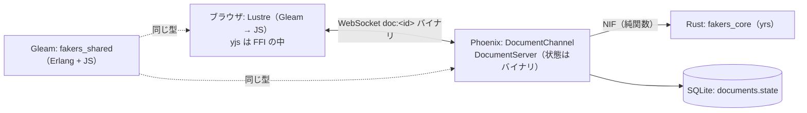
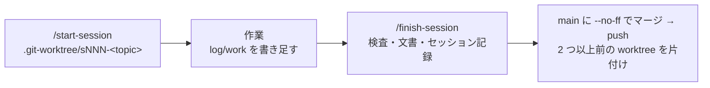

# S001 運用基盤と計画

| | |
| --- | --- |
| セッション | S001 |
| 日付 | 2026-10-22 |
| ブランチ | `feature/s001-ops-and-plan` |
| Phase | P0 |
| スライド | [slides.html](slides.html) |
| 作業記録 | [log/work/2026-10-22-s001-ops-and-plan.md](../../../log/work/2026-10-22-s001-ops-and-plan.md) |

## 1. 目的

ユーザーの依頼は 3 つ。

1. 「これは Notion を模倣するプロジェクト。メインは Rust, Gleam, Elixir。コアは Rust、分散処理やホットスワップの仕組みを活かすなら Elixir や Gleam がよいか」→ 役割分担の評価。
2. 「プランを作成し進めて」→ 範囲は「骨組み + 最初の縦スライス」、UI は Gleam / Lustre、DB は SQLite（ユーザーが選んだ）。
3. 「GlobeMode のセッションを参考にして記録やワークツリーを管理して」→ 兄弟リポジトリ GlobeMode の運用の型（`.git-worktree/` の feature ブランチ、セッション記録のフック、作業記録、スライドと解説書、main への `--no-ff` マージと push）をこのリポジトリに移す。

3 を先に済ませるため、このセッションを P0（運用基盤）にし、縦スライスの実装は S002 に分けた。[roadmap.md](../../roadmap.md) の P0 の完了条件（フックが伏せ字版を出力する、リンク切れ 0 件、P1 の計画が ADR と調査に裏付けを持つ）に向けた作業。

## 2. 決定と理由

| 項目 | 決定 | 理由 |
| --- | --- | --- |
| 作業ツリー（既定のまま） | orca が作った worktree（`asari300/compilator`）ではなく、main 直下の `.git-worktree/s001-ops-and-plan`（`feature/s001-ops-and-plan`） | GlobeMode の S017 と同じ判断。finish-session の手順がそのまま使える |
| セッションの分割（既定のまま） | S001 = 運用基盤と計画、S002 = 骨組みと縦スライス | 規約を先に main に置き、実装の差分を小さく保つ |
| 言語の役割（ユーザーの方針を ADR に） | Rust コア、Elixir リアルタイムと分散、Gleam 共有する型と Lustre、Python ツール（[ADR-0002](../../adr/0002-language-roles.md)） | 三言語税を境界で防ぐ。Gleam の固有の価値は Erlang と JS の両ターゲット |
| ツールチェーン（ユーザーの方針を ADR に） | uv / cargo・rustup / mise（[ADR-0001](../../adr/0001-toolchain.md)） | GlobeMode の ADR-0003 と同じ型。Rust だけ rustup |
| CRDT（既定のまま、Proposed） | yjs / yrs。状態は BEAM 側のバイナリ、NIF は純関数（[ADR-0003](../../adr/0003-crdt-yjs-yrs.md)） | Rustler 0.38 は NIF をホットスワップできない。yrs には `small-client` と UTF-16 が要る |
| Gleam の組み込み（既定のまま、Proposed） | mix.exs のカスタムコンパイラ、Lustre + esbuild（[ADR-0004](../../adr/0004-gleam-integration.md)） | mix_gleam は停滞、本体サポートは未マージ。lustre_dev_tools の Bun は 16K ページのカーネルで不安 |
| DB（ユーザーが選んだ） | SQLite（ecto_sqlite3、[ADR-0005](../../adr/0005-persistence-sqlite.md)） | Postgres が無く、常駐を増やさない。P5 で移行 |
| UI（ユーザーが選んだ） | Gleam / Lustre の SPA | 型をクライアントとサーバで共有する |
| Python パッケージ（既定のまま） | `src/20261022_fakers_notion` を `src/Python/mod/fakers_notion` に改名し、Playwright を開発依存に | 数字で始まるモジュール名は import できない。GlobeMode の S002 と同じ配置 |
| CI（既定のまま） | S001 では作らない。S003 の候補 | 検査するコードがまだ無い |

## 3. 図

層の構成（P1 の縦スライス。詳細は [architecture.md](../../architecture.md)）:



運用の流れ（GlobeMode と同じ）:



## 4. 再現手順

```bash
MAIN=~/monorepo/Chaos/20261022_Fakers_Notion
git -C "$MAIN" worktree add -b feature/s001-ops-and-plan .git-worktree/s001-ops-and-plan main
cd "$MAIN/.git-worktree/s001-ops-and-plan"
mise trust && mise install && uv sync     # erlang 27.3.4.19 / elixir 1.18.3-otp-27 / gleam 1.19.2 / node 24.22.0 / uv 0.13.4、Playwright 1.64
mise run doctor
mise run docs:check                       # check_docs.py（デッキ・リンク）と render_slides.py（Playwright）
python3 .claude/hooks/save_session_log.py --check log/sessions/*.md
```

検証の結果（数字）:

- `mise install`: 5 ツール（uv / erlang / elixir / gleam / node）が入り、`mise.lock` ができた。`mise install --locked` は差分なし。
- `uv sync`: 通った（playwright 1.64.0）。
- `check_docs.py`: デッキ 2 件 OK（S001 と雛形）/ 文書 23 件・相対リンク 90 件・切れ 0 件。
- `render_slides.py`: デッキ 2 件（S001 の 7 枚と雛形の 6 枚）× 3 表示（デスクトップのライトとダーク、スマートフォン）で問題 0 件。
- セッション記録の `--check`: 取りこぼし 0 件。
- ステージした差分の漏洩検査: 0 件（`pyproject.toml` の著者のメールアドレスは意図したもの）。

数字の確定値は [作業記録](../../../log/work/2026-10-22-s001-ops-and-plan.md) の「検証」にある。

## 5. 次回

- S002（P1 の 1 回目）: [roadmap.md](../../roadmap.md) の「S002 の計画」の 12 段。最初の山は手順 3 の相互運用ゲート（yrs → yjs）。通ったら [ADR-0003](../../adr/0003-crdt-yjs-yrs.md) と [ADR-0004](../../adr/0004-gleam-integration.md) を Accepted にする。
- S003 の候補: CI（GitHub Actions）、ライセンスの決定、Hex の rustler 0.39。
- 積み残し: Playwright の目視（スクリーンショット）は S001 では機械の検査のみ。GlobeMode のメモリにある「elixir は glibc で入らない」はこの RPi では起きていない（[ADR-0001](../../adr/0001-toolchain.md) の結果）。
