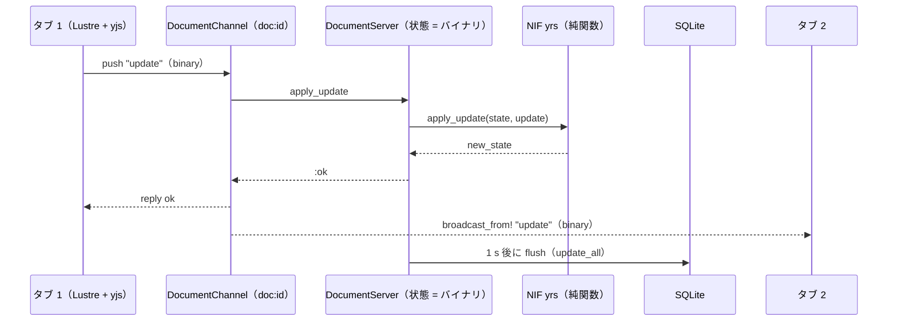
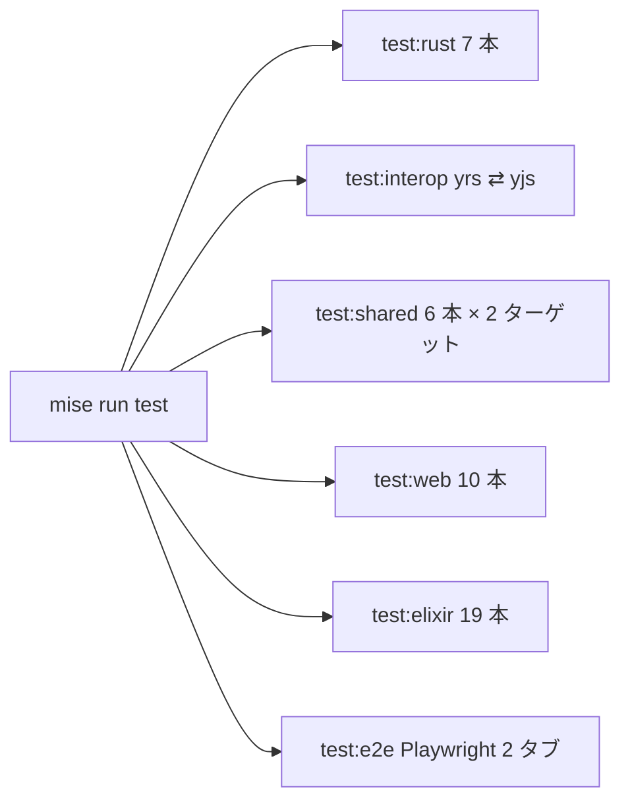

# S002 骨組みと最初の縦スライス

| | |
| --- | --- |
| セッション | S002 |
| 日付 | 2026-10-22 |
| ブランチ | `feature/s002-vertical-slice` |
| Phase | P1 |
| スライド | [slides.html](slides.html) |
| 作業記録 | [log/work/2026-10-22-s002-vertical-slice.md](../../../log/work/2026-10-22-s002-vertical-slice.md) |

## 1. 目的

S001 で承認されたプラン（[roadmap.md](../../roadmap.md) の「S002 の計画」12 段）を実装し、P1 の完了条件のうち次の 4 つを満たす。

1. `mise run test` が 3 言語とも通る
2. 2 つのタブで片方の編集がもう片方に即時反映される
3. サーバを再起動しても内容が残る
4. 相互運用ゲート（yrs ⇄ yjs）が通り、[ADR-0003](../../adr/0003-crdt-yjs-yrs.md) と [ADR-0004](../../adr/0004-gleam-integration.md) が Accepted になる

CI とライセンスは残す（S003 の候補）。

## 2. 決定と理由

| 項目 | 決定 | 理由 |
| --- | --- | --- |
| 相互運用ゲート（既定のまま） | yrs → yjs だけでなく yjs → yrs も確かめる。`test/interop.mjs` が cargo の例題（`dump_page`、`apply_hex`）を子プロセスで呼ぶ | 両方向が通らないと縦スライスは動かない。UI の前に確かめる |
| SPA の実装（既定のまま） | Opus（effort medium）のサブエージェントに、JSON の形・Channel のイベント・FFI の API を契約として渡して任せた | Elixir 側と並行できる。契約が固定されていたので分担の境界が明確 |
| Enter と IME（サブエージェント） | `event.on_keydown` ではなく `event.advanced("keydown", …)` で `isComposing` を見て `preventDefault` | 日本語の変換確定の Enter で新しいブロックを作らない |
| 差分計算（サブエージェント） | FFI の `diff_text` は UTF-16 単位で、サロゲートペアの途中で切らない | yjs の位置は UTF-16。Gleam の `string.length` は書記素 |
| E2E（既定のまま） | Playwright の Python（`src/Python/e2e/two_tabs.py`）で自動化し、`mise run test` に入れた。Phoenix は PORT=4100 で起動する | 完了条件そのもの。手動確認を残さない。dev の 4000 とぶつからない |
| `static_paths`（既定のまま） | `fonts` と `images` を外す | ディレクトリが無く、dev では `raise_on_missing_only` で Plug.Static が落ちる |
| 既知の制限 | ブロックは controlled `<input>`。リモート編集が来るとキャレットが末尾に飛ぶ | P2 で contenteditable にする |
| 文書のプロセスの呼び出し（既定のまま） | `Documents.apply_update/2` と `document_state/1` は毎回 `ensure_server/1` を通す | idle で止まった直後の呼び出しでも起動し直せる |

## 3. 図

編集が流れる道（詳細は [architecture.md](../../architecture.md#3-データの流れp1-の縦スライス)）:



検査の構成:



## 4. 再現手順

```bash
MAIN=~/monorepo/Chaos/20261022_Fakers_Notion
cd "$MAIN/.git-worktree/s002-vertical-slice"
mise trust && mise install --locked && uv sync
mix archive.install hex phx_new 1.8.16        # 1 回だけ（ユーザー全体）。mix local.rebar も
mise run setup                                # cargo fetch / npm ci / gleam deps download / mix deps.get
mise run test                                 # Rust / interop / Gleam / Elixir / E2E
mise run dev                                  # http://localhost:4000 を 2 つのタブで開く
```

検証の結果（数字）:

- `test:rust`: fmt の差分 0、clippy 0 件（`manual_is_multiple_of` を 1 件直した）、テスト 7 本。yrs の初回ビルドは約 22 s。
- `test:interop`: OK（yrs → yjs のブロック 2 つが一致、yjs の "hello 😀!" を yrs に戻せた、update 29 バイト）。
- `test:shared`: 6 本 × 2 ターゲット。`test:web`: 10 本。
- `test:elixir`: 19 本（NIF 4、Documents 6、Channel 4、API 3、error_json 2）。
- `test:e2e`: OK。タブ 1 → タブ 2 の反映 約 5 ms、再起動後も 3 ブロックが残った。
- `app.js`: 507.6 KB（dev、minify 無し）。`priv/native/fakers_nif.so`: 約 8.8 MB（debug）。
- `check_docs.py` と `render_slides.py`、セッション記録の `--check`、漏洩検査の数字は [作業記録](../../../log/work/2026-10-22-s002-vertical-slice.md)。

## 5. 次回

- P1 の残り: CI（GitHub Actions。x86_64 の runner で `mise run test` の E2E 以外、または Playwright も）とライセンスの決定。
- P2 の最初: contenteditable でキャレットを保つ、Presence とカーソル、見出しブロックと `title` 列の同期、切断と再接続の E2E（実装はあるが未検証）、ブロックの種類の追加。
- 細かい積み残し: `build:web` を prod では `--minify`（182 KB）に、Hex の rustler が 0.39 になったら crate と揃える、`DocumentServer` の idle 停止直後の呼び出しの競合は `ensure_server` で起動し直す設計だが未検証。
