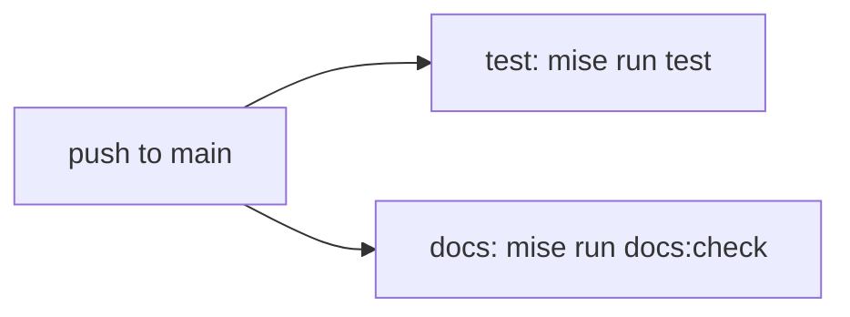

# S003 ライセンスと CI

| | |
| --- | --- |
| セッション | S003 |
| 日付 | 2026-10-22 |
| ブランチ | `feature/s003-ci-license` |
| Phase | P1 |
| スライド | [slides.html](slides.html) |
| 作業記録 | [log/work/2026-10-22-s003-ci-license.md](../../../log/work/2026-10-22-s003-ci-license.md) |

## 1. 目的

P1 の残り 2 つ: ライセンスを決める、CI を main で通す。

## 2. 決定と理由

[ADR-0006](../../adr/0006-license-and-ci.md) のとおり。ライセンスはユーザーが MIT OR Apache-2.0 を選んだ。CI は差分方式を入れず、毎回全部を検査する。

## 3. 図



## 4. 再現手順

```bash
gh run list --branch main --limit 3
gh run watch <run-id> --exit-status
```

CI の結果は作業記録の「検証」。

## 5. 次回

P2: contenteditable、Presence、title の同期、再接続の E2E。
