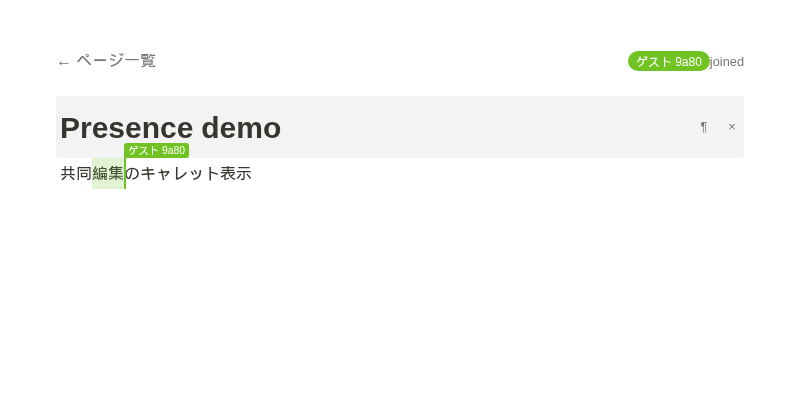
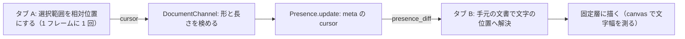

# S006 Presence とカーソル

| | |
| --- | --- |
| セッション | S006 |
| 日付 | 2026-10-23 |
| ブランチ | `feature/s006-presence-cursors` |
| Phase | P2（2回目） |
| スライド | [slides.html](slides.html) |
| 作業記録 | [log/work/2026-10-23-s006-presence-cursors.md](../../../log/work/2026-10-23-s006-presence-cursors.md) |

## 1. 目的

P2 の 2 回目。S005 の終わりに挙げた次の候補のうち、既定の S006（Presence とリモートのカーソル表示）を進めた。次の 3 つをやった。

- 同じページを開いている他の人を、ナビに色付きの名前で並べる
- 他の人の選択範囲・キャレット・名前ラベルを、手元の画面に描く
- E2E に Presence とリモートのキャレットの検査を足す



## 2. 決定と理由

| 項目 | 決定 | 理由 |
| --- | --- | --- |
| 載せる場所 | カーソルは `Phoenix.Presence` の meta（`%{name, cursor}`）に載せる。別イベントの broadcast にはしない | 後から入った人にも今のカーソルが届く。切断した人のカーソルは Presence が自動で消すので、後片付けのコードが要らない |
| 位置の表現 | Y.RelativePosition を base64 にした文字列（`anchor` と `head`）で送る | 下の「相対位置の理由」 |
| user_id | join ごとにサーバが振る（`Ecto.UUID.generate()`）。クライアントには名乗らせない | 下の「user_id と入力の検証」 |
| 描画 | Lustre の外。画面に固定した透明な層に、縦線・名前・選択範囲を置く | `<input>` の中にはキャレットを描けない。Lustre の差分描画ともぶつからない |
| 色 | user_id のハッシュから hsl で決める | 全員の画面で同じ人は同じ色になる |

### 相対位置の理由

絶対位置（文字の番号）で送ると、受け手の手元にある、相手にまだ送っていない編集の分だけ番号がずれる。Y.RelativePosition は番号ではなく特定の文字に付くので、受け手の未送信の編集があってもずれない。受け手は手元の文書で相対位置を文字の位置へ解決する（`session.ffi.mjs` の `toIndex`）。

もう 1 つの利点は、キャレットの手前に文字を打っても相対位置の値が変わらないこと。送信側は直前に送った値と同じなら送らないので、入力のたびに送る必要がない。送信はさらに 1 フレームに 1 回にまとめる（`sendCursor`）。

### user_id と入力の検証

- user_id は `DocumentChannel.join` がサーバで振り、join の返事（`%{user_id: ...}`）で本人に返す。クライアントが自分で名乗ると、他人の user_id を名乗って他人のカーソルを動かせてしまうため
- 名前はクライアントが送る（タブごとの `sessionStorage` の「ゲスト xxxx」）。サーバで trim して 32 文字に切り、空なら「ゲスト」にする
- `"cursor"` の `block` は文字列で 64 バイトまで、`anchor` と `head` は文字列で 256 バイトまで。形が違えば `"bad cursor"` のエラーを返す。`%{}` はカーソルを消す（フォーカスが外れた）
- サーバは `anchor` と `head` の中身を見ない。Presence の meta は同じページの全員へ配られるので、長さと形だけを検める
- 壊れた相対位置が届いても、受け手の `toIndex` が `null` を返して、そのカーソルを描かない

### Lustre の外で描く理由

ブロックは制御された `<input>` で、`<input>` の中には他人のキャレットを描けない。そこで `document.body` に `position: fixed` の透明な層（`.remote-layer`、`pointer-events: none`）を作り、canvas の `measureText` で測った文字幅から x 座標を出して、縦線・名前ラベル・選択範囲を置く。Lustre が管理する DOM の外なので、差分描画に消されない。文書の更新・スクロール・リサイズのたびに描き直す。入力欄の外へスクロールしたキャレットは描かない。

ナビの参加者の一覧だけは Lustre の中で描く。JS が参加者の `[{id, name, color}]` を JSON で Gleam へ渡し（`PeersChanged`）、`Peer` の一覧としてモデルに持つ。カーソルの位置は Gleam へ渡さない。

## 3. 図



文書の編集（Yjs の update）は別の経路で、カーソルは Presence だけを通る。

## 4. 再現手順

```bash
git diff main -- src/
mise run test:elixir
mise run test:web
mise run test:e2e
```

変更したファイル:

- `src/Elixir/fakers/lib/fakers_web/presence.ex`（新規）と `src/Elixir/fakers/lib/fakers/application.ex`（子プロセスに追加）
- `src/Elixir/fakers/lib/fakers_web/channels/document_channel.ex`: join で user_id を振って返事に入れ、`:after_join` で `Presence.track` と `presence_state` の push。`"cursor"` を検めて `Presence.update`
- `src/Gleam/fakers_web/src/fakers_web/session.ffi.mjs`: Presence の同期、自分のカーソルの送信、他人のカーソルの描画、`close` での後片付け
- `src/Gleam/fakers_web/src/fakers_web/session.gleam` と `src/Gleam/fakers_web/src/fakers_web.gleam`: `on_peers`、`Peer`、`PeersChanged`、ナビの参加者
- `src/Gleam/fakers_web/app.css`: `.peers` と `.remote-*`
- テスト: Channel テストに Presence（名前の整形、cursor の載せ替え、長すぎる block の拒否、消去、退室で leaves）。E2E（`src/Python/e2e/two_tabs.py`）に 5b

E2E の 5b で確かめること: 参加者が 1 人、リモートのキャレットの名前と位置、キャレットの追従、座標が入力欄の中にあること、フォーカスを外すと消えること。さらに、サーバの再起動後に参加者が互いに 1 人ずつであること。

検証の結果（数字）:

- Elixir は 21 テスト、失敗 0
- Web は 10 passed
- E2E は成功。タブ 1 からタブ 2 まで 27 ms、切断中の編集は再接続後 4937 ms で届いた
- スクリーンショットで選択範囲（2〜4 文字目）、キャレット、名前ラベルの位置を目で確かめた（上の図の `presence.png`）

## 5. 次回

積み残し:

- 名前は「ゲスト xxxx」のまま。名前の変更とアカウントは P4（ワークスペースと権限）で
- カーソルの x 座標は canvas の文字幅で出すので、合字やカーニングで 1px ほどずれうる。複数行のブロック（contenteditable）にしたら Range の矩形に替える
- 日本語入力の変換中にリモート更新が来たときの扱いは残ったまま

次のセッション（P2）:

- S007: ブロックの種類を増やす
