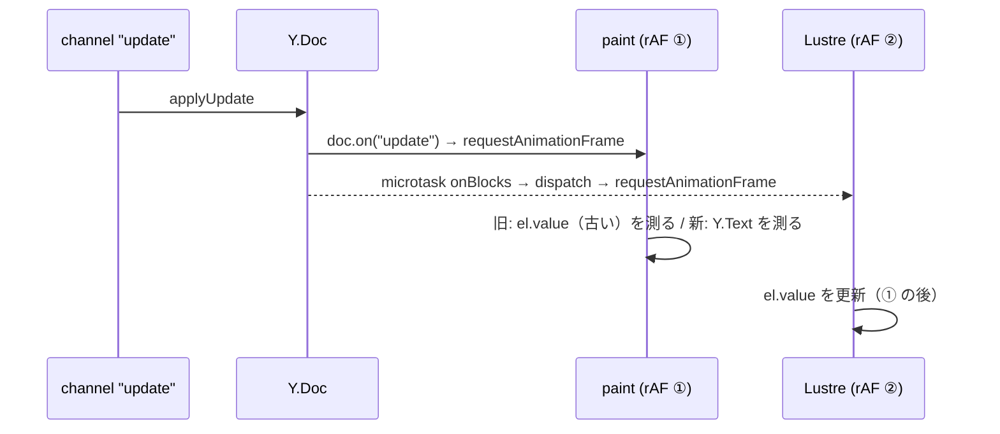

# S007 S006 レビューの指摘を直す

| | |
| --- | --- |
| セッション | S007 |
| 日付 | 2026-10-24 |
| ブランチ | `feature/s007-review-fixes` |
| Phase | P2 |
| スライド | [slides.html](slides.html) |
| 作業記録 | `log/work/2026-10-24-s007-review-fixes.md` |

## 1. 目的

S006（Presence と他の人のキャレット・選択範囲の表示）のコミットを `/ponytail-review` でレビューし、出た指摘 1〜3 を全部直す（ユーザーの選択）。[roadmap.md](../../roadmap.md) の P2「共同編集の品質」の仕上げにあたる。

指摘はレビュー時点では「読んで出した結論で、ブラウザでは再現していない」としていたので、直す前に E2E で再現させ、直した後に同じ検査が通ることを確かめた。

## 2. 決定と理由

| 項目 | 決定 | 理由 |
| --- | --- | --- |
| 1 相手のキャレットが 1 文字遅れて描かれる | `paintCursors` が測る文字列を入力欄の `el.value` ではなく、文書（Y.Text）の `toString()` にする（[session.ffi.mjs](../../../src/Gleam/fakers_web/src/fakers_web/session.ffi.mjs)） | リモート更新を受けると `doc.on("update")` が `paint()` の rAF を先に予約し、Lustre の再描画（microtask の dispatch 経由で rAF を予約）はその後に走る。そのため paint は古い `el.value` を測っていた。相手が末尾に打っている間は相対位置が変わらず cursor が再送されないので、描き直しの機会もなかった。文書を測れば描画の順番に左右されない |
| 2 名前にバイト数の上限がない | `clean_name` のガードに `byte_size(name) <= 256` を足し、超えたら「ゲスト」（[document_channel.ex](../../../src/Elixir/fakers/lib/fakers_web/channels/document_channel.ex)） | `String.slice(0, 32)` は書記素で数えるので、結合文字を 300 個つないだ名前は 1 書記素のまま通り、Presence で全員に配られる。cursor の `byte_size` と同じ検め方にそろえた |
| 3 選択範囲の帯が入力欄の外へはみ出す | 帯の左右を入力欄の `left`〜`right` に収め、幅が 0 以下なら描かない | キャレットは入力欄の外なら描かないのに、帯だけ検めていなかった |

既定のまま進めたこと: 指摘の順番と直し方はレビューで提案したとおり。S 番号は 007 を使ったので、roadmap の「S007: ブロックの種類の追加」は S008 に繰り下げた。

## 3. 図



## 4. 再現手順

```bash
cd .git-worktree/s007-review-fixes
mise run setup                      # 依存の取得（新しい worktree のため）
mise run test:elixir                # 名前のバイト上限のテストを含む
mise run build:web && mise run test:e2e
mise run test                       # 全部
```

E2E の 5b に足した場面: タブ 1 のフォーカスを外し、タブ 2 が末尾に 1 文字入力 → タブ 1 に描かれた相手のキャレットの x 座標が右へ動く。タブ 1 が同じブロックにフォーカスしていると `applyRemote` が入力欄の値を先に揃えるので不具合が隠れる。x 座標は要素が描き直しで入れ替わるため、1 回の `evaluate` で取る（`remote_caret_x`）。

検証の結果（数字）:

- 旧 FFI に新しい E2E: `リモートのキャレットが入力に追従していない: 430.84375 → 430.84375` で失敗（不具合を再現）。
- 修正後 `mise run test`: Rust 7 passed、interop OK、Gleam 6+6+10 passed、Elixir 21 tests 0 failures、E2E OK（tab1→tab2 19 ms、再接続後 1301 ms）。
- src の差分: 4 ファイル、+39 / -8 行。
- `check_docs.py`: 全デッキ OK / リンク 150 件中の切れ 0 件。`render_slides.py`: 問題 0 件。セッション記録の `--check`: 取りこぼし 0 件。

## 5. 次回

- S008: ブロックの種類の追加（リスト・ToDo・コード・引用・区切り・トグル）。P2 の残りの最後の項目。
- 日本語入力の変換中にリモート更新が来たときの扱いは残ったまま。
- `mix deps.get` が依存の security advisories を表示した。内容は未確認【未確認】。次に Elixir の依存を触るときに `mix hex.audit` で見る。
