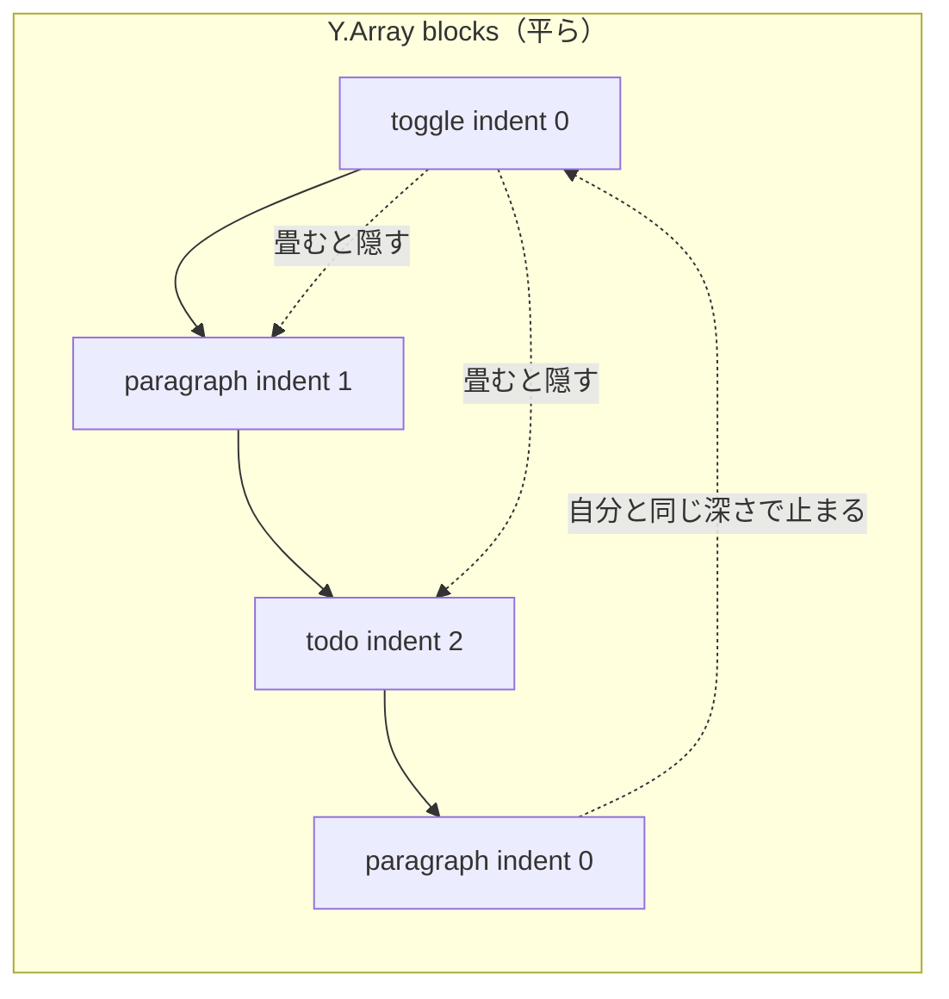

# S008 ブロックの種類と入れ子

| | |
| --- | --- |
| セッション | S008 |
| 日付 | 2026-10-24 |
| ブランチ | `feature/s008-block-types` |
| Phase | P2 |
| スライド | [slides.html](slides.html) |
| 作業記録 | `log/work/2026-10-24-s008-block-types.md` |

## 1. 目的

[roadmap.md](../../roadmap.md) の P2 の最後の項目「ブロックの種類の追加（リスト・ToDo・コード・引用・区切り・トグル）」を済ませる。[features.md](../../features.md) の方針は「`type` を足し、`text` 以外の属性は `Y.Map` のキーにする」。

## 2. 決定と理由

| 項目 | 決定 | 理由 |
| --- | --- | --- |
| 入れ子（トグルの中身） | ブロックに `indent`（0 からの整数）を持たせる。Tab / Shift+Tab で増減し、上限は「1 つ前のブロックより 1 段深い」まで。トグルを畳むと、すぐ後ろにある自分より深いブロックを隠す（**ユーザーが選んだ**） | `children: Y.Array` の木にすると、Rust の `blocks_json`、FFI、Elixir の title 同期、キャレットの探索がすべて再帰になる。平らな配列のままなら既存の処理は変わらない。リストの入れ子にも同じ仕組みが使える |
| 畳んだ状態 | 各自の画面（Lustre の `Model.collapsed`）だけに持ち、文書には書かない | Notion もトグルの開閉は人ごと。1 人が畳むと全員の画面が畳まれるのは困る |
| ToDo のチェック | `Y.Map` の `checked`（bool） | features.md の方針どおり。`text` の CRDT とは独立に、最後に書いた人が勝つ |
| 古い文書 | `checked` と `indent` が無ければ false と 0（Rust・Gleam の両方） | S007 までの文書はキーを持たない。移行は要らない |
| 壊れた値 | FFI の `snapshot` と Rust で、bool でない `checked` は false、整数でないか負の `indent` は 0 にそろえる | Gleam のデコーダは 1 件でも型が違うと一覧ごと失敗する。他人の書いた値で画面全体が読めなくなるのを防ぐ |
| 種類の切り替え | H / ¶ のボタンを `<select class="block-kind">` に替えた | 種類が 8 つになり、ボタンの切り替えでは足りない |
| Enter | 箇条書きと ToDo は同じ種類を続ける。トグルは 1 段深い段落を足して開く。空の箇条書き・ToDo・トグルで Enter を押すと段落に戻す | Notion の振る舞いに合わせた |
| コード | `textarea`（折り返さない）。Enter は改行、Ctrl / Cmd + Enter で次のブロック。相手のキャレットは改行の数から行を決めて描く | コードは複数行が要る。`<input>` を前提にしていた `caretX` を `caretAt`（x, y, 高さ）に広げた。折り返さないので行は改行の数で決まる |
| 区切り線 | `<hr>` だけで入力欄を持たない（`text` は空のまま） | 中身が無い |

既定のまま進めたこと: 番号付きリストは足していない（「リスト」は箇条書きとした）。Tab で深くしたブロックの後ろにある子は一緒に動かさない。複数行にまたがる相手の選択範囲は帯を描かない（キャレットだけ）。

## 3. 図



## 4. 再現手順

```bash
cd .git-worktree/s008-block-types
mise run setup                      # 依存の取得（新しい worktree のため）
mise run test:interop               # yjs で付けた checked / indent を yrs が読む
mise run test:shared && mise run test:web
mise run build:web && mise run test:e2e
mise run test                       # 全部
```

E2E の 9 に足した場面: タブ 1 でトグルを作り、Enter で 1 段深い段落、さらに ToDo にして Tab で 2 段目へ、チェックを付ける。タブ 2 に深さとチェックが届く。タブ 1 でトグルを畳むとタブ 1 だけブロックが 6 → 4 になる。タブ 2 で段落をコードにして Enter で改行すると、ブロックは増えず、タブ 1 に描かれる相手のキャレットは入力欄の上端より 1 行下になる。

検証の結果（数字）:

- `mise run test`: Rust 7 passed、interop OK、Gleam 7+7+11 passed、Elixir 21 tests 0 failures、E2E OK（tab1→tab2 21 ms、再接続後 824 ms）。
- src の差分: 14 ファイル、+506 / -97 行（うち `fakers_web.gleam` が +285 行）。
- 画面: ライトとダークで全種類を並べたスクリーンショットを目で確かめた。区切り線が 2 本出ていた不具合（外側の `div` も `block-divider` になり `hr` の CSS が当たった）を見つけ、`hr` を `block-rule` に替えて直した。

## 5. 次回

- P2 の作業の項目は全部済んだ。次は P3（データベースとフォーミュラ）。
- 残り: 日本語入力の変換中にリモート更新が来たときの扱い、contenteditable（インライン書式が要るとき）、番号付きリスト、ブロックの並べ替え。
- `mix deps.get` が表示した依存の security advisories は未確認のまま【未確認】。
