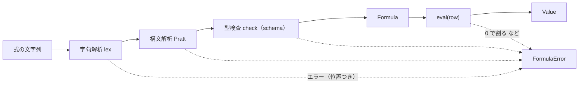

# S009 フォーミュラ言語

| | |
| --- | --- |
| セッション | S009 |
| 日付 | 2026-10-25 |
| ブランチ | `feature/s009-formula` |
| Phase | P3 |
| スライド | [slides.html](slides.html) |
| 作業記録 | `log/work/2026-10-25-s009-formula.md` |

## 1. 目的

[roadmap.md](../../roadmap.md) の P3 の完了条件のうち「フォーミュラの例題集が Rust のテストで通る」を満たす。[features.md](../../features.md) の方針は「Rust の字句解析・構文解析・型検査・評価器」。データベースの行とプロパティの持ち方はまだ決めていないが、フォーミュラはそれに依らずに作れるので P3 の最初に置いた。

## 2. 決定と理由

詳しくは [ADR-0007](../../adr/0007-formula-language.md)。

| 項目 | 決定 | 理由 |
| --- | --- | --- |
| 置き場所 | `fakers_core::formula`（[formula.rs](../../../src/Rust/crates/fakers_core/src/formula.rs)） | 依存が増えない。状態を持たない純関数なので、NIF にも P5 の WASM にも同じ実装が載る |
| API | `compile(src, schema)` で型検査まで、`Formula::eval(row)` で 1 行を評価 | 型検査は列の定義が変わったときだけでよい。行ごとには評価だけをする |
| 文法 | Notion の formula 2.0 に寄せた部分集合。`prop("名前")`、算術、比較、`and` / `or` / `not`（記号も可）、`c ? a : b`、`if(c, a, b)`、14 個の関数 | Notion の利用者が同じ書き方で書ける。優先順位は Pratt 法の結合力の表 1 つで決める（`^` は右結合で単項の `-` より強い: `-2 ^ 2` は -4） |
| 型 | 数値・テキスト・真偽値。暗黙の変換をしない | `1 + "a"` を型エラーにして、書いた時点で気づかせる。文字にしたいときは `format()` |
| 空の値 | 行に無いプロパティは 0・空文字・false。`empty(x)` はそれと等しいか | 新しい行はほとんどの値を持たない。空のたびにエラーにすると使えない |
| 実行時エラー | 数値が有限でなくなったら（0 での割り算・負の平方根・桁あふれ）と、`toNumber` で読めない文字列 | 評価の最後に 1 か所で検める。`and` / `or` は右辺を必要なときだけ評価するので `false and 1 / 0 > 0` は false |
| 深さの上限 | 入れ子は 100 まで（木の高さと構文解析の再帰の両方を数える） | 型検査と評価は再帰する。利用者の書いた深い式で NIF のスタック（dirty CPU scheduler の既定は 40 kword、[erl のドキュメント](https://www.erlang.org/doc/apps/erts/erl_cmd.html) の `+sssdcpu`、2026-10-25 確認）があふれると VM ごと落ちる |
| エラーの位置 | 先頭からの文字数（Unicode のスカラー値） | 日本語のプロパティ名を含む式でも位置がずれない。UI で下線を引くときは UTF-16 に直す必要がある |

既定のまま進めたこと: サブエージェントは使っていない（1 ファイルに収まる大きさで、渡す文脈の方が大きかった）。日付の型・リスト・メソッド記法・`let` は入れていない。

## 3. 図



## 4. 再現手順

```bash
cd .git-worktree/s009-formula/src/Rust
cargo test -p fakers_core --test formula    # 例題集
cd ../.. && mise run test                   # 全部
```

例題集は [tests/formula.rs](../../../src/Rust/crates/fakers_core/tests/formula.rs) の表。1 行が 1 題で、式と期待する値（または期待するエラーの位置と文言の一部）を並べる。題を足すときは表に 1 行足す。

検証の結果（数字）:

- 例題 42 題、構文と型のエラー 22 題、実行時エラー 4 題、行の値の型違い 1 題、深さの上限（50 段は通り、10 万段は打ち切る。括弧・`+` の連鎖・`not` の 3 通り）。最初の実行で全題が通った。
- `mise run test`: 結果は作業記録に書く。

## 5. 次回

- データベースのデータモデル: 行とプロパティ（テキスト・数値・選択・日付・チェック）を Y.Doc にどう置くか。ビューはページの中のブロック（[features.md](../../features.md)）。
- テーブルのビューと、フォーミュラ列の計算の経路（NIF でサーバが計算するか。WASM は P5）。
- 日付の型・選択の型を足したら、フォーミュラにも同じ型と関数を足す。
