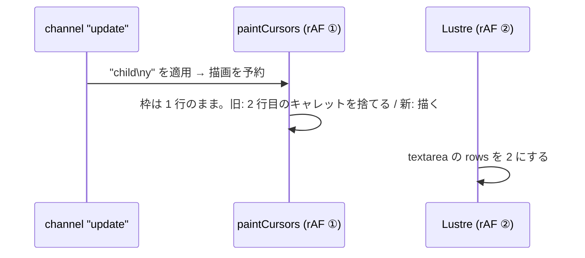

# S010 コードブロックのキャレットが CI で消える

| | |
| --- | --- |
| セッション | S010 |
| 日付 | 2026-10-25 |
| ブランチ | `feature/s010-ci-caret-fix` |
| Phase | P2 の手直し |
| スライド | [slides.html](slides.html) |
| 作業記録 | `log/work/2026-10-25-s010-ci-caret-fix.md` |

## 1. 目的

S009 を main に push したところ、CI（run 40160672881）の test ジョブが E2E で落ちた。落ちたのは S008 で足した場面 9 の「タブ 2 でコードブロックに改行して打つと、タブ 1 に相手のキャレットが 2 行目に描かれる」で、`.remote-caret` が見つからない。失敗したジョブを回し直しても同じ行で落ちた（2 回中 2 回）。ローカルと S008 の CI（run 40076114717）では通っていた。[CLAUDE.md](../../../CLAUDE.md) の手順どおり、新しいセッションで直してもう一度 push する。

## 2. 決定と理由

| 項目 | 内容 |
| --- | --- |
| 原因 | `paintCursors`（[session.ffi.mjs](../../../src/Gleam/fakers_web/src/fakers_web/session.ffi.mjs)）は、文書の更新を受けた直後に予約した rAF で走る。Lustre の再描画はその後になる（[S007 の解説書](../S007-review-fixes/解説書.md) の図と同じ順番）。textarea の `rows`（行数）は Lustre が書くので、描く時点の枠はまだ 1 行のまま。2 行目のキャレットは「入力欄の下にはみ出した」と判定して捨てていた。改行と次の文字が同じフレームの前に届くと、2 行の枠で描き直す機会もない |
| 直し方 | キャレットを捨てる条件から縦の範囲を消し、横だけを見る |
| 理由 | textarea は行数ぶんの `rows` を持ち、折り返さない（`wrap=off`）ので縦にスクロールしない。`input` はキャレットの y が常に枠の上端なので、縦の検査は元々何も弾いていなかった。条件を増やすのではなく消して直せる |
| 古いコードでの再現 | ローカルでは再現できなかった（届く順番しだい）。CI では旧コードが 2 回中 2 回落ちたので、新しいコードが CI で通ることを修正の確認にする |

## 3. 図



## 4. 再現手順

```bash
cd .git-worktree/s010-ci-caret-fix
mise run setup && mise run build:web
mise run test:e2e
mise run test
```

検証の結果（数字）は作業記録に書く。

## 5. 次回

- P3 の 2 回目: データベースのデータモデル（行とプロパティを Y.Doc にどう置くか）とテーブルのビュー、フォーミュラ列の計算の経路。
- キャレットの描画が Lustre の再描画より先に走る構造は残っている。今は「文書を測る」「縦を見ない」で避けている。枠の大きさに頼る処理を足すなら、Lustre の描画の後にもう一度描く仕組みが要る。
