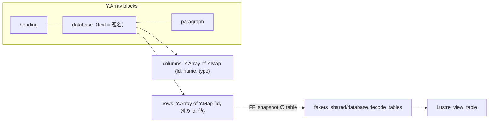

# S011 データベースとテーブルのビュー

| | |
| --- | --- |
| セッション | S011 |
| 日付 | 2026-10-25 |
| ブランチ | `feature/s011-database-table` |
| Phase | P3 |
| スライド | [slides.html](slides.html) |
| 作業記録 | `log/work/2026-10-25-s011-database-table.md` |

## 1. 目的

[roadmap.md](../../roadmap.md) の P3 の 2 回目。[features.md](../../features.md) の方針「ビューはページの中のブロック。データは `Y.Map` の行」に沿って、データベースのブロックとテーブルのビューを作る。P3 の完了条件のもう半分「ビューの切り替えとフィルタが UI で動く」の土台にあたる。

## 2. 決定と理由

詳しくは [ADR-0008](../../adr/0008-database-in-page-doc.md)。

| 項目 | 決定 | 理由 |
| --- | --- | --- |
| 置き場所 | ブロックの種類に `database` を足す。ページの `Y.Array("blocks")` に他のブロックと並ぶ | 同期・永続化・Presence・切断中の編集の復元が、今のページの経路のまま使える |
| 列と行 | ブロックの `Y.Map` に `columns: Y.Array<Y.Map{id, name, type}>` と `rows: Y.Array<Y.Map{id, <列の id>: 値}>` | 列や行を 2 人が同時に足しても消しても収束する。行の Y.Map はセルごとにキーが分かれるので、別のセルの同時編集はぶつからない |
| セルの値 | 文字列・数値・真偽値をそのまま置き、セルごとに後勝ち | 小さく始める。同じセルを 2 人が同時に打つと片方が消える（`shortcut:` のコメントを付けた） |
| 型を変えたとき | 値は消さない。`fakers_shared/database.cell` が列の型と合う値だけを返し、合わなければ空 | 型を戻せば値も戻る。他人の書いた壊れた値（配列など）で表全体が読めなくならない |
| JSON | FFI の `snapshot` がデータベースのブロックに `"table"` を足し、`database.decode_tables` が読む。`Block` の形（Erlang の 6 要素のタプル）は変えない | Elixir のパターンと Rust の `blocks_json` を触らずに済む。サーバは表を読む必要がまだない |
| 数値のセル | 打っている途中の文字列を `Model.number_draft` に持ち、数として読めたときだけ書く。フォーカスが外れたら消す | Lustre は入力のたびに入力欄の値を描画の値へ戻す。"1." を書かずにいると "1" に戻され、続けて "5" を打つと "15" になった（E2E で見つけた） |
| 種類を戻したとき | 表（`columns` と `rows`）は消さない | もう一度データベースを選べば戻る。誤操作で表を失わない |

既定のまま進めたこと: 列の型は テキスト・数値・チェック の 3 つ（日付と選択は次）。セルには相手のキャレットを描かない。サブエージェントは使っていない（データモデル・FFI・画面・E2E が互いに依存していて、分けると渡す文脈の方が大きかった）。

## 3. 図



## 4. 再現手順

```bash
cd .git-worktree/s011-database-table
mise run setup && mise run build:web
mise run test:shared                 # 表の JSON（知らない型・壊れた値・型違いを含む）を両ターゲットで読む
mise run test:interop                # yjs で作った表のブロックを yrs の blocks_json が読む
mise run test:e2e                    # 10: 列・行・セルの同期、列の型の変更、行の削除
mise run test                        # 全部
```

E2E の 10 に足した場面: タブ 1 で段落をデータベースにし、列を足して「価格」（数値）にする。行を足して「りんご」と、数値のセルに "1." → "5" と打つ（途中の形を書かない）。タブ 2 に名前・型・値が届く。タブ 2 でチェックの列を足して付けると、タブ 1 に届く。タブ 1 で価格の列をテキストに変えると、タブ 2 では空になり、数値に戻すと 1.5 に戻る。タブ 2 で行を消すと、タブ 1 から消える。

検証の結果（数字）:

- Gleam: fakers_shared 9 + 9（両ターゲット）、fakers_web 13 passed。
- 画面: ライト・ダーク・幅 390 px のスクリーンショットを目で確かめた。列の型の選択欄で「チェック」が切れていたので幅を広げた。狭い幅では表だけが横にスクロールする。
- `mise run test` の結果は作業記録に書く。

## 5. 次回

- フィルタとソート、ボードとリストのビュー（ビューの設定もブロックの `Y.Map` に持つか、各自の画面だけにするかを決める）。
- フォーミュラの列: [ADR-0007](../../adr/0007-formula-language.md) の評価器をどこで呼ぶか。クライアントで評価するなら WASM（P5 の予定を前倒し）、サーバなら NIF で結果を配る。
- 日付と選択の列の型。セルの同時入力が問題になったら Y.Text にする。
