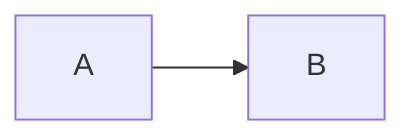

# SNNN 題名

| | |
| --- | --- |
| セッション | SNNN |
| 日付 | YYYY-MM-DD |
| ブランチ | `feature/sNNN-<topic>` |
| Phase | P? |
| スライド | [slides.html](slides.html) |
| 作業記録 | `log/work/YYYY-MM-DD-sNNN-<topic>.md` |

## 1. 目的

依頼の要約と、どの Phase のどの完了条件に向けた作業か。

## 2. 決定と理由

| 項目 | 決定 | 理由 |
| --- | --- | --- |
| … | … | … |

## 3. 図



## 4. 再現手順

```bash
# 同じ結果を得るためのコマンド
```

検証の結果（数字）:

- …

## 5. 次回

- 積み残し
- 次のセッションでやること
