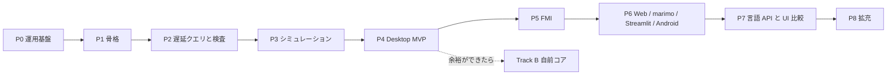

# セッション記録 fdaf1939-ea4d-47eb-856a-abcdf5ffa999

| | |
| --- | --- |
| 開始 | 2026-10-22 04:22:56 |
| 最終更新 | 2026-10-22 10:11:52 |
| ブランチ | `asari300/compilator` |
| 作業ディレクトリ | `~/orca/workspaces/20261022_Fakers_Notion/compilator` |
| やり取り | 324 件 |

> 読むための整形版。ツール結果と思考は先頭だけを抜いてある。
> メールアドレス・ローカルのユーザー名とパス・トークンらしき文字列は伏せ字にしてある。
> 完全な生ログは作業者の手元の `log/local/raw/` にだけある（コミットしない）。

## 👤 ユーザー　`2026-10-22 04:22:56`

<local-command-caveat>The command below was run directly in Claude Code, not sent to you as a request, and its output goes straight to the user. It's recorded here as context for later messages.</local-command-caveat>

## 👤 ユーザー　`2026-10-22 04:22:56`

<command-name>/model</command-name>
            <command-message>model</command-message>
            <command-args></command-args>

## 👤 ユーザー　`2026-10-22 04:22:56`

<local-command-stdout>Set model to `Fable 5.1` for this session only</local-command-stdout>

## 👤 ユーザー　`2026-10-22 04:23:04`

<local-command-caveat>The command below was run directly in Claude Code, not sent to you as a request, and its output goes straight to the user. It's recorded here as context for later messages.</local-command-caveat>

## 👤 ユーザー　`2026-10-22 04:23:04`

<command-name>/effort</command-name>
            <command-message>effort</command-message>
            <command-args></command-args>

## 👤 ユーザー　`2026-10-22 04:23:04`

<local-command-stdout>Set effort level to xhigh (saved as your default for new sessions): Deeper reasoning than high, just below maximum (on supported models)</local-command-stdout>

## 👤 ユーザー　`2026-10-22 04:23:40`

これはNotionを模倣するプロジェクトである。
メインはRust, Gleam, Elixirで作成する。
コアはRust, 分散処理やホットスワップの仕組みを活かすならElixirやGleamがよいであろうか。
- サブエージェントはOpus/effort/medium

## 🤖 Claude　`2026-10-22 04:23:48`

<details><summary>思考</summary>


</details>

## 🤖 Claude　`2026-10-22 04:23:49`

リポジトリの中身とメモリを確認してから、Rust / Elixir / Gleam の役割分担について評価を返します。

## 🤖 Claude　`2026-10-22 04:23:50`

**🔧 Bash** — List repo files and recent commits

<details><summary>入力</summary>

```json
{
 "command": "ls -la && git log --oneline -5 && find . -path ./.git -prune -o -type f -print | head -50",
 "description": "List repo files and recent commits"
}
```

</details>

## 👤 ユーザー　`2026-10-22 04:23:51`

<details><summary>ツール結果</summary>

```
合計 28
drwxr-xr-x 3 <user> <user> 4096 10月 22 13:19 .
drwxr-xr-x 3 <user> <user> 4096 10月 22 13:19 ..
-rw-r--r-- 1 <user> <user>   88 10月 22 13:19 .git
-rw-r--r-- 1 <user> <user>  109 10月 22 13:19 .gitignore
-rw-r--r-- 1 <user> <user>    5 10月 22 13:19 .python-version
-rw-r--r-- 1 <user> <user>    0 10月 22 13:19 README.md
-rw-r--r-- 1 <user> <user>  403 10月 22 13:19 pyproject.toml
drwxr-xr-x 7 <user> <user> 4096 10月 22 13:19 src
22092b3 Initial commit
./.python-version
./pyproject.toml
./.gitignore
./README.md
./src/Rust/.gitkeep
./src/Gleam/.gitkeep
./src/Elixir/.gitkeep
./src/20261022_fakers_notion/__init__.py
./src/Python/.gitkeep
```

</details>

## 🤖 Claude　`2026-10-22 04:23:52`

**🔧 Bash** — Check existing memory index

<details><summary>入力</summary>

```json
{
 "command": "ls -la ~/.claude/projects/-home-<user>-monorepo-Chaos-20261022-Fakers-Notion/memory/ && cat ~/.claude/projects/-home-<user>-monorepo-Chaos-20261022-Fakers-Notion/memory/MEMORY.md 2>/dev/null",
 "description": "Check existing memory index"
}
```

</details>

## 👤 ユーザー　`2026-10-22 04:23:52`

<details><summary>ツール結果</summary>

```
Exit code 1
合計 8
drwxr-xr-x 2 <user> <user> 4096 10月 22 13:23 .
drwxr-xr-x 3 <user> <user> 4096 10月 22 13:23 ..
```

</details>

## 🤖 Claude　`2026-10-22 04:24:54`

<details><summary>思考</summary>


</details>

## 🤖 Claude　`2026-10-22 04:24:57`

**🔧 Bash** — Show project config and installed toolchains

<details><summary>入力</summary>

```json
{
 "command": "cat pyproject.toml .gitignore .python-version && cat src/20261022_fakers_notion/__init__.py && which rustc cargo erl elixir gleam mix 2>&1; rustc --version 2>/dev/null; erl -noshell -eval 'io:format(\"~s~n\",[erlang:system_info(otp_release)]), halt().' 2>/dev/null; elixir --version 2>/dev/null | tail -1; gleam --version 2>/dev/null",
 "description": "Show project config and installed toolchains"
}
```

</details>

## 🤖 Claude　`2026-10-22 04:24:57`

**🔧 ToolSearch**

<details><summary>入力</summary>

```json
{
 "query": "select:WebSearch",
 "max_results": 1
}
```

</details>

## 👤 ユーザー　`2026-10-22 04:24:57`

<details><summary>ツール結果</summary>

```
Exit code 1
[project]
name = "20261022-fakers-notion"
version = "0.1.0"
description = "Add your description here"
readme = "README.md"
authors = [
    { name = "asari300", email = "<email>" }
]
requires-python = ">=3.12"
dependencies = []

[project.scripts]
20261022-fakers-notion = "20261022_fakers_notion:main"

[build-system]
requires = ["uv_build>=0.13.4,<0.14.0"]
build-backend = "uv_build"
# Python-generated files
__pycache__/
*.py[oc]
build/
dist/
wheels/
*.egg-info

# Virtual environments
.venv
3.12
def main() -> None:
    print("Hello from 20261022-fakers-notion!")
~/.cargo/bin/rustc
~/.cargo/bin/cargo
~/.local/share/mise/shims/erl
~/.local/share/mise/shims/elixir
~/.local/share/mise/shims/gleam

… （残り 79 字は生ログを参照）
```

</details>

## 👤 ユーザー　`2026-10-22 04:24:57`

<details><summary>ツール結果</summary>

```

```

</details>

## 🤖 Claude　`2026-10-22 04:25:01`

<details><summary>思考</summary>


</details>

## 🤖 Claude　`2026-10-22 04:25:03`

**🔧 Bash** — Show mise-managed tool versions and uv/cargo

<details><summary>入力</summary>

```json
{
 "command": "mise ls 2>&1 | head -20; echo ---; mise current 2>&1; echo ---; cat .mise.toml mise.toml .tool-versions 2>/dev/null; echo ---; uv --version 2>&1; cargo --version 2>&1",
 "description": "Show mise-managed tool versions and uv/cargo"
}
```

</details>

## 🤖 Claude　`2026-10-22 04:25:04`

**🔧 WebSearch**

<details><summary>入力</summary>

```json
{
 "query": "Rustler NIF upgrade callback hot code reload support",
 "mode": "standard"
}
```

</details>

## 👤 ユーザー　`2026-10-22 04:25:04`

<details><summary>ツール結果</summary>

```
cargo-deny                        0.20.2
clojure                           1.12.6.1673
deno                              2.9.7
dotnet                            10.0.402 (symlink)
elixir                            1.18.3-otp-27
erlang                            27.3.4.19
github:wasm-bindgen/wasm-bindgen  0.2.129
gleam                             1.19.2
go                                1.27.2
java                              temurin-25.0.4+7.0.LTS
julia                             1.13.2
node                              24.22.0
ruby                              4.0.7
rust                              stable (symlink)
uv                                0.13.1
zig                               0.17.0
---
---
---
uv 0.13.4 (aarch64-unknown-linux-gnu)
cargo 1.99.1 (5f94df478 2026-08-27)
```

</details>

## 🤖 Claude　`2026-10-22 04:25:05`

**🔧 WebSearch**

<details><summary>入力</summary>

```json
{
 "query": "gleam_otp 1.0 supervisor actor release 2025",
 "mode": "standard"
}
```

</details>

## 🤖 Claude　`2026-10-22 04:25:05`

**🔧 WebSearch**

<details><summary>入力</summary>

```json
{
 "query": "y_ex Elixir Yjs Yrs Rustler CRDT library",
 "mode": "standard"
}
```

</details>

## 👤 ユーザー　`2026-10-22 04:25:10`

<details><summary>ツール結果</summary>

```
Web search results for query: "Rustler NIF upgrade callback hot code reload support"

Links: [{"title":"[erlang-questions] NIFs Reloading","url":"https://erlang.org/pipermail/erlang-questions/2011-October/061467.html"},{"title":"Compiling and loading NIFs on runtime","url":"https://elixirforum.com/t/compiling-and-loading-nifs-on-runtime/56849"},{"title":"[erlang-questions] When to release resources in NIF?","url":"https://erlang.org/pipermail/erlang-questions/2014-March/078362.html"},{"title":"[erlang-questions] reloading a NIF library without restarting the server","url":"https://erlang.org/pipermail/erlang-questions/2015-October/086510.html"},{"title":"dynamic reload","url":"https://github.com/AstroHQ/dynamic_reload"},{"title":"[erlang-questions] reloading a NIF library without restartin
… （残り 2,395 字は生ログを参照）
```

</details>

## 👤 ユーザー　`2026-10-22 04:25:11`

<details><summary>ツール結果</summary>

```
Web search results for query: "gleam_otp 1.0 supervisor actor release 2025"

Links: [{"title":"gleam_otp 1.0.0","url":"https://www.hex.pm/packages/gleam_otp/1.0.0"},{"title":"gleam-otp.hexdocs.pm","url":"https://gleam-otp.hexdocs.pm/0.1.0/"},{"title":"readme.hex.pm","url":"https://readme.hex.pm/gleam_otp/1.0.0"},{"title":"gleam-otp.hexdocs.pm","url":"https://gleam-otp.hexdocs.pm/1.0.0/"},{"title":"preview.hex.pm","url":"https://preview.hex.pm/preview/gleam_otp/1.0.0"},{"title":"Gleam OTP : Using Supervisors","url":"https://vpgleam.substack.com/p/gleam-otp-using-supervisors"},{"title":"github.com","url":"https://github.com/gleam-lang/otp"},{"title":"gleam-otp.hexdocs.pm","url":"https://gleam-otp.hexdocs.pm/0.1.1/"},{"title":"gleam-otp.hexdocs.pm","url":"https://gleam-otp.hexdocs.pm/0.1.6/"}
… （残り 1,714 字は生ログを参照）
```

</details>

## 👤 ユーザー　`2026-10-22 04:25:12`

<details><summary>ツール結果</summary>

```
Web search results for query: "y_ex Elixir Yjs Yrs Rustler CRDT library"

Links: [{"title":"Ecosyste.ms: Packages","url":"https://packages.ecosyste.ms/registries/hex.pm/packages/yex"},{"title":"hex.pm","url":"https://hex.pm/packages/yex/0.0.1/files"},{"title":"repo.hex.pm","url":"https://repo.hex.pm/preview/yex/0.0.1/README.md"},{"title":"readme.hex.pm","url":"https://readme.hex.pm/y_ex/0.8.0"},{"title":"hexdocs.pm","url":"https://hexdocs.pm/yex/yex.epub"},{"title":"readme.hex.pm","url":"https://readme.hex.pm/y_ex/0.6.5"},{"title":"www.hex.pm","url":"https://www.hex.pm/packages/yex"},{"title":"readme.hex.pm","url":"https://readme.hex.pm/y_ex/0.7.0"},{"title":"readme.hex.pm","url":"https://readme.hex.pm/y_ex/0.7.1"},{"title":"libraries.io","url":"https://libraries.io/hex/yex"}]

The search 
… （残り 1,246 字は生ログを参照）
```

</details>

## 🤖 Claude　`2026-10-22 04:25:43`

<details><summary>思考</summary>


</details>

## 🤖 Claude　`2026-10-22 04:25:59`

**🔧 Bash** — Save project, toolchain, and subagent preferences to memory

<details><summary>入力</summary>

```json
{
 "command": "M=~/.claude/projects/-home-<user>-monorepo-Chaos-20261022-Fakers-Notion/memory\ncat > \"$M/subagents-opus-medium.md\" <<'EOF'\n---\nname: subagents-opus-medium\ndescription: User wants every subagent spawned with model Opus and effort medium\nmetadata:\n  type: feedback\n---\n\nWhen spawning subagents (Agent tool), use `model: \"opus\"` and `effort: \"medium\"` unless the user says otherwise for a specific task.\n\n**Why:** Stated by the user on 2026-10-22 at the start of the Fakers Notion project (\"サブエージェントはOpus/effort/medium\"). Keeps cost predictable while t
… （残り 2,548 字は生ログを参照）
```

</details>

## 👤 ユーザー　`2026-10-22 04:26:08`

<details><summary>ツール結果</summary>

```
MEMORY.md
fakers-notion-project.md
subagents-opus-medium.md
toolchain-uv-cargo-mise.md
```

</details>

## 🤖 Claude　`2026-10-22 04:26:27`

結論から言うと、その分担は妥当です。ただし「分散処理とホットスワップ」の担い手は Elixir に寄せ、Gleam は型付きの純粋ロジックとフロント共有に限定するのを勧めます。ホットスワップは設計上の保険程度に扱うのが現実的です。

**推奨する層の分担**

- **Rust(コア)**: ブロック文書の CRDT(yrs)、フォーミュラやブロック構造のコンパイラ、永続化、全文検索(tantivy)。この worktree の名前が compilator なので、フォーミュラ言語やブロックのコンパイラ部分はここが自然な置き場です。Elixir からは Rustler の NIF(dirty scheduler)で呼びます。
- **Elixir(リアルタイムと分散)**: Phoenix Channels と Presence で共同編集、文書ごとに GenServer を立てて監視ツリーに置く、libcluster と Horde か :global でノード間に分散、Ecto で Postgres、Oban でバックグラウンド処理。ここは BEAM の成熟したエコシステムが一番効く層です。
- **Gleam(型と共有)**: Erlang と JavaScript の両方にコンパイルできるので、ブロック型や操作型をクライアントとサーバで共有する用途に向きます。フロントを Lustre で書くなら価値がさらに上がります。gleam_otp は 1.x で actor と static_supervisor が揃いましたが、Elixir の OTP 対応より薄いので、プロセスや監視や分散は Elixir 側に寄せ、Gleam と Elixir を同じ層で混ぜないでください。

**注意点**

- **ホットスワップの実コスト**: BEAM の強みですが、relup と appup の作成、code_change での状態移行という運用負担が重いです。さらに Rust NIF は共有ライブラリの再ロードと erl_nif の upgrade コールバックが絡むため、差し替えが最も難しい部分になります。そのため CRDT の状態は BEAM 側がバイナリで保持し、Rust は純関数的に呼ぶ設計にしてください。実運用はローリングデプロイと CRDT による再接続再同期を基本にし、ホットスワップは「接続を落とさず小さな修正を当てる」用途に限定するのが良いです。
- **三言語税**: 境界を明確にしないと、同じ概念が三回定義されます。上の分担をそのまま境界にしてください。
- **既存ライブラリ**: yrs の Elixir バインディング y_ex(0.7 から 0.8 系)があります。自前で Rustler を書く前に評価する価値があります。

**ツールチェーン**: uv、Cargo、mise の管理方針は了解し、サブエージェントを Opus の effort medium で起動する方針と合わせてメモリに保存しました。現在の環境は次の通りです。

| ツール | バージョン | 管理 |
|---|---|---|
| erlang | 27.3.4.19 | mise |
| elixir | 1.18.3-otp-27 | mise |
| gleam | 1.19.2 | mise |
| rustc / cargo | 1.99.1 | rustup / Cargo |
| uv | 0.13.4 | uv |

プロジェクトにはまだ mise.toml がないので、着手時に Erlang、Elixir、Gleam のバージョンをそこに固定するのが最初の一手になります。今回はリポジトリへの変更は行っていません。

Sources:
- [gleam_otp 1.0.0 on Hex](https://www.hex.pm/packages/gleam_otp/1.0.0)
- [gleam_otp 1.0.0 docs (static_supervisor)](https://gleam-otp.hexdocs.pm/1.0.0/)
- [y_ex 0.8.0 README](https://readme.hex.pm/y_ex/0.8.0)
- [erlang-questions: reloading a NIF library without restarting the server](https://erlang.org/pipermail/erlang-questions/2015-October/086510.html)

## 👤 ユーザー　`2026-10-22 04:37:24`

プランを作成し進めて

## 🤖 Claude　`2026-10-22 04:37:48`

<details><summary>思考</summary>


</details>

## 🤖 Claude　`2026-10-22 04:37:49`

まずリポジトリ周辺(orca のワークスペース構成、DB や Node の有無)を読み取り専用で確認し、スコープを絞る質問をしてからプランを書きます。

## 🤖 Claude　`2026-10-22 04:37:52`

**🔧 Bash** — Inspect orca workspace layout and sibling worktrees

<details><summary>入力</summary>

```json
{
 "command": "ls -la ~/orca/ 2>&1 | head -30; echo \"--- workspaces\"; ls -la ~/orca/workspaces/20261022_Fakers_Notion/ 2>&1; echo \"--- orca config\"; find ~/orca -maxdepth 2 -type f \\( -name '*.toml' -o -name '*.yaml' -o -name '*.yml' -o -name '*.json' -o -name '*.md' \\) 2>/dev/null | head -20; echo \"--- git worktrees\"; cd ~/orca/workspaces/20261022_Fakers_Notion/compilator && git worktree list 2>&1; git branch -a 2>&1",
 "description": "Inspect orca workspace layout and sibling worktrees"
}
```

</details>

## 👤 ユーザー　`2026-10-22 04:37:55`

<details><summary>ツール結果</summary>

```
合計 12
drwxr-xr-x  3 <user> <user> 4096 10月 22 09:55 .
drwx------ 40 <user> <user> 4096 10月 22 13:36 ..
drwxr-xr-x  6 <user> <user> 4096 10月 22 13:19 workspaces
--- workspaces
合計 12
drwxr-xr-x 3 <user> <user> 4096 10月 22 13:19 .
drwxr-xr-x 6 <user> <user> 4096 10月 22 13:19 ..
drwxr-xr-x 3 <user> <user> 4096 10月 22 13:19 compilator
--- orca config
--- git worktrees
~/monorepo/Chaos/20261022_Fakers_Notion              22092b3 [main]
~/orca/workspaces/20261022_Fakers_Notion/compilator  22092b3 [asari300/compilator]
* asari300/compilator
+ main
  remotes/origin/main
```

</details>

## 🤖 Claude　`2026-10-22 04:37:55`

**🔧 Bash** — Check available databases, runtimes, and machine resources

<details><summary>入力</summary>

```json
{
 "command": "for t in psql postgres pg_ctl docker podman sqlite3 node npm pnpm bun deno rebar3 mix; do printf \"%-8s \" \"$t\"; command -v $t 2>/dev/null || echo \"(none)\"; done; echo \"--- services\"; systemctl list-units --type=service --state=running 2>/dev/null | grep -Ei 'postgres|docker|redis' || echo \"no postgres/docker/redis service running\"; echo \"--- cpu/mem\"; nproc; free -h | head -2; df -h /home | tail -1; echo \"--- cargo tools\"; ls ~/.cargo/bin 2>/dev/null | tr '\\n' ' '",
 "description": "Check available databases, runtimes, and machine resources"
}
```

</details>

## 👤 ユーザー　`2026-10-22 04:37:56`

<details><summary>ツール結果</summary>

```
psql     (none)
postgres (none)
pg_ctl   (none)
docker   /usr/bin/docker
podman   /usr/bin/podman
sqlite3  (none)
node     ~/.nvm/versions/node/v24.22.1/bin/node
npm      ~/.nvm/versions/node/v24.22.1/bin/npm
pnpm     (none)
bun      (none)
deno     ~/.local/share/mise/shims/deno
rebar3   (none)
mix      ~/.local/share/mise/shims/mix
--- services
  docker.service                loaded active running Docker Application Container Engine
--- cpu/mem
4
               total        used        free      shared  buff/cache   available
Mem:           7.9Gi       7.1Gi       223Mi        74Mi       766Mi       825Mi
/dev/mmcblk0p2   117G  101G  9.3G   92% /
--- cargo tools
btm cargo cargo-clippy cargo-fmt cargo-miri clippy-driver onefetch rls 
… （残り 73 字は生ログを参照）
```

</details>

## 🤖 Claude　`2026-10-22 04:38:19`

<details><summary>思考</summary>


</details>

## 🤖 Claude　`2026-10-22 04:38:30`

**🔧 AskUserQuestion**

<details><summary>入力</summary>

```json
{
 "questions": [
  {
   "question": "このプランで作る範囲はどこまでですか?",
   "header": "範囲",
   "multiSelect": false,
   "options": [
    {
     "label": "骨組み + 最初の縦スライス (Recommended)",
     "description": "Cargo workspace / Phoenix / Gleam / mise.toml を立て、ブロック文書の作成・編集・リアルタイム同期を 1 本だけ端から端まで通す"
    },
    {
     "label": "Rust コアのみ",
     "description": "src/Rust にブロックモデル・CRDT・コンパイラを作り、テストで動作確認。Elixir/Gleam 連携は次のタスク"
    },
    {
     "label": "骨組みだけ",
     "description": "3 言語それぞれのビルドとテストが通る空プロジェクトと、ルートのタスクランナーまで"
    }
   ]
  },
  {
   "question": "worktree 名の「compilator」は何を指しますか?",
   "header": "compilato
… （残り 1,214 字は生ログを参照）
```

</details>

## 👤 ユーザー　`2026-10-22 04:51:31`

<details><summary>ツール結果</summary>

```
Your questions have been answered: "このプランで作る範囲はどこまでですか?"="骨組み + 最初の縦スライス (Recommended)", "worktree 名の「compilator」は何を指しますか?"="特に意味はない", "フロントエンドはこの段階でどうしますか?"="Gleam / Lustre で SPA", "永続化はどれにしますか? (この Pi には Postgres が未インストール、Docker は稼働中)"="SQLite (Recommended)". You can now continue with these answers in mind.
```

</details>

## 🤖 Claude　`2026-10-22 04:52:17`

<details><summary>思考</summary>


</details>

## 🤖 Claude　`2026-10-22 04:53:08`

**🔧 Agent** — Design Fakers Notion scaffold plan

<details><summary>入力</summary>

```json
{
 "description": "Design Fakers Notion scaffold plan",
 "subagent_type": "Plan",
 "model": "opus",
 "effort": "medium",
 "prompt": "You are designing the implementation plan for the first milestone of \"Fakers Notion\", a Notion clone. Produce a concrete, step-ordered implementation plan (file tree, commands, key code shapes, pitfalls). Do NOT modify any files; read-only exploration and web research only. Use WebSearch/WebFetch to verify current library versions and APIs where I ask you to — do not guess versions.\n\n## Repo state\nPath: ~/orca/workspaces/20261022_Fakers_Notion/
… （残り 6,947 字は生ログを参照）
```

</details>

## 👤 ユーザー　`2026-10-22 04:53:08`

<details><summary>ツール結果</summary>

```
Async agent launched successfully. (This tool result is internal metadata — never quote or paste any part of it, including the agentId below, into a user-facing reply.)
agentId: a994857546ebf0b91 (internal ID - do not mention to user. Use SendMessage with to: 'a994857546ebf0b91', summary: '<5-10 word recap>' to continue this agent.)
The agent is working in the background. You will be notified automatically when it completes. You know nothing about its results until that notification arrives — do not report, assume, or predict them; continue other work or respond to the user in the meantime.
Do not duplicate this agent's work — avoid working with the same files or topics it is using.
output_file: /tmp/claude-1000/-home-<user>-orca-workspaces-20261022-Fakers-Notion-compilator/fdaf1939-ea4
… （残り 291 字は生ログを参照）
```

</details>

## 🤖 Claude　`2026-10-22 04:53:08`

**🔧 Bash** — Check wasm target, Phoenix installer, and build tool availability

<details><summary>入力</summary>

```json
{
 "command": "echo \"--- rustup targets\"; rustup target list --installed 2>&1; echo \"--- mix archives\"; mix archive 2>&1 | head; ls ~/.mix/archives 2>/dev/null; echo \"--- hex\"; ls ~/.mix 2>/dev/null; echo \"--- tools\"; for t in just wasm-pack wasm-bindgen wasm-opt trunk; do printf \"%-12s \" \"$t\"; command -v $t 2>/dev/null || echo \"(none)\"; done; echo \"--- mise tasks support\"; mise --version 2>&1; echo \"--- cargo target dir env\"; echo \"CARGO_TARGET_DIR=${CARGO_TARGET_DIR:-unset}\"; ls ~/.cargo/registry 2>/dev/null | head -3; du -sh ~/.cargo 2>/dev/null",
 "description": "Check 
… （残り 62 字は生ログを参照）
```

</details>

## 👤 ユーザー　`2026-10-22 04:53:57`

<details><summary>ツール結果</summary>

```
--- rustup targets
aarch64-linux-android
aarch64-unknown-linux-gnu
wasm32-unknown-unknown
wasm32-wasip2
--- mix archives
mise ERROR No version is set for shim: mix
Set a global default version with one of the following:
mise use -g elixir@1.18.3-otp-27
mise ERROR Version: 2026.10.15 linux-arm64 (2026-10-19)
mise ERROR Run with --verbose or MISE_VERBOSE=1 for more information
--- hex
--- tools
just         (none)
wasm-pack    (none)
wasm-bindgen ~/.local/share/mise/shims/wasm-bindgen
wasm-opt     (none)
trunk        (none)
--- mise tasks support
2026.10.15 linux-arm64 (2026-10-19)
mise WARN  mise version 2026.10.17 available
mise WARN  To update, run mise self-update
--- cargo target dir env
CARGO_TARGET_DIR=unset
CACHEDIR.TAG
cache
index
1.4G	~/.cargo
```

</details>

## 🤖 Claude　`2026-10-22 04:54:05`

<details><summary>思考</summary>


</details>

## 🤖 Claude　`2026-10-22 04:54:09`

**🔧 Bash** — Check Elixir, Hex, Gleam availability through mise exec

<details><summary>入力</summary>

```json
{
 "command": "echo \"--- mix via mise exec\"; mise exec erlang@27.3.4.19 elixir@1.18.3-otp-27 -- mix archive 2>&1 | head -5; echo \"--- hex installed?\"; mise exec erlang@27.3.4.19 elixir@1.18.3-otp-27 -- mix hex.info 2>&1 | head -3; echo \"--- gleam\"; mise exec gleam@1.19.2 -- gleam --version 2>&1; echo \"--- erl\"; mise exec erlang@27.3.4.19 -- erl -noshell -eval 'io:format(\"OTP ~s~n\",[erlang:system_info(otp_release)]), halt().' 2>&1; echo \"--- global mise config\"; cat ~/.config/mise/config.toml 2>/dev/null | head -30",
 "description": "Check Elixir, Hex, Gleam availability through mis
… （残り 28 字は生ログを参照）
```

</details>

## 👤 ユーザー　`2026-10-22 04:54:12`

<details><summary>ツール結果</summary>

```
--- mix via mise exec
* hex-2.5.4
Archives installed at: ~/.local/share/mise/installs/elixir/1.18.3-otp-27/.mix/archives
--- hex installed?
Hex:    2.5.4
Elixir: 1.18.3
OTP:    27.3.4.19
--- gleam
gleam 1.19.2
--- erl
OTP 27
--- global mise config
```

</details>

## 🤖 Claude　`2026-10-22 04:54:17`

<details><summary>思考</summary>


</details>

## 🤖 Claude　`2026-10-22 04:54:27`

**🔧 Write** — ~/.claude/plans/rosy-puzzling-moon.md

<details><summary>入力</summary>

```json
{
 "file_path": "~/.claude/plans/rosy-puzzling-moon.md",
 "content": "# Fakers Notion: 骨組み + 最初の縦スライス\n\n## Context\n\nFakers Notion は Notion を模倣するプロジェクト。リポジトリは空(src/Rust, src/Gleam, src/Elixir, src/Python の .gitkeep と uv の Python パッケージのみ)。\nこの計画は「3 言語の骨組みを立て、ブロック文書の作成・編集・リアルタイム同期を 1 本だけ端から端まで通す」までを対象にする。\n\nユーザーが確定した方針:\n\n- Rust = コア(ブロック文書モデル + CRDT)。\n- Elixir/Phoenix = リアルタイムと分散(Channel、PubSub、文書ごとのプロセス、監視ツリー)。\n- Gleam = Erlang と JavaScript の両ターゲットで共有する型 + Lustre の SPA。\n- Python = ツール用途のみ(今回は触らない)。\n- 永続化 = SQLite(ecto_sqlite3)。\n- ツールチェーン管理 = Python は uv、Rust は Cargo、それ以外
… （残り 623 字は生ログを参照）
```

</details>

## 👤 ユーザー　`2026-10-22 04:54:27`

<details><summary>ツール結果</summary>

```
File created successfully at: ~/.claude/plans/rosy-puzzling-moon.md (file state is current in your context — no need to Read it back)
```

</details>

## 🤖 Claude　`2026-10-22 04:54:33`

<details><summary>思考</summary>


</details>

## 🤖 Claude　`2026-10-22 04:54:33`

プランファイルに前提と環境の事実を書き出しました。設計部分は、Opus(effort medium)の Plan エージェントが Rustler / yrs / Lustre / mix_gleam / Phoenix 1.8 の現行バージョンと API を調査中なので、その結果を受けて追記します。

## 👤 ユーザー　`2026-10-22 05:04:09`

<task-notification>
<task-id>a994857546ebf0b91</task-id>
<tool-use-id>toolu_01BY4rZK6rQeavJ4UpAe7uug</tool-use-id>
<output-file>/tmp/claude-1000/-home-<user>-orca-workspaces-20261022-Fakers-Notion-compilator/fdaf1939-ea4d-47eb-856a-abcdf5ffa999/tasks/a994857546ebf0b91.output</output-file>
<status>completed</status>
<summary>Agent "Design Fakers Notion scaffold plan" finished</summary>
<note>A task-notification fires each time this agent stops with no live background children of its own. The user can send it another message and resume it, so the same task-id may notify more than once.</note>
<result># Fakers Notion, Milestone 1: skeleton plus first vertical slice

## Things I found that change the plan

- **Bun may not run on this machine.** The kernel uses 16K memory pages (`getconf PAGESIZE` returns 16384). Bun's support for non-4K pages on aarch64 Linux is still an open issue ([oven-sh/bun#17627](https://github.com/oven-sh/bun/issues/17627)). lustre_dev_tools 2.x bundles with Bun, so it can't be on the critical path. Bundle with **esbuild from npm** instead (Go binary, published for linux-arm64).
- **yrs 0.28 needs a feature flag to talk to current Yjs.** By default yrs 0.28 uses 53-bit client IDs. The `small-client` feature exists "for compatibility with yrs v0.26 and below and pre-v14 Yjs". npm `latest` is yjs **13.6.33**, so enable `small-client`.
- **yrs counts text positions differently from Yjs by default.** `Options::offset_kind` defaults to `OffsetKind::Bytes` (UTF-8). Yjs uses UTF-16. Every yrs `Doc` must be built with `OffsetKind::Utf16`.
- **Rustler NIF modules can't be hot-upgraded today.** Rustler 0.38 generates `upgrade: None`. The erl_nif docs say "The library fails to load if `upgrade` returns anything other than `0` or if `upgrade` is `NULL`." This drives decision E.
- **The Rustler crate and Hex package are out of step.** The crate is at 0.39.0, Hex `rustler` is at 0.38.0. Pin both to 0.38.
- **mix_gleam is effectively unmaintained.** It's at 0.6.2 (Nov 2023), and the last code commit was Feb 2024. Native Gleam support in Mix ([elixir PR #14262](https://github.com/elixir-lang/elixir/pull/14262)) is still **open**, so it's not in Elixir 1.18.
- **The root `mise.toml` is required, not optional.** No global mise versions are set: `gleam` fails with "No version is set for shim". mise's `jobs` setting is **8** here, so the project file must set `jobs = 1`.
- **Toolchain checks passed.** The `wasm32-unknown-unknown` target is installed. gcc 12.2 and make are present, so exqlite can compile SQLite if it has to.

---

## A. Directory layout

Recommendation: the NIF crate lives in the Rust workspace, outside the Mix project, and Rustler's `path:` option points at it.

Verified by reading the rustler_mix 0.38.0 source (`rustler_mix/lib/rustler/compiler.ex` and `compiler/config.ex`):
- `path:` is just the `cd:` directory for `cargo rustc -p &lt;crate&gt; --message-format=json-render-diagnostics`. It defaults to `native/&lt;crate&gt;`, and a relative path is resolved from the Mix project root.
- Rustler finds the built `.so` from Cargo's JSON `compiler-artifact` messages, wherever the target dir is, and copies it to `priv/native/&lt;crate&gt;.so`. A shared workspace target dir therefore just works.
- `cargo metadata` finds local path dependencies (`fakers_core`) and registers them as `@external_resource`. Editing core recompiles the NIF.
- `skip_compilation?: true` skips cargo entirely and only loads from `load_from` (default `{otp_app, "priv/native/&lt;crate&gt;"}`). It isn't needed now; it's for later prebuilt release artifacts.

Why this layout is the better choice:
- It gives you one Cargo workspace, one `Cargo.lock` and one `target/`, shared by `cargo test` and the Mix build.
- Putting the NIF under `src/Elixir/fakers/native/` would create a second workspace or `target/` (twice the disk and RAM). Or it would need `CARGO_TARGET_DIR` tricks.

## B. Client-side CRDT

**Recommendation: (a) yjs 13.6.33 from npm, called through a JS FFI module.** Keep `fakers_wasm` as a later option. The wasm32 target is installed (verified with `rustup target list --installed`), so nothing blocks it later.

| | (a) yjs | (b) yrs compiled to WASM |
|---|---|---|
| Build cost on this Pi | Zero Rust work; esbuild takes seconds | A second full build of yrs and its deps for wasm32, in a separate artifact set (more RAM and disk). The `wasm-bindgen` crate must equal CLI 0.2.129 exactly. No wasm-opt installed. |
| Bundle size | yjs + lib0, roughly tens of KB gzipped (unverified, check at implementation) | The `ywasm` 0.28.0 npm package unpacks to 1.23 MB, mostly `.wasm` (verified via `npm view ywasm`) |
| Lustre complexity | Synchronous; just `import * as Y from "yjs"` | `init(url)` is async. The app must start after a promise or carry a `CrdtReady` state. esbuild needs `--loader:.wasm=file` or a manual copy of the `.wasm` |
| Wire compatibility | yrs is a Yjs port using the same lib0 v1 encoding, plus `small-client` | Same implementation on both sides |

The cost of (a) is duplicating the block-schema helpers in JS, about 80 lines: create a block, set kind, and diff text into a `Y.Text`. That's acceptable for this slice.

**If you choose (b) later:**
- Run `wasm-bindgen --target web` and put the output in `priv/static/assets/`.
- The FFI calls `await init("/assets/fakers_wasm_bg.wasm")`.
- Gleam's `main` calls `lustre.start` from the promise's `then`, through a small FFI `on_ready(fn)`.
- lustre_dev_tools (Bun) is avoided either way.

## C. Gleam integration

**C1. How Elixir calls Gleam modules.** Don't use mix_gleam. Instead, define a ~20-line custom Mix compiler inside `mix.exs`:
- It runs `gleam build --target erlang` in `src/Gleam/fakers_shared`.
- It then calls `Code.prepend_path/1` on each `build/dev/erlang/*/ebin`.
- Enable it with `compilers: [:gleam_shared] ++ Mix.compilers()`.
- Elixir calls Gleam modules as `:<email>_blocks(json)`.

Why not the alternatives:
- Gleam 1.19.2 still has `compile-package` and `export erlang-shipment` (verified via `gleam --help`), so mix_gleam would probably still work. But it's an archive installed globally, it resolves Gleam deps through Hex in Mix, and it's unmaintained.
- Native Mix support isn't released.

Notes:
- In `config/dev.exs`, set `reloadable_compilers: [:elixir, :app]` so Phoenix's code reloader doesn't shell out to `gleam` on every request.
- For releases later, use `gleam export erlang-shipment` and copy the result into the release. That's out of scope here.
- Verify at implementation that a `Mix.Tasks.Compile.*` module defined in `mix.exs` is picked up. I believe it is; the fallback is a `compile: ["gleam_shared", "compile"]` alias.

**C2. Shared package on both targets.** In `fakers_shared/gleam.toml`, leave the default `target = "erlang"`. Depend only on `gleam_stdlib` (1.0.5) and `gleam_json` (3.1.0), and use no target-specific FFI.
- `gleam_json` 3.x on Erlang uses OTP 27's `json` module, which needs OTP 27 or later (fine here).
- Run tests on both targets: `gleam test` and `gleam test --target javascript`.
- `fakers_web/gleam.toml` sets `target = "javascript"` and declares `fakers_shared = { path = "../fakers_shared" }`. Path dependencies are compiled for the depending package's target (path deps confirmed in the [gleam.toml reference](https://gleam.run/documentation/gleam-toml-reference)).

**C3. Lustre and how Phoenix serves it.**
- Versions: Lustre **5.7.1** and lustre_dev_tools **2.4.0** (verified via hex.pm API).
- dev_tools commands are `gleam run -m lustre/dev start|build|add`. `build` writes to `./dist` by default (`[tools.lustre.build] outdir`, `minify`, `no_html`). `bin.bun = "system"` is available. It bundles with Bun (verified via [docs](https://lustre-dev-tools.hexdocs.pm/index.html), [TOML ref](https://lustre-dev-tools.hexdocs.pm/toml-reference.html), [lustre/dev](https://lustre-dev-tools.hexdocs.pm/lustre/dev.html)).
- Because of the Bun risk, **don't add lustre_dev_tools in this milestone**.

Build pipeline:
1. `gleam build --target javascript`
2. `npx esbuild entry.mjs --bundle --format=esm --outfile=../../Elixir/fakers/priv/static/assets/app.js` (add `--minify` for prod). `entry.mjs` is `import { main } from "./build/dev/javascript/fakers_web/fakers_web.mjs"; main();`.

`node_modules` (yjs, phoenix, esbuild) sits in `src/Gleam/fakers_web/`, which is above `build/`, so esbuild resolves the bare imports in FFI files.

Serving it from Phoenix:
- Phoenix serves `/assets/app.js` via the generated `Plug.Static` (`only: FakersWeb.static_paths()`, which includes `assets`).
- A hand-written, committed `priv/static/index.html` is served by `PageController.index` using `send_file`, from a catch-all `get "/*path"` route placed after `/api`.

## D. Phoenix generation

Versions:
- phx_new / phoenix **1.8.16** (verified via hex.pm API, released 2026-10-20).
- ecto_sqlite3 **0.26.0**: pin `{:ecto_sqlite3, "~&gt; 0.26"}`. The generator writes `"&gt;= 0.0.0"`. It requires ecto/ecto_sql ~&gt; 3.14 and exqlite ~&gt; 0.40 (exqlite latest is 0.43.0).
- Flags verified from the 1.8.16 installer source.

```
mix local.hex --force --if-missing
mix archive.install hex phx_new 1.8.16 --force     # one-time, user-global archive
cd ~/orca/workspaces/20261022_Fakers_Notion/compilator
mix phx.new src/Elixir/fakers --app fakers --module Fakers \
  --database sqlite3 --binary-id \
  --no-html --no-live --no-assets --no-mailer --no-gettext --no-dashboard \
  --no-agents-md --no-install
```

- `--no-assets` covers both `--no-esbuild` and `--no-tailwind`.
- `--no-html` removes phoenix_html, LiveView and live_reload.
- Use `--no-install`, then run `mix deps.get` through mise so the pinned toolchain is used.
- exqlite uses `cc_precompiler`, and an aarch64-linux-gnu precompiled NIF is likely available. Otherwise it compiles the SQLite amalgamation with gcc (expect 1–3 min and about 400 MB RAM; unverified).
- After generating, run `mix phx.gen.channel Document`. It creates `UserSocket` (answer yes to the prompt), `DocumentChannel` and `test/support/channel_case.ex`, which `--no-html` doesn't generate.

## E. Rust crates and the NIF surface

Versions (verified via the crates.io API):
- **yrs 0.28.0**, with `features = ["small-client"]`. No default features. Dependencies are moderate: arc-swap, async-lock, async-trait, dashmap, fastrand, serde, serde_json, smallstr, smallvec, thiserror.
- **rustler: pin `"0.38"`** to match Hex `rustler` 0.38.0. Crate 0.39.0 exists (2026-10-12) but its Hex counterpart doesn't yet.

Rustler API, verified via the 0.38.0 [UPGRADE.md](https://github.com/rusterlium/rustler/blob/master/UPGRADE.md) and [CHANGELOG](https://github.com/rusterlium/rustler/blob/master/CHANGELOG.md):
- `rustler::init!("Elixir.Fakers.Native")` with **no function list**; lists were removed in 0.38.
- The `resource!` macro is gone; use `#[rustler::resource_impl] impl Resource for T {}`.
- `#[rustler::nif(schedule = "DirtyCpu")]` is unchanged.
- MSRV is 1.91; installed rustc is 1.99.1.
- Return `Result&lt;T, String&gt;`, which encodes as `{:ok, t} | {:error, msg}`. To build binaries, use `OwnedBinary::new(n)` + `copy_from_slice` + `.release(env)`, or `NewBinary`. (0.39's `From&lt;&amp;[u8]&gt; for Binary` isn't available in 0.38.)

yrs 0.28 API, verified against the crate source and [docs.rs](https://docs.rs/yrs/0.28.0/yrs/):
- `TransactionMut::apply_update(&amp;mut self, Update) -&gt; Result&lt;(), UpdateError&gt;`
- `Update::decode_v1`, `txn.encode_state_as_update_v1(&amp;StateVector)`, `txn.state_vector().encode_v1()`
- Free functions `merge_updates_v1`, `encode_state_vector_from_update_v1`, `diff_updates_v1`
- `MapPrelim`, `ArrayPrelim`, `TextPrelim`, `ToJson::to_json(&amp;txn) -&gt; Any`, `Doc::with_options(Options { offset_kind: OffsetKind::Utf16, .. })`
- Verify at implementation: the exact `MapPrelim` construction syntax with a nested `TextPrelim` (it wraps `HashMap&lt;Arc&lt;str&gt;, In&gt;`).

**`fakers_core`** is pure Rust with no rustler dependency:
```rust
pub const ROOT: &amp;str = "blocks";               // Y.Array&lt;Y.Map{id,type,text:Y.Text}&gt;
pub fn new_page(title: &amp;str, heading_id: &amp;str, para_id: &amp;str) -&gt; Vec&lt;u8&gt;;           // full state (update v1)
pub fn apply_update(state: &amp;[u8], update: &amp;[u8]) -&gt; Result&lt;Vec&lt;u8&gt;, CoreError&gt;;     // new full state
pub fn state_vector(state: &amp;[u8]) -&gt; Result&lt;Vec&lt;u8&gt;, CoreError&gt;;
pub fn diff(state: &amp;[u8], sv: &amp;[u8]) -&gt; Result&lt;Vec&lt;u8&gt;, CoreError&gt;;
pub fn blocks_json(state: &amp;[u8]) -&gt; Result&lt;String, CoreError&gt;;                       // [{"id","type","text"}]
pub fn edit_text(state: &amp;[u8], block_id: &amp;str, utf16_index: u32, insert: &amp;str)
    -&gt; Result&lt;(Vec&lt;u8&gt;, Vec&lt;u8&gt;), CoreError&gt;;                                       // (new_state, update); tests and server-side seeding
fn load(state: &amp;[u8]) -&gt; Result&lt;Doc, CoreError&gt;  // Doc::with_options(Utf16) + apply
```

**`fakers_nif`** wraps each function one-to-one, all `schedule = "DirtyCpu"` because full-document decodes can take over 1 ms on a Pi. Set `crate-type = ["cdylib"]`, `test = false`, `doctest = false`, so `cargo test` never tries to link the `enif_*` symbols.

**Keep document state as a binary in the GenServer; don't use a `ResourceArc`.** Reasons:
1. **Hot swap.** Rustler sets `upgrade = NULL`, so a new version of `Fakers.Native` can't load a NIF library while old code is still loaded. With binary state, nothing is tied to a library instance. You can hot-swap `DocumentServer` and the channel freely, and keep `Fakers.Native` a stable, rarely changed facade. Resource types would also need takeover-on-upgrade handling.
2. **Correctness and simplicity.** These are pure functions, easy to test, and the state persists byte-for-byte.
3. **Performance.** Each update costs O(document size), meaning decode + apply + encode. For milestone-sized docs (KBs) on a Pi this is sub-millisecond to a few ms (unverified; measure).

Later optimization: cache a `ResourceArc&lt;Mutex&lt;Doc&gt;&gt;` alongside the binary, rebuilt from the binary after an upgrade.

Broadcast the client's original update bytes after the server validates and merges them. Every peer is a CRDT, so duplicates and reordering are harmless.

## F. Elixir process design

- **`Fakers.Application` children:** Repo, PubSub, `{Registry, keys: :unique, name: Fakers.Documents.Registry}`, `{DynamicSupervisor, name: Fakers.Documents.Supervisor, strategy: :one_for_one}`, Endpoint.
- **`Fakers.Documents` (context):**
  - `create_page(title)`: generates heading and paragraph UUIDs with `Ecto.UUID.generate`, calls `Native.new_page`, inserts the row.
  - `list_pages/0`, `get_page/1`.
  - `ensure_server(id)`: `DynamicSupervisor.start_child`, treating `{:error, {:already_started, pid}}` as success.
- **`Document` schema:** `@primary_key {:id, :binary_id, autogenerate: false}`, `title :string`, `state :binary`, timestamps. The migration creates the `documents` table.
- **`DocumentServer`:**
  - `restart: :transient`, named `{:via, Registry, {Fakers.Documents.Registry, id}}`.
  - `init` loads the state from the database and calls `Process.flag(:trap_exit, true)`.
  - API: `get_state/1`, `apply_update/2`, `flush/1`, `stop/1`.
  - On update: run the NIF merge, set `dirty: true`, and if no flush timer is running, `Process.send_after(self(), :flush, flush_ms)` (1000 ms in dev, configurable).
  - On `:flush`: `Repo.update_all` the state.
  - Idle handling: return `{:noreply, s, idle_ms}` (10 min). On `:timeout`, flush and stop with `:normal`. `terminate/2` also flushes.
  - State is a map with a `:vsn` key, and `code_change/3` is implemented (identity for now) to keep hot swap possible.
- **`FakersWeb.DocumentChannel` on `"doc:" &lt;&gt; id`:**
  - `join` checks the page exists (otherwise `{:error, %{reason: "not_found"}}`), calls `ensure_server`, then `send(self(), :after_join)`.
  - `handle_info(:after_join)` does `push(socket, "sync", {:binary, state})`. It runs after Phoenix has subscribed the channel to the topic, so no update can slip between the snapshot and the subscription.
  - `handle_in("update", {:binary, u})` calls `DocumentServer.apply_update`. On `:ok` it does `broadcast_from!(socket, "update", {:binary, u})` and replies `:ok`. On error it replies `{:error, %{reason: ...}}`.
  - Binary push, reply and broadcast-fastlane support is verified in the Phoenix 1.8.16 `channel.ex` and `v2_json_serializer.ex` source.
- **`UserSocket`:** `channel "doc:*", FakersWeb.DocumentChannel`, no auth. `endpoint.ex` gets `socket "/socket", FakersWeb.UserSocket, websocket: true`.
- **JSON API:** `GET /api/pages` and `POST /api/pages` return `{id, title}`, through `FakersWeb.PageApiController`.
- **Client reconnect:** on every `sync`, the client applies the state, computes `sv = Y.encodeStateVectorFromUpdate(state)`, and pushes `Y.encodeStateAsUpdate(doc, sv)` if it's non-empty. This recovers edits made while disconnected. Both functions are confirmed in yjs 13.6.33's type definitions.
- **Left out:** auth, permissions, Presence (a natural next step), and syncing title edits back to the `title` column. The heading block's text and the `title` column will diverge, which is a known gap.

## G. Block model

- **CRDT:** root `Y.Array("blocks")` containing `Y.Map{ "id": string, "type": "paragraph"|"heading", "text": Y.Text }`. The server seeds `[heading(title), paragraph("")]` when the page is created, so clients never race to create the first block.
- **JSON contract:** the same shape is produced by yrs `blocks_json` and by the JS FFI (from `blocks.toArray()`, mapping `text.toString()`):
  `[{"id":"…","type":"heading","text":"My page"},{"id":"…","type":"paragraph","text":""}]`
- **`fakers_shared/src/fakers_shared/block.gleam`:**
  ```gleam
  pub type BlockKind { Paragraph Heading }
  pub type Block { Block(id: String, kind: BlockKind, text: String) }
  pub fn kind_to_string(BlockKind) -&gt; String
  pub fn kind_decoder() -&gt; decode.Decoder(BlockKind)
  pub fn block_decoder() -&gt; decode.Decoder(Block)
  pub fn decode_blocks(json: String) -&gt; Result(List(Block), json.DecodeError)
  pub fn block_to_json(Block) -&gt; json.Json
  ```
- **`page.gleam`:** `PageSummary(id: String, title: String)` with a decoder and encoder, used by the SPA for `/api/pages`.
- **On Erlang:** a block is `{block, Id, heading, Text}` and `decode_blocks` returns `{ok, [...]}`.
- **SPA:** the Lustre model holds the `List(Block)` snapshot. Byte arrays never cross into Gleam; the JS FFI session owns the `Y.Doc` and the `phoenix` `Socket`.
- **FFI API:** `open(doc_id, on_blocks_json, on_status) -&gt; Session`, `set_text(s, id, new_text)` (prefix/suffix diff done in JS so positions are UTF-16), `insert_block_after(s, id, kind) -&gt; id` (uses `crypto.randomUUID()`), `set_kind(s, id, kind)`, `close(s)`.
- **Gleam side:** effects via `effect.from(fn(dispatch) {...})`; Lustre 5.7.1 has `application(init, update, view)` and `start(app, "#app", flags)` (verified in the package source). HTTP uses `rsvp` 2.0.0; verify the `rsvp.get` and `expect_json` names at implementation.
- **Known limitation:** each block is a controlled `&lt;input&gt;`/`&lt;textarea&gt;`. A remote edit to the block you're typing in moves the caret to the end.

## H. Verification a human can run

1. `mise trust &amp;&amp; mise install &amp;&amp; mise run doctor` prints the expected versions: erlang 27.3.4.19, elixir 1.18.3, gleam 1.19.2, node 24, rustc 1.99.1.
2. `mise run test:rust` runs `cargo test -p fakers_core`. Test `concurrent_edits_converge`:
   - Two client docs with distinct IDs and `Utf16` both start from the same `new_page` state.
   - A inserts "Hello " at 0 in the paragraph; B inserts "World" at 0 concurrently.
   - The server state applies (uA, uB) in one order and (uB, uA) in the other.
   - Both `blocks_json` results are equal and the paragraph text contains both strings.
   - Plus `invalid_update_is_error` and a UTF-16 test (insert after an emoji).
3. `mise run test:interop` (recommended): `cargo run -p fakers_core --example dump_page` prints the state as hex, piped into `node test/interop.mjs` in `fakers_web`. The script applies it to a `Y.Doc`, asserts the JSON shape, and prints `OK`. This gates the `small-client` and wire-compatibility claim before any UI work.
4. `mise run test:shared` runs `gleam test` and `gleam test --target javascript`. Expect gleeunit passing on both: a round-trip of `block_to_json` into `decode_blocks`, and a fixture JSON with the exact Rust output shape.
5. `mise run test:elixir` runs `mix test`:
   - `native_test.exs`: `new_page` → `blocks_json` → `:<email>_blocks` gives `{:ok, [{:block, _, :heading, "T"}, {:block, _, :paragraph, ""}]}`. This proves Rust → Erlang → Gleam.
   - `document_channel_test.exs` (`async: false`, `Ecto.Adapters.SQL.Sandbox.mode(Repo, {:shared, self()})`):
     - Join A and B; `assert_push "sync", {:binary, s}`.
     - Build an update with `Native.edit_text`, push it on A, `assert_reply ref, :ok`, `assert_broadcast "update", {:binary, ^u}`.
     - `DocumentServer.flush`, then the database row decodes to the edited text.
     - `DocumentServer.stop`, then rejoin: the sync state still contains the edit (restore test).
     - Joining a bogus id returns `{:error, %{reason: "not_found"}}`.
6. Manual check:
   - Run `mise run dev` and open http://localhost:4000. Create page "Test".
   - Open a second tab on the same URL and click "Test".
   - Type in the paragraph in tab 1; it appears live in tab 2. Press Enter to add a block, and toggle one to a heading; both tabs update.
   - Ctrl-C the server and run `mise run dev` again. Reload both tabs; the content is still there.
   - Optional: inspect `src/Elixir/fakers/fakers_dev.db`. The sqlite3 CLI isn't installed, so use `mix run -e 'IO.inspect Fakers.Repo.all(Fakers.Documents.Document)'`.

## File tree (new or changed)

```
mise.toml                      # [tools] erlang 27.3.4.19, elixir 1.18.3-otp-27, gleam 1.19.2, node 24
                               # [settings] jobs = 1 ; [env] CARGO_BUILD_JOBS = "2"
                               # tasks: doctor, setup, build(:rust|:shared|:web|:elixir), test(:rust|:interop|:shared|:web|:elixir), dev
.gitignore                     # + src/Rust/target/, node_modules/ (Python's existing "build/" already covers Gleam build dirs)
README.md                      # quickstart: mise trust; mise run setup; mise run test; mise run dev
src/Rust/Cargo.toml            # [workspace] resolver="3", members=["crates/*"]; [workspace.dependencies] yrs={version="0.28",features=["small-client"]}, rustler="0.38"
                               # [profile.dev] debug="line-tables-only"; [profile.dev.package."*"] debug=false
src/Rust/.cargo/config.toml    # [build] jobs = 2  (picked up by rustler too, since it cds into the crate)
src/Rust/crates/fakers_core/{Cargo.toml, src/lib.rs, tests/merge.rs, examples/dump_page.rs}
src/Rust/crates/fakers_nif/{Cargo.toml (cdylib, test=false), src/lib.rs}
src/Gleam/fakers_shared/{gleam.toml, manifest.toml, src/fakers_shared/block.gleam, src/fakers_shared/page.gleam, test/fakers_shared_test.gleam}
src/Gleam/fakers_web/{gleam.toml (target="javascript"; lustre, rsvp, fakers_shared path; gleeunit dev), manifest.toml,
                      package.json (yjs 13.6.33, phoenix 1.8.16, esbuild 0.28.2), package-lock.json, entry.mjs,
                      src/fakers_web.gleam, src/fakers_web/session.gleam, src/fakers_web/session.ffi.mjs, src/fakers_web/api.gleam,
                      test/fakers_web_test.gleam, test/interop.mjs}
src/Elixir/fakers/             # phx.new output, plus:
  mix.exs                      # Mix.Tasks.Compile.GleamShared; compilers; {:rustler,"~&gt; 0.38.0",runtime: false}; {:ecto_sqlite3,"~&gt; 0.26"}
  config/dev.exs               # reloadable_compilers: [:elixir, :app]; flush/idle settings
  lib/fakers/native.ex         # use Rustler, otp_app: :fakers, crate: "fakers_nif", path: "../../Rust/crates/fakers_nif", mode: (prod→:release, else :debug)
  lib/fakers/documents.ex, lib/fakers/documents/{document.ex, document_server.ex}
  lib/fakers_web/channels/{user_socket.ex, document_channel.ex}
  lib/fakers_web/controllers/{page_controller.ex, page_api_controller.ex}; router.ex; endpoint.ex (socket)
  priv/static/index.html (committed); priv/static/assets/app.js and priv/native/*.so (generated, git-ignored)
  priv/repo/migrations/*_create_documents.exs
  test/fakers/native_test.exs; test/fakers_web/channels/document_channel_test.exs; test/support/channel_case.ex
```

Use `mode: :debug` outside prod so `cargo test` and the NIF share dev-profile artifacts, compiling yrs only once.

## I. Ordered steps (each leaves the repo green)

1. **mise.toml, .gitignore, README, `doctor` task.** Risk: low. Verify at implementation that `[settings] jobs` is honoured in a project file (otherwise use `MISE_JOBS=1` in `[env]`), and that `{{config_root}}` works in `dir`.
2. **Rust workspace + `fakers_core` + tests.** Risk: medium. Check yrs `MapPrelim`/`TextPrelim` syntax, and watch RAM on the first build with `-j 2`.
3. **Interop gate.** Create `fakers_web/package.json` and run `npm ci`, add the `dump_page` example and `interop.mjs`. If yrs → yjs fails, revisit `small-client` before building the UI. Risk: medium; this is the key early de-risk.
4. **`fakers_shared` + tests on both targets.** Risk: low.
5. **`phx.new` as in D**, pin ecto_sqlite3, `mix deps.get`, `mix ecto.setup`, `mix test`. Then `mix phx.gen.channel Document`. Risk: medium (exqlite build or download, swap pressure). Verify that `mix local.rebar --force --if-missing` exists (unverified).
6. **`fakers_nif` + `Fakers.Native` + `native_test` (Rust half).** Risk: medium. Check how Rustler resolves a relative `path:` (from the project root) and the `.so` copy.
7. **GleamShared compiler in mix.exs + the cross-language decode test.** Risk: medium (C1 caveat).
8. **Schema, migration, `Documents` context, `DocumentServer` + tests.** Risk: low. Watch SQLite sandbox `{:shared, self()}` together with the debounce timer.
9. **`UserSocket`, `DocumentChannel`, channel tests including the restart test.** Risk: low.
10. **JSON API + index.html controller + catch-all route.** Risk: low.
11. **Lustre SPA:** page list, create, open, block editing, Enter for a new block, kind toggle. Add the esbuild `build:web` task and the `test:web` gleeunit JS test of the FFI text diff. Risk: medium (Lustre 5 event and attribute APIs, caret behaviour).
12. **Finish `mise run build|test|dev`,** do the manual two-tab check, and update the README. Optional: a Phoenix `watchers:` entry running a ~30-line `node` script (`fs.watch` recursive, then `gleam build`, then esbuild) for auto-rebuild. Lustre dev_tools is deferred because of Bun.

**Verify at implementation:**
- Whether Bun works on 16K pages, if you later want lustre_dev_tools; try `gleam run -m lustre/dev add bun`.
- The yjs bundle size.
- exqlite's precompiled aarch64-linux-gnu NIF.
- `rsvp` function names.
- That Rustler's `Result&lt;T, String&gt;` encodes as `{:ok, _}` / `{:error, _}`.
- Bumping to rustler 0.39 once Hex catches up.

### Sources
- crates.io API: [rustler](https://crates.io/crates/rustler), [yrs](https://crates.io/crates/yrs), [wasm-bindgen](https://crates.io/crates/wasm-bindgen)
- hex.pm API: [phoenix/phx_new](https://hex.pm/packages/phx_new), [ecto_sqlite3](https://hex.pm/packages/ecto_sqlite3), [rustler](https://hex.pm/packages/rustler), [mix_gleam](https://hex.pm/packages/mix_gleam), [lustre](https://hex.pm/packages/lustre), [lustre_dev_tools](https://hex.pm/packages/lustre_dev_tools), [rsvp](https://hex.pm/packages/rsvp), [gleam_json](https://hex.pm/packages/gleam_json); npm registry for yjs, ywasm, phoenix, esbuild
- [rustler CHANGELOG](https://github.com/rusterlium/rustler/blob/master/CHANGELOG.md), [UPGRADE.md](https://github.com/rusterlium/rustler/blob/rustler-0.38.0/UPGRADE.md), [rustler_mix compiler.ex / config.ex @0.38.0](https://github.com/rusterlium/rustler/tree/rustler-0.38.0/rustler_mix/lib), [rustler_codegen init.rs](https://github.com/rusterlium/rustler/blob/rustler-0.38.0/rustler_codegen/src/init.rs)
- [erl_nif upgrade semantics (OTP 27.3)](https://github.com/erlang/otp/blob/OTP-27.3/erts/doc/references/erl_nif.md)
- [yrs 0.28 docs](https://docs.rs/yrs/0.28.0/yrs/), [features](https://docs.rs/crate/yrs/0.28.0/features), plus the yrs 0.28.0 crate source (`ClientID`/`small-client`, `Options::offset_kind`, `apply_update`)
- [mix_gleam repo/README](https://github.com/gleam-lang/mix_gleam), [Elixir PR #14262](https://github.com/elixir-lang/elixir/pull/14262), [Elixir Forum: Gleam support in Mix](https://elixirforum.com/t/request-for-testers-gleam-support-in-mix/70166)
- [lustre_dev_tools docs](https://lustre-dev-tools.hexdocs.pm/index.html), [TOML reference](https://lustre-dev-tools.hexdocs.pm/toml-reference.html), [lustre/dev](https://lustre-dev-tools.hexdocs.pm/lustre/dev.html), plus the Lustre 5.7.1 package source
- [Bun non-4K page tracking issue #17627](https://github.com/oven-sh/bun/issues/17627); [16K page-size background (ipconfigure)](https://support.ipconfigure.com/hc/en-us/articles/32362653709709-Change-Kernel-Page-Size-for-Raspberry-Pi-5-Devices)
- Phoenix 1.8.16 source: [phx.new task](https://github.com/phoenixframework/phoenix/blob/v1.8.16/installer/lib/mix/tasks/phx.new.ex), [generator.ex](https://github.com/phoenixframework/phoenix/blob/v1.8.16/installer/lib/phx_new/generator.ex), [mix.exs template](https://github.com/phoenixframework/phoenix/blob/v1.8.16/installer/templates/phx_single/mix.exs.eex), [endpoint template](https://github.com/phoenixframework/phoenix/blob/v1.8.16/installer/templates/phx_web/endpoint.ex.eex), [channel.ex](https://github.com/phoenixframework/phoenix/blob/v1.8.16/lib/phoenix/channel.ex), [v2_json_serializer.ex](https://github.com/phoenixframework/phoenix/blob/v1.8.16/lib/phoenix/socket/serializers/v2_json_serializer.ex)
- [exqlite mix.exs v0.43.0](https://github.com/elixir-sqlite/exqlite/blob/v0.43.0/mix.exs)
- [mise TOML tasks](https://mise.jdx.dev/tasks/toml-tasks.html), plus `mise run --help` locally
- [gleam.toml reference](https://gleam.run/documentation/gleam-toml-reference)
- [yjs 13.6.33 type definitions (unpkg)](https://unpkg.com/yjs@13.6.33/dist/src/index.d.ts)

### Critical Files for Implementation
- ~/orca/workspaces/20261022_Fakers_Notion/compilator/mise.toml
- ~/orca/workspaces/20261022_Fakers_Notion/compilator/src/Rust/crates/fakers_core/src/lib.rs
- ~/orca/workspaces/20261022_Fakers_Notion/compilator/src/Elixir/fakers/mix.exs
- ~/orca/workspaces/20261022_Fakers_Notion/compilator/src/Elixir/fakers/lib/fakers/documents/document_server.ex
- ~/orca/workspaces/20261022_Fakers_Notion/compilator/src/Gleam/fakers_web/src/fakers_web/session.ffi.mjs</result>
<usage><subagent_tokens>112200</subagent_tokens><tool_uses>52</tool_uses><duration_ms>661072</duration_ms></usage>
</task-notification>

## 🤖 Claude　`2026-10-22 05:05:02`

<details><summary>思考</summary>


</details>

## 🤖 Claude　`2026-10-22 05:05:03`

Plan エージェントの設計が返ってきました。内容を精査し、確定した設計を日本語でプランファイルに書き込みます。

## 🤖 Claude　`2026-10-22 05:06:33`

**🔧 Write** — ~/.claude/plans/rosy-puzzling-moon.md

<details><summary>入力</summary>

```json
{
 "file_path": "~/.claude/plans/rosy-puzzling-moon.md",
 "content": "# Fakers Notion: 骨組み + 最初の縦スライス\n\n## Context\n\nFakers Notion は Notion を模倣するプロジェクト。リポジトリは空(src/Rust, src/Gleam, src/Elixir, src/Python の .gitkeep と uv の Python パッケージのみ)。\nこの計画は「3 言語の骨組みを立て、ブロック文書の作成・編集・リアルタイム同期を 1 本だけ端から端まで通す」までを対象にする。完了時の姿:\n\n- `mise run test` で Rust / Gleam(両ターゲット)/ Elixir のテストが全部通る。\n- `mise run dev` で http://localhost:4000 が開き、ページを作成し、2 つのタブで同じページを開いて片方で打った文字がもう片方に即時反映される。サーバを再起動しても内容が残る。\n\nユーザーが確定した方針:\n\n- Rust = コア(ブロック文書モデル + CRDT)。Elixir/Phoenix = リアルタイムと分散。Gleam = Erlang と JS の両ターゲ
… （残り 13,452 字は生ログを参照）
```

</details>

## 👤 ユーザー　`2026-10-22 05:06:33`

<details><summary>ツール結果</summary>

```
The file ~/.claude/plans/rosy-puzzling-moon.md has been updated successfully. (file state is current in your context — no need to Read it back)
```

</details>

## 🤖 Claude　`2026-10-22 05:06:36`

<details><summary>思考</summary>


</details>

## 🤖 Claude　`2026-10-22 05:06:36`

**🔧 ToolSearch**

<details><summary>入力</summary>

```json
{
 "query": "select:ExitPlanMode",
 "max_results": 1
}
```

</details>

## 👤 ユーザー　`2026-10-22 05:06:36`

<details><summary>ツール結果</summary>

```

```

</details>

## 🤖 Claude　`2026-10-22 05:06:37`

**🔧 ExitPlanMode**

<details><summary>入力</summary>

```json
{
 "plan": "# Fakers Notion: 骨組み + 最初の縦スライス\n\n## Context\n\nFakers Notion は Notion を模倣するプロジェクト。リポジトリは空(src/Rust, src/Gleam, src/Elixir, src/Python の .gitkeep と uv の Python パッケージのみ)。\nこの計画は「3 言語の骨組みを立て、ブロック文書の作成・編集・リアルタイム同期を 1 本だけ端から端まで通す」までを対象にする。完了時の姿:\n\n- `mise run test` で Rust / Gleam(両ターゲット)/ Elixir のテストが全部通る。\n- `mise run dev` で http://localhost:4000 が開き、ページを作成し、2 つのタブで同じページを開いて片方で打った文字がもう片方に即時反映される。サーバを再起動しても内容が残る。\n\nユーザーが確定した方針:\n\n- Rust = コア(ブロック文書モデル + CRDT)。Elixir/Phoenix = リアルタイムと分散。Gleam = Erlang と JS の両ターゲットで共有する型 + Lustre の SPA。Python = ツール用途のみ(今回は触らない)。\n- 永続化 = SQLite(ecto_
… （残り 13,452 字は生ログを参照）
```

</details>

## 👤 ユーザー　`2026-10-22 05:17:17`

<details><summary>ツール結果</summary>

```
User has approved your plan. You can now start coding. Start with updating your todo list if applicable

Your plan has been saved to: ~/.claude/plans/rosy-puzzling-moon.md
You can refer back to it if needed during implementation.

## Approved Plan:
# Fakers Notion: 骨組み + 最初の縦スライス

## Context

Fakers Notion は Notion を模倣するプロジェクト。リポジトリは空(src/Rust, src/Gleam, src/Elixir, src/Python の .gitkeep と uv の Python パッケージのみ)。
この計画は「3 言語の骨組みを立て、ブロック文書の作成・編集・リアルタイム同期を 1 本だけ端から端まで通す」までを対象にする。完了時の姿:

- `mise run test` で Rust / Gleam(両ターゲット)/ Elixir のテストが全部通る。
- `mise run dev` で http://localhost:4000 が開き、ページを作成し、2 つのタブで同じページを開いて片方で打った文字がもう片方に即時反映される。サーバを再起動しても内容が残る。

ユーザーが確定した方針:

- Rust = コア(ブロック文書モデル + CRDT)。Elixir/Phoenix = リアルタイムと分散。Gleam = Erlang と JS の両ターゲットで共有する型 + Lustre の SPA。Python = 
… （残り 13,146 字は生ログを参照）
```

</details>

## 👤 ユーザー　`2026-10-22 05:18:12`

GlobeModeのセッションを参考にして記録やワークツリーを管理して。

## 🤖 Claude　`2026-10-22 05:18:15`

<details><summary>思考</summary>


</details>

## 🤖 Claude　`2026-10-22 05:18:15`

「GlobeMode」のセッションが残した記録や規約を探します。

## 🤖 Claude　`2026-10-22 05:18:18`

**🔧 Bash** — Search for GlobeMode session records and directories

<details><summary>入力</summary>

```json
{
 "command": "ls ~/.claude/projects/ 2>/dev/null; echo \"--- grep GlobeMode in .claude\"; grep -rli \"globemode\" ~/.claude --include='*.md' --include='*.json' --include='*.toml' 2>/dev/null | head -20; echo \"--- dirs named GlobeMode\"; find ~ -maxdepth 4 -iname '*globemode*' -not -path '*/node_modules/*' 2>/dev/null | head -20",
 "description": "Search for GlobeMode session records and directories"
}
```

</details>

## 👤 ユーザー　`2026-10-22 05:18:20`

<details><summary>ツール結果</summary>

```
-home-<user>-monorepo-Chaos-20261018-GlobeMode
-home-<user>-monorepo-Chaos-20261022-Fakers-Notion
-home-<user>-monorepo-Chaos-Colorful-DL4mine
-home-<user>-orca-workspaces-20261018-GlobeMode-acornworm
-home-<user>-orca-workspaces-20261022-Fakers-Notion-compilator
-home-<user>-orca-workspaces-Colorful-DL4mine-seadragon
--- grep GlobeMode in .claude
~/.claude/sessions/19968.json
~/.claude/projects/-home-<user>-monorepo-Chaos-20261018-GlobeMode/memory/subagent-opus-medium.md
~/.claude/projects/-home-<user>-monorepo-Chaos-20261018-GlobeMode/memory/rpi-environment.md
--- dirs named GlobeMode
~/.claude/projects/-home-<user>-orca-workspaces-20261018-GlobeMode-acornworm
~/.claude/projects/-home-Pi500KP
… （残り 667 字は生ログを参照）
```

</details>

## 🤖 Claude　`2026-10-22 05:18:24`

<details><summary>思考</summary>


</details>

## 🤖 Claude　`2026-10-22 05:18:26`

**🔧 Bash** — Read all GlobeMode memory files

<details><summary>入力</summary>

```json
{
 "command": "for d in ~/.claude/projects/-home-<user>-monorepo-Chaos-20261018-GlobeMode/memory ~/.claude/projects/-home-<user>-orca-workspaces-20261018-GlobeMode-acornworm/memory; do echo \"===== $d\"; ls -la \"$d\" 2>/dev/null; for f in \"$d\"/*.md; do [ -f \"$f\" ] && { echo \"----- $f\"; cat \"$f\"; echo; }; done; done",
 "description": "Read all GlobeMode memory files"
}
```

</details>

## 👤 ユーザー　`2026-10-22 05:18:27`

<details><summary>ツール結果</summary>

```
Exit code 1
===== ~/.claude/projects/-home-<user>-monorepo-Chaos-20261018-GlobeMode/memory
合計 24
drwxr-xr-x 2 <user> <user> 4096 10月 22 12:43 .
drwx------ 3 <user> <user> 4096 10月 22 10:06 ..
-rw-r--r-- 1 <user> <user>  334 10月 22 12:43 MEMORY.md
-rw-r--r-- 1 <user> <user> 1852 10月 22 12:08 rpi-environment.md
-rw-r--r-- 1 <user> <user> 1259 10月 22 12:43 rpi-target-dir-reuse.md
-rw-r--r-- 1 <user> <user>  702 10月 22 10:12 subagent-opus-medium.md
----- ~/.claude/projects/-home-<user>-monorepo-Chaos-20261018-GlobeMode/memory/MEMORY.md
- [Subagents: Opus, effort medium](subagent-opus-medium.md) — user instruction, S012 and S017
- [RPi environment](rpi-environment.md) — aarch64, 7.9 GiB RAM, msl:funnel memory limit
- [RPi: re
… （残り 4,514 字は生ログを参照）
```

</details>

## 🤖 Claude　`2026-10-22 05:18:29`

**🔧 Bash** — Inspect GlobeMode repo structure, history, and conventions

<details><summary>入力</summary>

```json
{
 "command": "cd ~/monorepo/Chaos/20261018_GlobeMode && echo \"--- tree (depth 2)\"; find . -maxdepth 2 -not -path './.git*' -not -path '*/node_modules*' -not -path '*/target*' -not -path '*/_build*' -not -path '*/deps*' | sort | head -80; echo \"--- git log\"; git log --oneline --all --graph | head -40; echo \"--- branches/worktrees\"; git branch -a; git worktree list; echo \"--- top-level md files\"; ls *.md 2>/dev/null; echo \"--- CLAUDE.md\"; cat CLAUDE.md 2>/dev/null | head -80",
 "description": "Inspect GlobeMode repo structure, history, and conventions"
}
```

</details>

## 👤 ユーザー　`2026-10-22 05:18:30`

<details><summary>ツール結果</summary>

```
--- tree (depth 2)
.
./.cargo
./.cargo/config.toml
./.claude
./.claude/hooks
./.claude/settings.json
./.claude/skills
./.python-version
./CLAUDE.md
./Cargo.lock
./Cargo.toml
./LICENSE-APACHE
./LICENSE-MIT
./README.md
./data
./data/.gitkeep
./deny.toml
./doc
./doc/.gitkeep
./doc/adr
./doc/architecture.md
./doc/assets
./doc/features.md
./doc/licenses.md
./doc/mise-setup.html
./doc/msl-funnel.md
./doc/msl-sim.md
./doc/omc-compare.md
./doc/research
./doc/roadmap.md
./doc/sessions
./log
./log/.gitkeep
./log/README.md
./log/local
./log/sessions
./log/work
./mise.lock
./mise.toml
./pyproject.toml
./src
./src/Elixir
./src/Gleam
./src/Julia
./src/Modelica
./src/Python
./src/Rust
./src/Svelte
./src/Zig
./uv.lock
--- git log
*   cb6785e Merge feature/s017-rpi-aarch64: Claude の実行場所を Raspberry Pi（aarch
… （残り 9,106 字は生ログを参照）
```

</details>

## 🤖 Claude　`2026-10-22 05:18:34`

**🔧 Bash** — Find GlobeMode record-keeping files and commit message style

<details><summary>入力</summary>

```json
{
 "command": "cd ~/monorepo/Chaos/20261018_GlobeMode && echo \"--- docs/ or records\"; find . -maxdepth 3 \\( -iname '*log*' -o -iname '*record*' -o -iname '*journal*' -o -iname '*adr*' -o -iname '*decision*' -o -iname '*note*' -o -iname '*handoff*' -o -iname '*progress*' -o -iname '*session*' \\) -not -path './.git/*' -not -path '*/node_modules/*' -not -path '*/target/*' -not -path '*/_build/*' -not -path '*/deps/*' 2>/dev/null | head -40; echo \"--- docs dir listing\"; ls -la docs 2>/dev/null; echo \"--- full commit messages (last 8)\"; git log -8 --format='=== %h %ad%n%B' --d
… （残り 92 字は生ログを参照）
```

</details>

## 👤 ユーザー　`2026-10-22 05:18:34`

<details><summary>ツール結果</summary>

```
--- docs/ or records
./log
./log/sessions
./doc/adr
./doc/sessions
./.claude/skills/finish-session
./.claude/skills/session-docs
./.claude/skills/start-session
./.claude/hooks/save_session_log.py
./.git-worktree/s017-rpi-aarch64/log
./.git-worktree/s018-init-resettle-check/log
./doc/adr/0014-session-route-wasm.md
--- docs dir listing
--- full commit messages (last 8)
=== cb6785e 2026-10-22
Merge feature/s017-rpi-aarch64: Claude の実行場所を Raspberry Pi（aarch64）に移す（ADR-0019。fetch-rumoca は target_arch で配布物を選ぶ、RPi の環境（elixir は erlang の glibc で入らない）、swap 8 GB で msl:funnel を全体で回した: 566 本 OK 369・最大 RSS 6.5 GiB。msl:compare 20 / 20、check 全段通過）

=== 97d7a18 2026-10-22
S017: Claude の実行場所を Raspberry Pi（aarch64）に移す（ADR-0019）

- cargo xtask fetch-rumoca は target_arch で配布物を選ぶ（RUMOCA_ASSET。Linux の x86_64 と aa
… （残り 2,526 字は生ログを参照）
```

</details>

## 🤖 Claude　`2026-10-22 05:18:36`

**🔧 Bash** — Inspect the GlobeMode orca worktree and orca config

<details><summary>入力</summary>

```json
{
 "command": "ls -la ~/orca/workspaces/20261018_GlobeMode/; cd ~/orca/workspaces/20261018_GlobeMode/acornworm 2>/dev/null && { echo \"--- acornworm branch/status\"; git branch --show-current; git status --short | head; git log --oneline -10; echo \"--- diff vs main (files)\"; git diff --stat main...HEAD 2>/dev/null | tail -15; }; echo \"--- orca config\"; ls -la ~/.config/orca/ 2>/dev/null; find ~/.config/orca -maxdepth 1 -type f 2>/dev/null | head",
 "description": "Inspect the GlobeMode orca worktree and orca config"
}
```

</details>

## 👤 ユーザー　`2026-10-22 05:18:37`

<details><summary>ツール結果</summary>

```
合計 12
drwxr-xr-x 3 <user> <user> 4096 10月 22 10:06 .
drwxr-xr-x 6 <user> <user> 4096 10月 22 13:19 ..
drwxr-xr-x 9 <user> <user> 4096 10月 22 10:06 acornworm
--- acornworm branch/status
asari300/acornworm
14e1aa8 Merge feature/s016-preflight-limit: RPi での最初のセッションでやること（fetch-rumoca の aarch64 対応、環境、メモリ）を roadmap に書く
32e231d S016: RPi での最初のセッションでやることを roadmap に書く（fetch-rumoca の aarch64 対応、環境、メモリ）
29e68a9 Merge feature/s016-preflight-limit: DrumBoiler のプリフライトに上限を掛けない（ADR-0018。止まっていたのはプリフライトではなく、組み立ての段も通る Rumoca の実行時オブジェクトの組み立て（根の条件 31 本・計 59.7 万演算の構造解析）。EngineV6 の外れは Rumoca の初期化が関係式の既定値で初期化方程式を解き、解き直さない不具合。コードは変えていない）
0572c5c S016: DrumBoiler のプリフライトに上限を掛けない（ADR-0018）。EngineV6 の外れは Rumoca の初期化の不具合
66072cb Merge feature/s015-lowering-limit: MSL の実行では lowering の段に別の上限（150 s）を掛け、外
… （残り 6,200 字は生ログを参照）
```

</details>

## 🤖 Claude　`2026-10-22 05:19:05`

<details><summary>思考</summary>


</details>

## 🤖 Claude　`2026-10-22 05:19:05`

GlobeMode の規約(CLAUDE.md、start/finish-session スキル、フック、log/ と doc/ の構成)を読み取ります。

## 🤖 Claude　`2026-10-22 05:19:07`

**🔧 Bash** — Read rest of GlobeMode CLAUDE.md, gitignore, and claude settings

<details><summary>入力</summary>

```json
{
 "command": "cd ~/monorepo/Chaos/20261018_GlobeMode && echo \"===== CLAUDE.md (rest)\"; sed -n '80,400p' CLAUDE.md; echo; echo \"===== .gitignore\"; cat .gitignore; echo; echo \"===== .claude tree\"; find .claude -type f | sort; echo; echo \"===== .claude/settings.json\"; cat .claude/settings.json",
 "description": "Read rest of GlobeMode CLAUDE.md, gitignore, and claude settings"
}
```

</details>

## 👤 ユーザー　`2026-10-22 05:19:07`

<details><summary>ツール結果</summary>

```
===== CLAUDE.md (rest)
---

## 3. ライセンス規則

GlobeMode は **MIT OR Apache-2.0**。判断基準は [doc/licenses.md](doc/licenses.md)。依存を足す手順は `/add-dependency` スキルにある。

- **許可**されたライセンスの依存だけを足す。条件付きのもの（MPL / EPL）は licenses.md に理由を書いてから足す。
- **GPL / AGPL / LGPL を静的リンクしない。** KLU（LGPL）は任意の feature に限る。russell_sparse（GPL の UMFPACK）は使わない。
- **Rumoca** は `globe-mode-frontend` と `globe-mode-exec` からだけ使う。
  - umbrella crate `rumoca` は使わない（zenoh などを引き込むため）。
  - 改変したら、そのファイルに明記する。製品名に「Rumoca」を使わない。
- **OpenModelica** は読むだけにする。リンクもコードの複製もしない。`omc` を別プロセスで呼ぶ照合用途だけはよい。
  - `tree-sitter-modelica` と `modelica-language-server` も AGPL / OSMC なので使わない。
- Cosmograph（NC）、Slint（GPL）、symbolica（source-available）は使わない。
- 依存を足したら、同じコミットで `doc/licenses.md` の表を更新する。

---

## 4. 文書の書き方

- 文書は日本語で書く。README は英語の要約を付ける。
- 調査した事実には出典 UR
… （残り 4,547 字は生ログを参照）
```

</details>

## 🤖 Claude　`2026-10-22 05:19:09`

**🔧 Bash** — Read GlobeMode session skills

<details><summary>入力</summary>

```json
{
 "command": "cd ~/monorepo/Chaos/20261018_GlobeMode && for f in .claude/skills/start-session/SKILL.md .claude/skills/finish-session/SKILL.md .claude/skills/session-docs/SKILL.md; do echo \"===== $f\"; cat \"$f\"; echo; done",
 "description": "Read GlobeMode session skills"
}
```

</details>

## 👤 ユーザー　`2026-10-22 05:19:09`

<details><summary>ツール結果</summary>

```
===== .claude/skills/start-session/SKILL.md
---
name: start-session
description: GlobeMode で新しいセッション（作業）を始める。S 番号を決め、git worktree に feature ブランチを切って uv sync し、doc/sessions/SNNN-<topic>/ のスライドと解説書の雛形、作業記録の下書きを作る。「作業を始める」「次のセッション」「worktree を切って」と言われたとき、またはこのリポジトリで実装・修正・文書作成を始める前に使う。
---

# セッションの開始

このリポジトリでは **`main` の作業ツリーを直接編集しない**。理由は [CLAUDE.md](../../../CLAUDE.md) の「1. 作業は git worktree の feature ブランチで行う」。

## 1. S 番号と topic を決める

- S 番号は [doc/sessions/README.md](../../../doc/sessions/README.md) の索引の最後の番号に 1 を足したもの（3 桁、例 `S002`）。
- topic は英小文字とハイフンで、何をするかがわかる短い名前（例 `workspace-skeleton`）。
  - ユーザーの依頼から自分で決めてよい。迷うときだけ確認する。
- ブランチは `feature/sNNN-<topic>`、worktree は `.git-worktree/sNNN-<topic>`。
- どの Phase の作業かを [doc/roadmap.md](../../../doc/roadmap.md) で確かめる。

## 2. worktree を作る

```bash
M
… （残り 9,341 字は生ログを参照）
```

</details>

## 🤖 Claude　`2026-10-22 05:19:11`

**🔧 Bash** — Read GlobeMode hook script and remaining claude files

<details><summary>入力</summary>

```json
{
 "command": "cd ~/monorepo/Chaos/20261018_GlobeMode && echo \"===== hooks/save_session_log.py\"; cat .claude/hooks/save_session_log.py; echo; echo \"===== other hook/skill files\"; for f in $(find .claude -type f -not -name SKILL.md -not -name save_session_log.py -not -name settings.json); do echo \"----- $f\"; head -60 \"$f\"; done",
 "description": "Read GlobeMode hook script and remaining claude files"
}
```

</details>

## 👤 ユーザー　`2026-10-22 05:19:11`

<details><summary>ツール結果</summary>

```
===== hooks/save_session_log.py
#!/usr/bin/env python3
"""Claude Code のセッション記録を `log/local/` に保存する。

`.claude/settings.json` の Stop / SessionEnd フックから呼ばれる。
標準入力にフックの JSON が来るので、そこから transcript のパスを取り出す。

出力は2つ（どちらも git 管理外の log/local/ に置く）。
  log/local/<日付>-<セッションID>.md          読むための整形版。**伏せ字済み**
  log/local/raw/<日付>-<セッションID>.jsonl.gz 完全な生ログ（圧縮）。伏せ字なし

公開リポジトリにコミットするのは整形版だけ。finish-session スキルが
log/local/ から worktree の log/sessions/ にコピーし、`--check` で取りこぼしを検査してからコミットする。
生ログにはメールアドレスやローカルパスがそのまま入っているので、絶対にコミットしない。

元は兄弟リポジトリ 20260816_exam の同名スクリプト。違いは次のとおり。
  - 出力先が log/local/
  - 整形版を伏せ字にする（redact）
  - project slug を CLAUDE_PROJECT_DIR から求める（worktree から手動で実行しても元の transcript が見つかる）
  - 手動実行用の引数（--session / --transcript / --latest [--match] / --out / --check）

フックとして呼ばれたときは、失敗しても黙って終了する（終了コー
… （残り 20,250 字は生ログを参照）
```

</details>

## 🤖 Claude　`2026-10-22 05:19:14`

**🔧 Bash** — Read GlobeMode log directory conventions and sample work logs

<details><summary>入力</summary>

```json
{
 "command": "cd ~/monorepo/Chaos/20261018_GlobeMode && echo \"===== log/README.md\"; cat log/README.md; echo; echo \"===== log/work\"; ls log/work; echo; echo \"===== log/sessions\"; ls log/sessions | head; echo; echo \"===== log/local\"; ls log/local 2>/dev/null | head -5; echo; LATEST=$(ls log/work/*.md | tail -1); echo \"===== latest work log: $LATEST\"; cat \"$LATEST\"; echo; echo \"===== first work log\"; FIRST=$(ls log/work/*.md | head -1); echo \"$FIRST\"; head -80 \"$FIRST\"",
 "description": "Read GlobeMode log directory conventions and sample work logs"
}
```

</details>

## 👤 ユーザー　`2026-10-22 05:19:14`

<details><summary>ツール結果</summary>

```
===== log/README.md
# log — 作業とセッションの記録

このリポジトリでの作業は**すべて記録を残す**。方針は [../CLAUDE.md](../CLAUDE.md) の「6. ログはすべて残す（公開用は伏せ字）」。

```text
log/
├── local/                          フックの出力（git 管理外）
│   ├── <日付>-<セッションID>.md      整形版（伏せ字済み）
│   └── raw/<日付>-<セッションID>.jsonl.gz  完全な生ログ（伏せ字なし。絶対にコミットしない）
├── sessions/                       公開用のセッション記録（コミットする）
│   └── <日付>-<セッションID>.md      finish-session が local/ からコピーしたもの
└── work/                           作業記録（手動。1セッション1枚）
    ├── _TEMPLATE.md
    └── <日付>-sNNN-<topic>.md
```

## local/ — 自動、コミットしない

- `.claude/settings.json` の `Stop` / `SessionEnd` フックが [../.claude/hooks/save_session_log.py](../.claude/hooks/save_session_log.py) を呼んで書き出す。
- 毎ターン上書きされるので、セッションが途中で落ちても直前までが残る。
- `raw/*.jsonl.gz` が**完全な記録**。`gunzip -c <file> | jq` で全文を辿れる。中身にはメールアドレス
… （残り 5,336 字は生ログを参照）
```

</details>

## 🤖 Claude　`2026-10-22 05:19:17`

**🔧 Bash** — Read GlobeMode ADR, research, and session doc conventions

<details><summary>入力</summary>

```json
{
 "command": "cd ~/monorepo/Chaos/20261018_GlobeMode && echo \"===== doc/adr\"; ls doc/adr; echo; echo \"===== doc/adr/0003-toolchain.md\"; cat doc/adr/0003-toolchain.md; echo; echo \"===== doc/adr/0001*\"; cat doc/adr/0001*.md | head -60; echo; echo \"===== doc/research\"; ls doc/research | head; echo; echo \"===== doc/sessions\"; ls doc/sessions | head; ls doc/sessions/$(ls doc/sessions | head -1) 2>/dev/null; echo; echo \"===== doc/assets\"; ls doc/assets",
 "description": "Read GlobeMode ADR, research, and session doc conventions"
}
```

</details>

## 👤 ユーザー　`2026-10-22 05:19:17`

<details><summary>ツール結果</summary>

```
===== doc/adr
0001-license-policy.md
0002-rumoca-adapter.md
0003-toolchain.md
0004-ui-tauri-svelte.md
0005-lazy-query-db.md
0006-incremental-ci.md
0007-unsupported-classification.md
0008-local-llm-reviewer.md
0009-structural-index-and-init.md
0010-omc-comparison.md
0011-init-system-matching.md
0012-loops-and-preflight.md
0013-exec-backend.md
0014-session-route-wasm.md
0015-auto-and-reference-tolerance.md
0016-preflight-on-build-lowering.md
0017-lowering-limit-and-hard-timeout-retry.md
0018-no-preflight-limit.md
0019-rpi-aarch64-environment.md
README.md

===== doc/adr/0003-toolchain.md
# ADR-0003 ツールチェーン（mise・uv・cargo）

- 状態: **Accepted**（2026-10-18、S002）。
  - S001 で Proposed として書いた。
  - S002 で、Rumoca v0.10.2 の `rumoca-compile` が stable 1.99.1 でビルドできることを確かめた。

## 背景

- 言語が多い（Rust / Python /
… （残り 2,975 字は生ログを参照）
```

</details>

## 🤖 Claude　`2026-10-22 05:19:19`

**🔧 Bash** — Read GlobeMode canonical docs (roadmap, architecture, features, README)

<details><summary>入力</summary>

```json
{
 "command": "cd ~/monorepo/Chaos/20261018_GlobeMode && echo \"===== doc/roadmap.md (head 120)\"; head -120 doc/roadmap.md; echo; echo \"===== doc/architecture.md (head 60)\"; head -60 doc/architecture.md; echo; echo \"===== doc/features.md (head 40)\"; head -40 doc/features.md; echo; echo \"===== README.md (head 60)\"; head -60 README.md",
 "description": "Read GlobeMode canonical docs (roadmap, architecture, features, README)"
}
```

</details>

## 👤 ユーザー　`2026-10-22 05:19:19`

<details><summary>ツール結果</summary>

```
===== doc/roadmap.md (head 120)
# GlobeMode ロードマップ

- 版: v0（2026-10-18、S001）。
- **P** は開発の段階（Phase）、**S** はセッション番号（`doc/sessions/SNNN-*`）。
- 1 つの Phase は複数のセッションにまたがる。セッションの数は目安。

## 全体



## Phase ごとの範囲と完了条件

| Phase | 範囲 | 完了条件 | 目安 |
| --- | --- | --- | --- |
| **P0 運用基盤** | 調査、計画、CLAUDE.md、スキル、セッション記録のフック、スライドと解説書の型 | S001 の成果物がそろう。フックが伏せ字版を出力する。リンク切れが 0 件 | S001 |
| **P1 骨格**（S003 で完了） | workspace 化、mise の rust の targets、cargo-deny、CI（Linux / Windows / wasm）。core / ir / frontend / cli。MSL の取得スクリプト。Python パッケージの改名 | `cargo deny chec
… （残り 18,800 字は生ログを参照）
```

</details>

## 🤖 Claude　`2026-10-22 05:19:22`

**🔧 Bash** — Read GlobeMode mise tasks, cargo config, and CI layout

<details><summary>入力</summary>

```json
{
 "command": "cd ~/monorepo/Chaos/20261018_GlobeMode && echo \"===== mise.toml\"; cat mise.toml | head -150; echo; echo \"===== .cargo/config.toml\"; cat .cargo/config.toml; echo; echo \"===== doc/sessions sample files\"; S=$(ls doc/sessions | tail -1); ls -la doc/sessions/$S; echo; echo \"===== git config / hooks in repo\"; ls .githooks 2>/dev/null; git config --get core.hooksPath; echo; echo \"===== .github\"; find .github -type f 2>/dev/null | head",
 "description": "Read GlobeMode mise tasks, cargo config, and CI layout"
}
```

</details>

## 👤 ユーザー　`2026-10-22 05:19:22`

<details><summary>ツール結果</summary>

```
===== mise.toml
[settings]
lockfile = true                    # 解決した正確なバージョンを mise.lock に記録する

[settings.erlang]
precompiled_os = "ubuntu-26.04"    # Ubuntu 26.04 は自動判定されないので明示する
# compile = true                   # プリコンパイル版が無いときは kerl でソースビルド (3-3 の apt が必要)

[tools]
uv     = "0.13.1"                    # pyproject.toml の uv_build に合わせる
rust   = { version = "stable", profile = "default", components = ["rust-analyzer"], targets = "wasm32-unknown-unknown,wasm32-wasip2,aarch64-linux-android" }  # edition 2024 は 1.85 以上。rust-toolchain.toml は置かない
cargo-deny = "0.20.2"             # ライセンスと依存の監査（doc/licenses.md）
"github:wasm-bindgen/wasm-bindgen" = "0.2.129"  # S012: wasm の束ねの JS の糊（wasm-bindgen --target nodejs）。版は Cargo.lock の wasm-bindgen と必ず同じにする
zig    = "latest"
julia  = "latest"
erlang = "
… （残り 4,414 字は生ログを参照）
```

</details>

## 🤖 Claude　`2026-10-22 05:20:35`

<details><summary>思考</summary>


</details>

## 🤖 Claude　`2026-10-22 05:20:35`

GlobeMode の残りの雛形(セッション索引、ADR 索引、スライド雛形、pyproject の構成)と、この repo のリモート状況をまとめて確認します。

## 🤖 Claude　`2026-10-22 05:20:37`

**🔧 Bash** — Read GlobeMode index files for sessions, ADRs, and session logs

<details><summary>入力</summary>

```json
{
 "command": "cd ~/monorepo/Chaos/20261018_GlobeMode && echo \"===== doc/sessions/README.md\"; cat doc/sessions/README.md; echo; echo \"===== doc/adr/README.md\"; cat doc/adr/README.md; echo; echo \"===== log/sessions/README.md\"; cat log/sessions/README.md; echo; echo \"===== .git-worktree/.gitkeep\"; ls -la .git-worktree/.gitkeep 2>&1",
 "description": "Read GlobeMode index files for sessions, ADRs, and session logs"
}
```

</details>

## 👤 ユーザー　`2026-10-22 05:20:37`

<details><summary>ツール結果</summary>

```
Exit code 2
===== doc/sessions/README.md
# セッションの索引

各セッションのスライドと解説書。書き方は `.claude/skills/session-docs/SKILL.md`、雛形は [_template/](_template/)。

| S | 日付 | Phase | 題名 | ブランチ | 状態 | スライド | 解説書 | セッション記録 |
| --- | --- | --- | --- | --- | --- | --- | --- | --- |
| S001 | 2026-10-18 | P0 | 調査と計画、運用基盤 | `feature/s001-research-plan` | 完了 | [slides](S001-research-plan/slides.html) | [解説書](S001-research-plan/解説書.md) | [log](../../log/sessions/2026-10-18-cf689fe6-f0d2-41f8-a25d-1a34aca756c7.md) |
| S002 | 2026-10-18 | P1 | workspace の骨格、Rumoca アダプタ、cargo-deny、Playwright | `feature/s002-workspace-skeleton` | 完了 | [slides](S002-workspace-skeleton/slides.html) | [解説書](S002-workspace-skeleton/解説書.md) | [log](../../log/sessions/2026-10-18-cf689fe6-f0d2-41f8-a25d-1a34aca756c7.md)（S001 と同じセッション） |
| S003 |
… （残り 8,468 字は生ログを参照）
```

</details>

## 🤖 Claude　`2026-10-22 05:20:39`

**🔧 Bash** — Read GlobeMode session document templates and a recent example

<details><summary>入力</summary>

```json
{
 "command": "cd ~/monorepo/Chaos/20261018_GlobeMode && echo \"===== _template/slides.html\"; cat doc/sessions/_template/slides.html; echo; echo \"===== _template/解説書.md\"; cat doc/sessions/_template/解説書.md; echo; echo \"===== S017 解説書.md\"; cat doc/sessions/S017-rpi-aarch64/解説書.md | head -120",
 "description": "Read GlobeMode session document templates and a recent example"
}
```

</details>

## 👤 ユーザー　`2026-10-22 05:20:39`

<details><summary>ツール結果</summary>

```
===== _template/slides.html
<!doctype html>
<html lang="ja">
<head>
<meta charset="utf-8">
<meta name="viewport" content="width=device-width, initial-scale=1">
<title>SNNN 題名 — GlobeMode</title>
<link rel="stylesheet" href="../../assets/slides.css">
</head>
<body data-deck="GlobeMode SNNN 題名">

<section class="slide" id="S01">
  <span class="tag">SNNN · YYYY-MM-DD · P?</span>
  <h1>題名</h1>
  <p class="lead">このセッションの結論を1文で</p>
  <div class="big">結論を<b>強調</b>して1〜2行で</div>
</section>

<section class="slide" id="S02">
  <span class="tag">目的</span>
  <h1>このセッションでやること</h1>
  <ul>
    <li>依頼の要約</li>
    <li>どの Phase のどの完了条件に向けた作業か</li>
  </ul>
</section>

<section class="slide" id="S03">
  <span class="tag">決定と理由</span>
  <h1>決めたこと</h1>
  <table>
    <tr><th>項目</th><th>決定</th><th>理由</th></tr>
   
… （残り 5,628 字は生ログを参照）
```

</details>

## 🤖 Claude　`2026-10-22 05:20:41`

**🔧 Bash** — Read a GlobeMode slide deck example and asset headers

<details><summary>入力</summary>

```json
{
 "command": "cd ~/monorepo/Chaos/20261018_GlobeMode && echo \"===== S017 slides.html (head 140)\"; head -140 doc/sessions/S017-rpi-aarch64/slides.html; echo; echo \"===== assets sizes\"; wc -l doc/assets/slides.css doc/assets/slides.js; echo \"===== slides.css head\"; head -40 doc/assets/slides.css",
 "description": "Read a GlobeMode slide deck example and asset headers"
}
```

</details>

## 👤 ユーザー　`2026-10-22 05:20:42`

<details><summary>ツール結果</summary>

```
===== S017 slides.html (head 140)
<!doctype html>
<html lang="ja">
<head>
<meta charset="utf-8">
<meta name="viewport" content="width=device-width, initial-scale=1">
<title>S017 RPi（aarch64）への移行 — GlobeMode</title>
<link rel="stylesheet" href="../../assets/slides.css">
</head>
<body data-deck="GlobeMode S017 RPi（aarch64）への移行">

<section class="slide" id="S01">
  <span class="tag">S017 · 2026-10-22 · P3</span>
  <h1>Claude の実行場所を Raspberry Pi（aarch64）に移す</h1>
  <p class="lead">fetch-rumoca の aarch64 対応、RPi の環境、msl:funnel のメモリ</p>
  <div class="big">RPi でも <b>msl:compare 20 / 20</b>・<b>check 全段通過</b>。製品のコードは変えていない</div>
</section>

<section class="slide" id="S02">
  <span class="tag">目的</span>
  <h1>このセッションでやること</h1>
  <ul>
    <li>S016 までは x86_64 の機械。ユーザーの指示で Raspberry Pi（aarch64、4 コア、RAM 7
… （残り 6,465 字は生ログを参照）
```

</details>

## 🤖 Claude　`2026-10-22 05:20:44`

**🔧 Bash** — Read GlobeMode pyproject, Python layout, research doc style, and S017 work log

<details><summary>入力</summary>

```json
{
 "command": "cd ~/monorepo/Chaos/20261018_GlobeMode && echo \"===== pyproject.toml\"; cat pyproject.toml; echo; echo \"===== src/Python tree\"; find src/Python -maxdepth 3 -not -path '*/.venv*' -not -path '*/__pycache__*' | head -20; echo; echo \"===== doc/research/rust-crates.md head\"; head -30 doc/research/rust-crates.md; echo; echo \"===== S017 work log\"; cat log/work/2026-10-22-s017-rpi-aarch64.md | head -90",
 "description": "Read GlobeMode pyproject, Python layout, research doc style, and S017 work log"
}
```

</details>

## 👤 ユーザー　`2026-10-22 05:20:45`

<details><summary>ツール結果</summary>

```
===== pyproject.toml
[project]
name = "globe-mode"
version = "0.1.0"
description = "GlobeMode — an open-source Modelica IDE (Python API, notebooks and dashboards)"
readme = "README.md"
license = "MIT OR Apache-2.0"
license-files = ["LICENSE-MIT", "LICENSE-APACHE"]
authors = [
    { name = "asari300", email = "<email>" }
]
requires-python = ">=3.12"
dependencies = [
    "marimo>=0.25.1",
    "plotly>=7.1.0",
    "polars>=2.0.0",
]

[project.scripts]
globe-mode = "globe_mode:main"

[build-system]
requires = ["uv_build>=0.13.1,<0.14.0"]
build-backend = "uv_build"

[dependency-groups]
dev = [
    "playwright>=1.64.0",
]

[tool.uv.build-backend]
# パッケージは言語別の src/Python/mod/ に置く（CLAUDE.md）
module-name = "globe_mode"
module-root = "src/Python/mod"

===== src/Python tree
src/Pyt
… （残り 6,182 字は生ログを参照）
```

</details>

## 🤖 Claude　`2026-10-22 05:20:48`

**🔧 Bash** — Check Fakers Notion remote, main checkout state, and gh auth

<details><summary>入力</summary>

```json
{
 "command": "echo \"===== remote\"; git remote -v; echo \"===== main checkout status\"; git -C ~/monorepo/Chaos/20261022_Fakers_Notion status --porcelain | head; echo \"(end status)\"; git -C ~/monorepo/Chaos/20261022_Fakers_Notion log --oneline -3; echo \"===== gh auth\"; gh auth status 2>&1 | head -5; echo \"===== page size\"; getconf PAGESIZE; echo \"===== git user\"; git config user.name; git config user.email",
 "description": "Check Fakers Notion remote, main checkout state, and gh auth"
}
```

</details>

## 👤 ユーザー　`2026-10-22 05:20:48`

<details><summary>ツール結果</summary>

```
===== remote
origin	https://github.com/asari300/20261022_Fakers_Notion.git (fetch)
origin	https://github.com/asari300/20261022_Fakers_Notion.git (push)
===== main checkout status
(end status)
22092b3 Initial commit
===== gh auth
github.com
  ✓ Logged in to github.com as asari300 (~/.config/gh/hosts.yml)
  ✓ Git operations for github.com configured to use https protocol.
  ✓ Token: <redacted>
===== page size
16384
===== git user
asari300
<email>
```

</details>

## 🤖 Claude　`2026-10-22 05:22:11`

<details><summary>思考</summary>


</details>

## 🤖 Claude　`2026-10-22 05:22:11`

<details><summary>思考</summary>

GlobeMode の規約を把握し、ワークツリーを `.git-worktree/sNNN-<topic>` 配下で作成する方針を固めました。まずS001(運用基盤整備)用のworktree作成に進みます。

</details>

## 🤖 Claude　`2026-10-22 05:22:11`

**🔧 Bash** — Check uv origin, Playwright cache, and erlang build on this machine

<details><summary>入力</summary>

```json
{
 "command": "echo \"--- uv origin\"; command -v uv; ls -la \"$(command -v uv)\"; echo \"--- playwright cache\"; ls ~/.cache/ms-playwright 2>/dev/null; echo \"--- erlang install origin / glibc\"; ls ~/.local/share/mise/installs/erlang/27.3.4.19/ | head; strings ~/.local/share/mise/installs/erlang/27.3.4.19/erts-*/bin/beam.smp 2>/dev/null | grep -o 'GLIBC_2\\.[0-9]*' | sort -V | tail -1; ldd --version | head -1; echo \"--- mise erlang source\"; mise ls erlang -J 2>/dev/null | head -20",
 "description": "Check uv origin, Playwright cache, and erlang build on this machine"
}
```

</details>

## 👤 ユーザー　`2026-10-22 05:22:12`

<details><summary>ツール結果</summary>

```
--- uv origin
~/.local/bin/uv
-rwxr-xr-x 1 <user> <user> 31725720 10月 20 23:55 ~/.local/bin/uv
--- playwright cache
chromium-1248
chromium_headless_shell-1248
ffmpeg-1013
--- erlang install origin / glibc
Install
activate
activate.csh
activate.fish
bin
erts-15.2.7.14
lib
misc
releases
usr
GLIBC_2.34
ldd (Debian GLIBC 2.36-9+rpt2+deb12u14) 2.36
--- mise erlang source
[
  {
    "version": "27.3.4.19",
    "install_path": "~/.local/share/mise/installs/erlang/27.3.4.19",
    "installed": true,
    "active": false
  }
]
```

</details>

## 🤖 Claude　`2026-10-22 05:22:14`

**🔧 Bash** — Create S001 worktree and feature branch from main

<details><summary>入力</summary>

```json
{
 "command": "MAIN=~/monorepo/Chaos/20261022_Fakers_Notion; TOPIC=s001-ops-and-plan; WT=\"$MAIN/.git-worktree/$TOPIC\"; git -C \"$MAIN\" worktree list; git -C \"$MAIN\" status --porcelain; git -C \"$MAIN\" worktree add -b \"feature/$TOPIC\" \"$WT\" main && git -C \"$WT\" branch --show-current && ls -la \"$WT\"",
 "description": "Create S001 worktree and feature branch from main"
}
```

</details>

## 👤 ユーザー　`2026-10-22 05:22:14`

<details><summary>ツール結果</summary>

```
~/monorepo/Chaos/20261022_Fakers_Notion              22092b3 [main]
~/orca/workspaces/20261022_Fakers_Notion/compilator  22092b3 [asari300/compilator]
Preparing worktree (new branch 'feature/s001-ops-and-plan')
HEAD is now at 22092b3 Initial commit
feature/s001-ops-and-plan
合計 28
drwxr-xr-x 3 <user> <user> 4096 10月 22 14:22 .
drwxr-xr-x 3 <user> <user> 4096 10月 22 14:22 ..
-rw-r--r-- 1 <user> <user>   95 10月 22 14:22 .git
-rw-r--r-- 1 <user> <user>  109 10月 22 14:22 .gitignore
-rw-r--r-- 1 <user> <user>    5 10月 22 14:22 .python-version
-rw-r--r-- 1 <user> <user>    0 10月 22 14:22 README.md
-rw-r--r-- 1 <user> <user>  403 10月 22 14:22 pyproject.toml
drwxr-xr-x 7 <user> <user> 4096 10月 22 14:22 src
```

</details>

## 🤖 Claude　`2026-10-22 05:23:38`

<details><summary>思考</summary>


</details>

## 🤖 Claude　`2026-10-22 05:23:38`

<details><summary>思考</summary>

worktree `.git-worktree/s001-ops-and-plan` を作成しました。続けてS001の運用基盤ファイル(CLAUDE.md、スキル、フック、log/、doc/、mise.toml、README、pyproject)を一括で書き込みます。

</details>

## 🤖 Claude　`2026-10-22 05:23:46`

**🔧 Bash** — Copy generic GlobeMode files into the S001 worktree and move the Python package

<details><summary>入力</summary>

```json
{
 "command": "set -e\nG=~/monorepo/Chaos/20261018_GlobeMode\nWT=~/monorepo/Chaos/20261022_Fakers_Notion/.git-worktree/s001-ops-and-plan\nmkdir -p \"$WT/.claude/hooks\" \"$WT/.claude/skills/start-session\" \"$WT/.claude/skills/finish-session\" \"$WT/.claude/skills/session-docs\" \\\n         \"$WT/doc/assets\" \"$WT/doc/adr\" \"$WT/doc/research\" \"$WT/doc/sessions/_template\" \"$WT/doc/sessions/S001-ops-and-plan\" \\\n         \"$WT/log/work\" \"$WT/log/sessions\" \"$WT/log/local\" \"$WT/src/Python/mod/fakers_notion\"\ncp \"$G/.claude/hooks/save_session_log.py\" \"
… （残り 1,575 字は生ログを参照）
```

</details>

## 👤 ユーザー　`2026-10-22 05:23:46`

<details><summary>ツール結果</summary>

```
--- GlobeMode playwright lock
name = "playwright"
version = "1.64.0"
--- done
~/monorepo/Chaos/20261022_Fakers_Notion/.git-worktree/s001-ops-and-plan/.claude/hooks/save_session_log.py
~/monorepo/Chaos/20261022_Fakers_Notion/.git-worktree/s001-ops-and-plan/.claude/skills/session-docs/check_docs.py
~/monorepo/Chaos/20261022_Fakers_Notion/.git-worktree/s001-ops-and-plan/.claude/skills/session-docs/render_slides.py
~/monorepo/Chaos/20261022_Fakers_Notion/.git-worktree/s001-ops-and-plan/.git
~/monorepo/Chaos/20261022_Fakers_Notion/.git-worktree/s001-ops-and-plan/.gitignore
~/monorepo/Chaos/20261022_Fakers_Notion/.git-worktree/s001-ops-and-plan/.python-version
~/monorepo/Chaos/20261022_Fakers_Notion
… （残り 1,354 字は生ログを参照）
```

</details>

## 🤖 Claude　`2026-10-22 05:24:24`

**🔧 Bash** — Write CLAUDE.md with the work rules

<details><summary>入力</summary>

```json
{
 "command": "WT=~/monorepo/Chaos/20261022_Fakers_Notion/.git-worktree/s001-ops-and-plan\ncat > \"$WT/CLAUDE.md\" <<'EOF'\n# このリポジトリでの作業ルール\n\nFakers Notion は Notion を模倣する共同編集アプリ。コアは Rust、リアルタイムと分散は Elixir / Phoenix、共有する型と UI は Gleam / Lustre。全体像は [README.md](README.md)、設計は [doc/architecture.md](doc/architecture.md)、順序は [doc/roadmap.md](doc/roadmap.md) にある。運用の型は兄弟リポジトリ GlobeMode（`20261018_GlobeMode`）と同じにしてある。\n\n以下は**このリポジトリで作業するとき必ず守ること**。\n\n---\n\n## 1. 作業は git worktree の feature ブランチで行う\n\n`main` の作業ツリーを直接編集しない。作業（＝1セッション）ごとに worktree を切る。手順は `/start-session` スキルにある。\n\n```b
… （残り 5,391 字は生ログを参照）
```

</details>

## 👤 ユーザー　`2026-10-22 05:24:25`

<details><summary>ツール結果</summary>

```
written: 124 lines
```

</details>

## 🤖 Claude　`2026-10-22 05:24:45`

**🔧 Bash** — Write settings.json, .gitignore, mise.toml, and pyproject.toml

<details><summary>入力</summary>

```json
{
 "command": "WT=~/monorepo/Chaos/20261022_Fakers_Notion/.git-worktree/s001-ops-and-plan\ncat > \"$WT/.claude/settings.json\" <<'EOF'\n{\n  \"permissions\": {\n    \"allow\": [\n      \"Read(//tmp/**)\",\n      \"Bash(/usr/bin/python3 -I -)\",\n      \"Bash(git status:*)\",\n      \"Bash(git log:*)\",\n      \"Bash(git diff:*)\",\n      \"Bash(git show:*)\",\n      \"Bash(git worktree list:*)\",\n      \"Bash(git branch --list:*)\",\n      \"Bash(cargo metadata:*)\",\n      \"Bash(cargo tree:*)\",\n      \"Bash(mix deps.tree:*)\",\n      \"Bash(gleam deps list:*)\",\n      \"Bas
… （残り 3,848 字は生ログを参照）
```

</details>

## 👤 ユーザー　`2026-10-22 05:24:45`

<details><summary>ツール結果</summary>

```
ok
```

</details>

## 🤖 Claude　`2026-10-22 05:25:51`

**🔧 Bash** — Write the three session skills

<details><summary>入力</summary>

```json
{
 "command": "WT=~/monorepo/Chaos/20261022_Fakers_Notion/.git-worktree/s001-ops-and-plan\ncat > \"$WT/.claude/skills/start-session/SKILL.md\" <<'EOF'\n---\nname: start-session\ndescription: Fakers Notion で新しいセッション（作業）を始める。S 番号を決め、git worktree に feature ブランチを切って mise install と uv sync をし、doc/sessions/SNNN-<topic>/ のスライドと解説書の雛形、作業記録の下書きを作る。「作業を始める」「次のセッション」「worktree を切って」と言われたとき、またはこのリポジトリで実装・修正・文書作成を始める前に使う。\n---\n\n# セッションの開始\n\nこのリポジトリでは **`main` の作業ツリーを直接編集しない**。理由は [CLAUDE.md](../../../CLAUDE.md) の「1. 作業は git worktree の feature ブランチで行う」。\n\norca が作った worktree（`~/orca/workspac
… （残り 10,385 字は生ログを参照）
```

</details>

## 👤 ユーザー　`2026-10-22 05:25:51`

<details><summary>ツール結果</summary>

```
ok
```

</details>

## 🤖 Claude　`2026-10-22 05:26:14`

**🔧 Bash** — Write README and index files for sessions, session logs, and ADRs

<details><summary>入力</summary>

```json
{
 "command": "WT=~/monorepo/Chaos/20261022_Fakers_Notion/.git-worktree/s001-ops-and-plan\ncat > \"$WT/README.md\" <<'EOF'\n# Fakers Notion\n\n**A Notion-like collaborative editor, built with Rust, Elixir and Gleam.**\n\n- **Rust** owns the core: the block document model and the CRDT (yrs), exposed to the BEAM as pure-function NIFs.\n- **Elixir / Phoenix** owns real-time and distribution: Channels, one supervised process per open document, PubSub, persistence through Ecto (SQLite for now).\n- **Gleam** owns the typed domain model shared by server (Erlang target) and client (JavaS
… （残り 3,319 字は生ログを参照）
```

</details>

## 👤 ユーザー　`2026-10-22 05:26:14`

<details><summary>ツール結果</summary>

```
ok
```

</details>

## 🤖 Claude　`2026-10-22 05:26:46`

<details><summary>思考</summary>


</details>

## 🤖 Claude　`2026-10-22 05:26:46`

正典の文書(roadmap・architecture・features)、ADR 5 本、調査記録を書き込みます。

## 🤖 Claude　`2026-10-22 05:28:07`

**🔧 Bash** — Write roadmap.md and architecture.md

<details><summary>入力</summary>

```json
{
 "command": "WT=~/monorepo/Chaos/20261022_Fakers_Notion/.git-worktree/s001-ops-and-plan\nsed -i 's/\"playwright>=1.64.0\",/\"playwright>=1.64.0,<1.65\",   # この RPi に入っている Chromium 1248 に合わせる（GlobeMode と同じ版）/' \"$WT/pyproject.toml\"\ncat > \"$WT/doc/roadmap.md\" <<'EOF'\n# Fakers Notion ロードマップ\n\n- 版: v0（2026-10-22、S001）。\n- **P** は開発の段階（Phase）、**S** はセッション番号（`doc/sessions/SNNN-*`）。\n- 1 つの Phase は複数のセッションにまたがる。セッションの数は目安。\n\n## 全体\n\n```mermaid\nflowchart LR\n  P0[P0 運用基盤] --> P1[P1 骨組みと縦スライス] --> P2[P2 共同編集の品質] --> P3[P3 データベースとフォーミュラ]\n  P3 --> P4[P4 ワークスペースと権限] --> P5[P5 分散と
… （残り 11,223 字は生ログを参照）
```

</details>

## 👤 ユーザー　`2026-10-22 05:28:08`

<details><summary>ツール結果</summary>

```
ok
```

</details>

## 🤖 Claude　`2026-10-22 05:29:41`

**🔧 Bash** — Write features.md and the five ADRs

<details><summary>入力</summary>

```json
{
 "command": "WT=~/monorepo/Chaos/20261022_Fakers_Notion/.git-worktree/s001-ops-and-plan\ncat > \"$WT/doc/features.md\" <<'EOF'\n# Fakers Notion に要る機能\n\nNotion を参考に、Fakers Notion に要る機能を洗い出した。Phase は [roadmap.md](roadmap.md) の区分。\n\n- 確認日: 2026-10-22。Notion の機能は一般に知られている範囲で挙げた（出典: <https://www.notion.com/help>、確認日 2026-10-22）。細部の挙動は【未確認】。\n- 優先度:\n  - **Must**: 最初の公開に必須\n  - **Should**: 公開後すぐに要る\n  - **Could**: 余裕があれば\n\n## 1. ページとブロック\n\n| 機能 | 優先度 | Phase | Fakers Notion での方針 |\n| --- | --- | --- | --- |\n| ページの作成・一覧・開く | Must | P1（S002） | `GET/POST /api/pages`、Lustre の一覧 |\n|
… （残り 11,687 字は生ログを参照）
```

</details>

## 👤 ユーザー　`2026-10-22 05:29:41`

<details><summary>ツール結果</summary>

```
ok
```

</details>

## 🤖 Claude　`2026-10-22 05:30:31`

**🔧 Bash** — Write the stack research record

<details><summary>入力</summary>

```json
{
 "command": "WT=~/monorepo/Chaos/20261022_Fakers_Notion/.git-worktree/s001-ops-and-plan\ncat > \"$WT/doc/research/stack.md\" <<'EOF'\n# P1 の技術スタック調査（版・API・落とし穴）\n\n- 確認日: 2026-10-22（S001）。調査は Plan エージェント（Opus、effort medium）が crates.io / hex.pm / npm の API と各ソースを読んで行い、ここに出典つきで写した。\n- 【未確認】と書いたものは実装時（S002）に確かめる。\n\n## 版（検証済み）\n\n| 層 | パッケージ | 版 | 出典 |\n| --- | --- | --- | --- |\n| Rust | yrs | 0.28.0（`features = [\"small-client\"]`） | <https://crates.io/crates/yrs>、<https://docs.rs/crate/yrs/0.28.0/features> |\n| Rust | rustler（crate） | 0.38（0.39.0 は 2026-10-12 に出たが Hex 側が 0.38.0
… （残り 7,205 字は生ログを参照）
```

</details>

## 👤 ユーザー　`2026-10-22 05:30:31`

<details><summary>ツール結果</summary>

```
ok
~/monorepo/Chaos/20261022_Fakers_Notion/.git-worktree/s001-ops-and-plan/doc:
adr
architecture.md
assets
features.md
research
roadmap.md
sessions

~/monorepo/Chaos/20261022_Fakers_Notion/.git-worktree/s001-ops-and-plan/doc/adr:
0001-toolchain.md
0002-language-roles.md
0003-crdt-yjs-yrs.md
0004-gleam-integration.md
0005-persistence-sqlite.md
README.md

~/monorepo/Chaos/20261022_Fakers_Notion/.git-worktree/s001-ops-and-plan/doc/research:
stack.md
```

</details>

## 🤖 Claude　`2026-10-22 05:30:56`

<details><summary>思考</summary>


</details>

## 🤖 Claude　`2026-10-22 05:31:00`

**🔧 Bash** — Install pinned tools with mise, sync Python deps, and run doctor

<details><summary>入力</summary>

```json
{
 "command": "cd ~/monorepo/Chaos/20261022_Fakers_Notion/.git-worktree/s001-ops-and-plan && echo \"--- session transcript\"; ls -t ~/.claude/projects/-home-<user>-orca-workspaces-20261022-Fakers-Notion-compilator/*.jsonl | head -2; echo \"--- svg classes in slides.css\"; grep -o '\\.svg-[a-z-]*' doc/assets/slides.css | sort -u | tr '\\n' ' '; echo; echo \"--- mise trust/install\"; mise trust 2>&1 | tail -1; time mise install 2>&1 | tail -15; echo \"--- mise install --locked (should be no-op)\"; mise install --locked 2>&1 | tail -3; ls -la mise.lock; echo \"--- uv sync\"; time
… （残り 184 字は生ログを参照）
```

</details>

## 👤 ユーザー　`2026-10-22 05:31:22`

<details><summary>ツール結果</summary>

```
--- session transcript
~/.claude/projects/-home-<user>-orca-workspaces-20261022-Fakers-Notion-compilator/fdaf1939-ea4d-47eb-856a-abcdf5ffa999.jsonl
--- svg classes in slides.css
.svg-arrowhead .svg-band .svg-box .svg-box-accent .svg-box-warn .svg-line .svg-line-accent .svg-node .svg-node- .svg-text .svg-text-a .svg-text-b .svg-text-m 
--- mise trust/install
mise trusted ~/monorepo/Chaos/20261022_Fakers_Notion/.git-worktree/s001-ops-and-plan
mise ✓ uv@0.13.4             1.9s  uv-aarch64-unknown-linux-gnu.tar.gz
mise ████████████████ 5/5 · installed 1 tool · 4 already installed in 2.2s
mise downloading artifact for lock-time provenance verification: uv-x86_64-unknown-linux-musl.tar.gz
mise downloading artifact for lock-time provenance verification: gleam-v1.19.2-aarch64-unkn
… （残り 2,487 字は生ログを参照）
```

</details>

## 🤖 Claude　`2026-10-22 05:32:39`

**🔧 Bash** — Write S001 slides, explanatory document, and work log

<details><summary>入力</summary>

```json
{
 "command": "WT=~/monorepo/Chaos/20261022_Fakers_Notion/.git-worktree/s001-ops-and-plan\ncat > \"$WT/doc/sessions/S001-ops-and-plan/slides.html\" <<'EOF'\n<!doctype html>\n<html lang=\"ja\">\n<head>\n<meta charset=\"utf-8\">\n<meta name=\"viewport\" content=\"width=device-width, initial-scale=1\">\n<title>S001 運用基盤と計画 — Fakers Notion</title>\n<link rel=\"stylesheet\" href=\"../../assets/slides.css\">\n</head>\n<body data-deck=\"Fakers Notion S001 運用基盤と計画\">\n\n<section class=\"slide\" id=\"S01\">\n  <span class=\"tag\">S001 · 2026-10-22 · P0</span>\n  <h1>運用基盤と計画</h1>\n  <p cla
… （残り 16,148 字は生ログを参照）
```

</details>

## 👤 ユーザー　`2026-10-22 05:32:39`

<details><summary>ツール結果</summary>

```
ok
```

</details>

## 🤖 Claude　`2026-10-22 05:32:54`

<details><summary>思考</summary>


</details>

## 🤖 Claude　`2026-10-22 05:32:55`

**🔧 Bash** — Run the slide and link checker

<details><summary>入力</summary>

```json
{
 "command": "cd ~/monorepo/Chaos/20261022_Fakers_Notion/.git-worktree/s001-ops-and-plan && python3 -I .claude/skills/session-docs/check_docs.py 2>&1 | tail -25",
 "description": "Run the slide and link checker"
}
```

</details>

## 👤 ユーザー　`2026-10-22 05:32:55`

<details><summary>ツール結果</summary>

```
[slides] doc/sessions/S001-ops-and-plan/slides.html: OK
[slides] doc/sessions/_template/slides.html: OK
[links] 文書 23 件 / 相対リンク 90 件 / 切れ 0 件
Shell cwd was reset to ~/orca/workspaces/20261022_Fakers_Notion/compilator
```

</details>

## 🤖 Claude　`2026-10-22 05:32:57`

**🔧 Bash** — Render the S001 deck in Playwright and check layout

<details><summary>入力</summary>

```json
{
 "command": "cd ~/monorepo/Chaos/20261022_Fakers_Notion/.git-worktree/s001-ops-and-plan && time uv run python .claude/skills/session-docs/render_slides.py 2>&1 | tail -25",
 "description": "Render the S001 deck in Playwright and check layout",
 "timeout": 300000
}
```

</details>

## 🤖 Claude　`2026-10-22 05:33:00`

**🔧 Bash** — Diagnose which node mise tasks pick up

<details><summary>入力</summary>

```json
{
 "command": "cd ~/monorepo/Chaos/20261022_Fakers_Notion/.git-worktree/s001-ops-and-plan && echo \"--- which node\"; which -a node | head -3; echo \"--- mise which\"; mise which node; mise x -- node --version; ~/.local/share/mise/installs/node/24.22.0/bin/node --version; echo \"--- mise run env PATH head\"; mise run --help >/dev/null 2>&1; mise env -s bash | grep -o 'PATH=[^ ]*' | tr ':' '\\n' | head -8",
 "description": "Diagnose which node mise tasks pick up"
}
```

</details>

## 👤 ユーザー　`2026-10-22 05:33:17`

<details><summary>ツール結果</summary>

```
[render] doc/sessions/S001-ops-and-plan/slides.html [desktop-light] 7 枚 → log/local/render/S001-ops-and-plan/slides/desktop-light
[render] doc/sessions/S001-ops-and-plan/slides.html [desktop-dark] 7 枚 → log/local/render/S001-ops-and-plan/slides/desktop-dark
[render] doc/sessions/S001-ops-and-plan/slides.html [mobile] 7 枚 → log/local/render/S001-ops-and-plan/slides/mobile
[render] doc/sessions/_template/slides.html [desktop-light] 6 枚 → log/local/render/_template/slides/desktop-light
[render] doc/sessions/_template/slides.html [desktop-dark] 6 枚 → log/local/render/_template/slides/desktop-dark
[render] doc/sessions/_template/slides.html [mobile] 6 枚 → log/local/render/_template/slides/mobile
[render] デッキ 2 件 / 問題 0 件
uv run python .claude/skills/session-docs/render_slides.py 2>&1  4.73s use
… （残り 178 字は生ログを参照）
```

</details>

## 👤 ユーザー　`2026-10-22 05:33:18`

<details><summary>ツール結果</summary>

```
--- which node
~/.nvm/versions/node/v24.22.1/bin/node
~/.local/share/mise/shims/node
--- mise which
~/.local/share/mise/installs/node/24.22.0/bin/node
v24.22.0
v24.22.0
--- mise run env PATH head
PATH='~/.config/orca/linux-orca-cli-shim
~/.nvm/versions/node/v24.22.1/bin
~/.cargo/bin
~/.local/bin
/usr/local/sbin
/usr/local/bin
/usr/sbin
/usr/bin
Shell cwd was reset to ~/orca/workspaces/20261022_Fakers_Notion/compilator
```

</details>

## 🤖 Claude　`2026-10-22 05:34:06`

<details><summary>思考</summary>


</details>

## 🤖 Claude　`2026-10-22 05:34:10`

**🔧 Bash** — Check whether mise tasks prefer mise's node over nvm's

<details><summary>入力</summary>

```json
{
 "command": "cd ~/monorepo/Chaos/20261022_Fakers_Notion/.git-worktree/s001-ops-and-plan && echo \"--- mise env node paths\"; mise env -s bash | tr ':' '\\n' | grep -n 'installs/node\\|nvm' ; echo \"--- settings\"; mise settings get activate_aggressive 2>&1; echo \"--- run task: which node\"; printf '[tasks.whichnode]\\nrun = \"command -v node; node --version\"\\n' > mise.local.toml; mise run whichnode 2>&1 | tail -2; echo \"--- with aggressive\"; MISE_ACTIVATE_AGGRESSIVE=1 mise run whichnode 2>&1 | tail -2; rm -f mise.local.toml",
 "description": "Check whether mise tasks prefe
… （残り 27 字は生ログを参照）
```

</details>

## 👤 ユーザー　`2026-10-22 05:34:10`

<details><summary>ツール結果</summary>

```
--- mise env node paths
5:~/.nvm/versions/node/v24.22.1/bin
25:~/.local/share/mise/installs/node/24.22.0/bin
--- settings
false
--- run task: which node
~/.nvm/versions/node/v24.22.1/bin/node
v24.22.1
--- with aggressive
~/.local/share/mise/installs/node/24.22.0/bin/node
v24.22.0
Shell cwd was reset to ~/orca/workspaces/20261022_Fakers_Notion/compilator
```

</details>

## 🤖 Claude　`2026-10-22 05:34:24`

**🔧 Bash** — Fill verification numbers into the work log, explanatory doc, slides, and index

<details><summary>入力</summary>

```json
{
 "command": "cd ~/monorepo/Chaos/20261022_Fakers_Notion/.git-worktree/s001-ops-and-plan && python3 - <<'PY'\nimport re, pathlib\np = pathlib.Path(\"doc/sessions/S001-ops-and-plan/解説書.md\"); s = p.read_text()\ns = s.replace(\"- `check_docs.py`: デッキ 1 件 OK / リンク切れ 0 件。\", \"- `check_docs.py`: デッキ 2 件 OK（S001 と雛形）/ 文書 23 件・相対リンク 90 件・切れ 0 件。\")\ns = s.replace(\"- `render_slides.py`: S001 のデッキ 7 枚 × 3 表示で問題 0 件。\", \"- `render_slides.py`: デッキ 2 件（S001 の 7 枚と雛形の 6 枚）× 3 表示（デスクトップのライトとダーク、スマートフォン）で問題 0 件。\")\np.write_text(s)\np = pathlib.Path(\"doc/sessions/S001-ops-and-plan/slides.h
… （残り 1,955 字は生ログを参照）
```

</details>

## 👤 ユーザー　`2026-10-22 05:34:25`

<details><summary>ツール結果</summary>

```
ok
51:- セッション記録の `--check`: 【検査後に記入】
52:- ステージした差分の漏洩検査: 【検査後に記入】
Shell cwd was reset to ~/orca/workspaces/20261022_Fakers_Notion/compilator
```

</details>

## 🤖 Claude　`2026-10-22 05:34:47`

<details><summary>思考</summary>


</details>

## 🤖 Claude　`2026-10-22 05:34:47`

次は締めの手順です。まず mise の node の優先順位を直し(`activate_aggressive`)、並行してセッション記録の伏せ字版を取り出して検査します。

## 🤖 Claude　`2026-10-22 05:34:58`

**🔧 Bash** — Make mise tools win over nvm in PATH and record the finding

<details><summary>入力</summary>

```json
{
 "command": "cd ~/monorepo/Chaos/20261022_Fakers_Notion/.git-worktree/s001-ops-and-plan && python3 - <<'PY'\nimport pathlib\np = pathlib.Path(\"mise.toml\"); s = p.read_text()\ns = s.replace('jobs = 1                           # Raspberry Pi: 並列インストールでメモリを使わない\\n',\n              'jobs = 1                           # Raspberry Pi: 並列インストールでメモリを使わない\\nactivate_aggressive = true         # mise のツールを PATH の先頭に置く（nvm の node が mise の node より先に出たため。S001）\\n')\np.write_text(s)\np = pathlib.Path(\"doc/research/stack.md\"); s = p.read_text()\ns = s.replace(\"- この RPi の mise は 2026.10.15
… （残り 1,130 字は生ログを参照）
```

</details>

## 👤 ユーザー　`2026-10-22 05:34:59`

<details><summary>ツール結果</summary>

```
edited
v24.22.0
Shell cwd was reset to ~/orca/workspaces/20261022_Fakers_Notion/compilator
```

</details>

## 🤖 Claude　`2026-10-22 05:35:02`

**🔧 Bash** — Export the redacted session record into log/sessions and check for leftovers

<details><summary>入力</summary>

```json
{
 "command": "cd ~/monorepo/Chaos/20261022_Fakers_Notion/.git-worktree/s001-ops-and-plan && PROJ=~/orca/workspaces/20261022_Fakers_Notion/compilator; MD=$(CLAUDE_PROJECT_DIR=\"$PROJ\" python3 .claude/hooks/save_session_log.py --latest --match \"feature/s001-ops-and-plan\" --out \"$PWD/log/local\") && echo \"MD=$MD\" && cp \"$MD\" log/sessions/ && ls -la log/sessions/ && python3 .claude/hooks/save_session_log.py --check log/sessions/*.md; echo \"exit=$?\"; echo \"--- head of record\"; head -14 \"log/sessions/$(basename \"$MD\")\"; echo \"--- grep for raw secrets/use
… （残り 220 字は生ログを参照）
```

</details>

## 👤 ユーザー　`2026-10-22 05:35:03`

<details><summary>ツール結果</summary>

```
MD=~/monorepo/Chaos/20261022_Fakers_Notion/.git-worktree/s001-ops-and-plan/log/local/2026-10-22-fdaf1939-ea4d-47eb-856a-abcdf5ffa999.md
合計 132
drwxr-xr-x 2 <user> <user>   4096 10月 22 14:35 .
drwxr-xr-x 5 <user> <user>   4096 10月 22 14:23 ..
-rw-r--r-- 1 <user> <user> 120859 10月 22 14:35 2026-10-22-fdaf1939-ea4d-47eb-856a-abcdf5ffa999.md
-rw-r--r-- 1 <user> <user>    362 10月 22 14:26 README.md
検査 2 件 / 取りこぼしのあるファイル 0 件
exit=0
--- head of record
# セッション記録 fdaf1939-ea4d-47eb-856a-abcdf5ffa999

| | |
| --- | --- |
| 開始 | 2026-10-22 04:22:56 |
| 最終更新 | 2026-10-22 05:35:02 |
| ブランチ | `asari300/compilator` |
| 作業ディレクトリ | `~/orca/workspaces/20261022_Fakers_Notion/compilator` |
| やり取り | 154 件 |

> 読むための整形版。ツール結果と思考は先頭だけを抜いてある。
> メールアドレス・ローカルのユーザー名とパス・トークンらしき文字
… （残り 183 字は生ログを参照）
```

</details>

## 🤖 Claude　`2026-10-22 05:35:29`

<details><summary>思考</summary>


</details>

## 🤖 Claude　`2026-10-22 05:35:41`

**🔧 Bash** — Fill final numbers, stage, run leak check, and commit S001 on the feature branch

<details><summary>入力</summary>

```json
{
 "command": "cd ~/monorepo/Chaos/20261022_Fakers_Notion/.git-worktree/s001-ops-and-plan && python3 - <<'PY'\nimport pathlib\np = pathlib.Path(\"log/work/2026-10-22-s001-ops-and-plan.md\"); s = p.read_text()\ns = s.replace(\"- セッション記録の `--check`: 【検査後に記入】\", \"- セッション記録の `--check`: 検査 2 件（記録 120,859 バイト、やり取り 154 件と README）/ 取りこぼし 0 件。\")\ns = s.replace(\"- ステージした差分の漏洩検査: 【検査後に記入】\", \"- ステージした差分の漏洩検査: 0 件。\")\np.write_text(s)\nPY\ngit add -A && echo \"--- status\" && git status --porcelain && echo \"--- leak check\" && LEAK=\"$(whoami)|$(git config user.email)|ghp_[A-Za-z0-9]{36
… （残り 1,409 字は生ログを参照）
```

</details>

## 👤 ユーザー　`2026-10-22 05:35:41`

<details><summary>ツール結果</summary>

```
--- status
A  .claude/hooks/save_session_log.py
A  .claude/settings.json
A  .claude/skills/finish-session/SKILL.md
A  .claude/skills/session-docs/SKILL.md
A  .claude/skills/session-docs/check_docs.py
A  .claude/skills/session-docs/render_slides.py
A  .claude/skills/start-session/SKILL.md
M  .gitignore
A  CLAUDE.md
M  README.md
A  doc/adr/0001-toolchain.md
A  doc/adr/0002-language-roles.md
A  doc/adr/0003-crdt-yjs-yrs.md
A  doc/adr/0004-gleam-integration.md
A  doc/adr/0005-persistence-sqlite.md
A  doc/adr/README.md
A  doc/architecture.md
A  doc/assets/slides.css
A  doc/assets/slides.js
A  doc/features.md
A  doc/research/stack.md
A  doc/roadmap.md
A  doc/sessions/README.md
A  doc/sessions/S001-ops-and-plan/slides.html
A  doc/sessions/S001-ops-and-plan/解説書.md
A  doc/sessions/_template/slides.
… （残り 869 字は生ログを参照）
```

</details>

## 🤖 Claude　`2026-10-22 05:35:58`

**🔧 Bash** — Save the session workflow conventions to memory

<details><summary>入力</summary>

```json
{
 "command": "M=~/.claude/projects/-home-<user>-monorepo-Chaos-20261022-Fakers-Notion/memory\ncat > \"$M/fakers-notion-session-ops.md\" <<'EOF'\n---\nname: fakers-notion-session-ops\ndescription: Fakers Notion follows GlobeMode's session workflow; work in $MAIN/.git-worktree/sNNN-<topic>, never in the orca worktree; session records need CLAUDE_PROJECT_DIR pointed at the launching checkout\nmetadata:\n  type: project\n---\n\nSince S001 (2026-10-22) Fakers Notion uses the GlobeMode operating pattern, written into the repo's CLAUDE.md and the skills start-session / finish-sessio
… （残り 2,518 字は生ログを参照）
```

</details>

## 👤 ユーザー　`2026-10-22 05:35:58`

<details><summary>ツール結果</summary>

```
memory updated
```

</details>

## 🤖 Claude　`2026-10-22 05:36:06`

<details><summary>思考</summary>


</details>

## 🤖 Claude　`2026-10-22 05:36:13`

**🔧 Bash** — Merge S001 into main with --no-ff, run leak check, and push main

<details><summary>入力</summary>

```json
{
 "command": "MAIN=~/monorepo/Chaos/20261022_Fakers_Notion; BRANCH=feature/s001-ops-and-plan\necho \"--- main status before merge\"; git -C \"$MAIN\" status --porcelain\ngit -C \"$MAIN\" merge --no-ff -q -m \"Merge $BRANCH: 運用基盤と計画（GlobeMode の運用の型: worktree・セッション記録・スライドと解説書。正典の文書 3 本、ADR 5 本、調査 1 本、S002 の縦スライスの計画 12 段。検査: デッキ 2 件 OK・リンク切れ 0・取りこぼし 0・漏洩 0）\n\nCo-Authored-By: Claude Fable 5.1 <<email>>\" \"$BRANCH\" && echo \"--- merged\" && git -C \"$MAIN\" log --oneline -3 && echo \"--- main status after merge\" && git -C \"$MAIN\" status --porcelain && echo \"--- l
… （残り 594 字は生ログを参照）
```

</details>

## 👤 ユーザー　`2026-10-22 05:36:14`

<details><summary>ツール結果</summary>

```
--- main status before merge
?? .git-worktree/
--- merged
d5efd24 Merge feature/s001-ops-and-plan: 運用基盤と計画（GlobeMode の運用の型: worktree・セッション記録・スライドと解説書。正典の文書 3 本、ADR 5 本、調査 1 本、S002 の縦スライスの計画 12 段。検査: デッキ 2 件 OK・リンク切れ 0・取りこぼし 0・漏洩 0）
a937c63 S001: 運用基盤と計画（GlobeMode の運用の型を移し、正典の文書 3 本・ADR 5 本・調査 1 本と P1 の計画を書いた）
22092b3 Initial commit
--- main status after merge
--- leak check main..origin/main
漏洩の疑い 0 件
To https://github.com/asari300/20261022_Fakers_Notion.git
   22092b3..d5efd24  main -> main
--- origin/main
d5efd24 Merge feature/s001-ops-and-plan: 運用基盤と計画（GlobeMode の運用の型: worktree・セッション記録・スライドと解説書。正典の文書 3 本、ADR 5 本、調査 1 本、S002 の縦スライスの計画 12 段。検査: デッキ 2 件 OK・リンク切れ 0・取りこぼし 0・漏洩 0）
~/monorepo/Chaos/20261022_Fakers_Notion                                  d5efd24 [main]
~
… （残り 228 字は生ログを参照）
```

</details>

## 🤖 Claude　`2026-10-22 05:36:34`

<details><summary>思考</summary>


</details>

## 🤖 Claude　`2026-10-22 05:36:34`

<details><summary>思考</summary>

S001はmainにマージ・pushしました(d5efd24)。次にS002「vertical-slice」に着手し、worktreeを作成しつつPhoenixインストーラ(phx_new 1.8.16)とrebar3をユーザー全体にインストールします。

</details>

## 🤖 Claude　`2026-10-22 05:36:45`

**🔧 Bash** — Create the S002 worktree, install tools, and seed session documents

<details><summary>入力</summary>

```json
{
 "command": "MAIN=~/monorepo/Chaos/20261022_Fakers_Notion; TOPIC=s002-vertical-slice; WT=\"$MAIN/.git-worktree/$TOPIC\"\ngit -C \"$MAIN\" status --porcelain; git -C \"$MAIN\" worktree add -b \"feature/$TOPIC\" \"$WT\" main 2>&1 | tail -1\ncd \"$WT\" && mise trust 2>&1 | tail -1 && mise install --locked 2>&1 | tail -1 && uv sync 2>&1 | tail -1 && git branch --show-current\nmkdir -p doc/sessions/S002-vertical-slice\ncp doc/sessions/_template/slides.html doc/sessions/S002-vertical-slice/slides.html\ncp doc/sessions/_template/解説書.md doc/sessions/S002-vertical-slice/解説書.md\ncat > lo
… （残り 1,390 字は生ログを参照）
```

</details>

## 👤 ユーザー　`2026-10-22 05:36:45`

<details><summary>ツール結果</summary>

```
HEAD is now at d5efd24 Merge feature/s001-ops-and-plan: 運用基盤と計画（GlobeMode の運用の型: worktree・セッション記録・スライドと解説書。正典の文書 3 本、ADR 5 本、調査 1 本、S002 の縦スライスの計画 12 段。検査: デッキ 2 件 OK・リンク切れ 0・取りこぼし 0・漏洩 0）
mise trusted ~/monorepo/Chaos/20261022_Fakers_Notion/.git-worktree/s002-vertical-slice
mise all tools are installed
 + typing-extensions==4.16.0
feature/s002-vertical-slice
--- ready
 M doc/sessions/README.md
?? doc/sessions/S002-vertical-slice/
?? log/work/2026-10-22-s002-vertical-slice.md
               total        used        free      shared  buff/cache   available
Mem:           7.9Gi       3.6Gi       1.7Gi        96Mi       2.7Gi       4.2Gi
/dev/mmcblk0p2   117G  101G  9.7G   92% /
Shell cwd was reset to ~/orca/workspaces/20261022_Fakers_Notion/compilator
```

</details>

## 🤖 Claude　`2026-10-22 05:36:47`

**🔧 Bash** — Install rebar3 and the Phoenix 1.8.16 project generator

<details><summary>入力</summary>

```json
{
 "command": "cd ~/monorepo/Chaos/20261022_Fakers_Notion && mise x -- mix local.rebar --force 2>&1 | tail -2; mise x -- mix archive.install hex phx_new 1.8.16 --force 2>&1 | tail -3; mise x -- mix archive 2>&1 | head -4",
 "description": "Install rebar3 and the Phoenix 1.8.16 project generator",
 "timeout": 300000
}
```

</details>

## 👤 ユーザー　`2026-10-22 05:36:53`

<details><summary>ツール結果</summary>

```
* creating ~/.local/share/mise/installs/elixir/1.18.3-otp-27/.mix/elixir/1-18/rebar3
Generated phx_new app
Generated archive "phx_new-1.8.16.ez" with MIX_ENV=prod
* creating ~/.local/share/mise/installs/elixir/1.18.3-otp-27/.mix/archives/phx_new-1.8.16
* hex-2.5.4
* phx_new-1.8.16
Archives installed at: ~/.local/share/mise/installs/elixir/1.18.3-otp-27/.mix/archives
Shell cwd was reset to ~/orca/workspaces/20261022_Fakers_Notion/compilator
```

</details>

## 🤖 Claude　`2026-10-22 05:38:50`

<details><summary>思考</summary>


</details>

## 🤖 Claude　`2026-10-22 05:38:50`

<details><summary>思考</summary>

実装を始めます。Rust workspace（`fakers_core`/`fakers_nif`）のビルド・テスト、`fakers_web`のnpm依存、Gleamの`fakers_shared`両ターゲットのテスト、`mix phx.new`と依存取得、mise タスク定義を並行して進めます。

</details>

## 🤖 Claude　`2026-10-22 05:40:02`

**🔧 Bash** — Write the Rust workspace, core crate, NIF crate, and run the first build and tests

<details><summary>入力</summary>

```json
{
 "command": "set -e\nWT=~/monorepo/Chaos/20261022_Fakers_Notion/.git-worktree/s002-vertical-slice\nR=\"$WT/src/Rust\"; mkdir -p \"$R/.cargo\" \"$R/crates/fakers_core/src\" \"$R/crates/fakers_core/tests\" \"$R/crates/fakers_core/examples\" \"$R/crates/fakers_nif/src\"\ngit -C \"$WT\" rm -q src/Rust/.gitkeep\ncat > \"$R/Cargo.toml\" <<'EOF'\n[workspace]\nresolver = \"3\"\nmembers = [\"crates/*\"]\n\n[workspace.package]\nversion = \"0.1.0\"\nedition = \"2024\"\npublish = false\n\n[workspace.dependencies]\n# yjs 13.6.x と話すには small-client が要る（doc/research/stack.md）\nyrs = { version 
… （残り 15,095 字は生ログを参照）
```

</details>

## 🤖 Claude　`2026-10-22 05:40:08`

**🔧 Bash** — Create fakers_web package.json and install yjs, phoenix, and esbuild

<details><summary>入力</summary>

```json
{
 "command": "set -e\nWT=~/monorepo/Chaos/20261022_Fakers_Notion/.git-worktree/s002-vertical-slice\nW=\"$WT/src/Gleam/fakers_web\"; mkdir -p \"$W/test\" \"$W/src/fakers_web\"\ncat > \"$W/package.json\" <<'EOF'\n{\n  \"name\": \"fakers_web\",\n  \"version\": \"0.1.0\",\n  \"private\": true,\n  \"type\": \"module\",\n  \"description\": \"Fakers Notion の SPA（Lustre）が使う JS の依存: yjs（CRDT）、phoenix（Channel）、esbuild（バンドル）\",\n  \"dependencies\": {\n    \"phoenix\": \"1.8.16\",\n    \"yjs\": \"13.6.33\"\n  },\n  \"devDependencies\": {\n    \"esbuild\": \"0.28.2\"\n  }\n}\nEOF\ncd \"$W\" 
… （残り 362 字は生ログを参照）
```

</details>

## 👤 ユーザー　`2026-10-22 05:40:25`

<details><summary>ツール結果</summary>

```
--- cargo test (first build)
   Compiling serde v1.0.229
   Compiling scopeguard v1.2.0
   Compiling lock_api v0.4.14
   Compiling serde_derive v1.0.229
   Compiling thiserror-impl v2.0.21
   Compiling event-listener-strategy v0.5.4
   Compiling once_cell v1.21.4
   Compiling memchr v2.8.3
   Compiling itoa v1.0.18
   Compiling hashbrown v0.14.5
   Compiling dashmap v6.2.1
   Compiling arc-swap v1.9.3
   Compiling async-lock v3.4.2
   Compiling async-trait v0.1.92
   Compiling smallstr v0.3.1
   Compiling fastrand v2.5.0
   Compiling yrs v0.28.0
   Compiling fakers_core v0.1.0 (~/monorepo/Chaos/20261022_Fakers_Notion/.git-worktree/s002-vertical-slice/src/Rust/crates/fakers_core)
error[E0369]: binary operation `==` cannot be applied to type `Result<&str, &CoreError>`
   --> cr
… （残り 1,043 字は生ログを参照）
```

</details>

## 👤 ユーザー　`2026-10-22 05:40:29`

<details><summary>ツール結果</summary>

```
added 6 packages in 3s
npm warn install-scripts 1 package has install scripts not yet covered by allowScripts:
npm warn install-scripts   esbuild@0.28.2 (postinstall: node install.js)
npm warn install-scripts
npm warn install-scripts Run `npm install-scripts ls` to review, or `npm install-scripts approve <pkg>` to allow.
mise x -- npm install --no-audit --no-fund 2>&1  1.99s user 0.41s system 61% cpu 3.877 total
tail -5  0.00s user 0.00s system 0% cpu 3.877 total
@esbuild
esbuild
isomorphic.js
lib0
phoenix
yjs
0.28.2
yjs ok, clientID bits <= 32: true
Shell cwd was reset to ~/orca/workspaces/20261022_Fakers_Notion/compilator
```

</details>

## 🤖 Claude　`2026-10-22 05:40:30`

**🔧 Bash** — Create the fakers_shared Gleam package and test it on both targets

<details><summary>入力</summary>

```json
{
 "command": "set -e\nWT=~/monorepo/Chaos/20261022_Fakers_Notion/.git-worktree/s002-vertical-slice\nS=\"$WT/src/Gleam/fakers_shared\"; mkdir -p \"$S/src/fakers_shared\" \"$S/test\"\ngit -C \"$WT\" rm -q src/Gleam/.gitkeep\ncat > \"$S/gleam.toml\" <<'EOF'\nname = \"fakers_shared\"\nversion = \"0.1.0\"\ndescription = \"Fakers Notion の、Erlang と JavaScript の両ターゲットで共有する型（ブロック、ページ）。FFI を置かない\"\ntarget = \"erlang\"\n\n[dependencies]\ngleam_stdlib = \">= 0.44.0 and < 2.0.0\"\ngleam_json = \">= 3.0.0 and < 4.0.0\"\n\n[dev-dependencies]\ngleeunit = \">= 1.0.0 and < 2.0.0\"\nEOF\ncat > \"$
… （残り 4,812 字は生ログを参照）
```

</details>

## 👤 ユーザー　`2026-10-22 05:40:33`

<details><summary>ツール結果</summary>

```
--- erlang target
  Compiling gleam_stdlib
  Compiling gleam_json
  Compiling gleeunit
  Compiling fakers_shared
   Compiled in 1.18s
    Running fakers_shared_test.main
......
6 passed, no failures
gleam test 2>&1  1.97s user 0.29s system 101% cpu 2.223 total
tail -8  0.00s user 0.00s system 0% cpu 2.223 total
--- javascript target
  Compiling gleam_stdlib
  Compiling gleam_json
  Compiling gleeunit
  Compiling fakers_shared
   Compiled in 0.12s
    Running fakers_shared_test.main
......
6 passed, no failures
gleam test --target javascript 2>&1  0.19s user 0.04s system 86% cpu 0.270 total
tail -8  0.00s user 0.00s system 0% cpu 0.270 total
Shell cwd w
… （残り 77 字は生ログを参照）
```

</details>

## 🤖 Claude　`2026-10-22 05:40:34`

**🔧 Bash** — Generate the Phoenix app with SQLite and no HTML or asset pipeline

<details><summary>入力</summary>

```json
{
 "command": "set -e\nWT=~/monorepo/Chaos/20261022_Fakers_Notion/.git-worktree/s002-vertical-slice\ncd \"$WT\" && git rm -q src/Elixir/.gitkeep\ntime mise x -- mix phx.new src/Elixir/fakers --app fakers --module Fakers --database sqlite3 --binary-id --no-html --no-live --no-assets --no-mailer --no-gettext --no-dashboard --no-agents-md --no-install 2>&1 | tail -12\necho \"--- tree\"; find src/Elixir/fakers -type f | sort | head -60; echo \"--- deps in mix.exs\"; sed -n '/defp deps/,/^  end/p' src/Elixir/fakers/mix.exs",
 "description": "Generate the Phoenix app with SQLite and no
… （残り 46 字は生ログを参照）
```

</details>

## 👤 ユーザー　`2026-10-22 05:40:35`

<details><summary>ツール結果</summary>

```
Then configure your database in config/dev.exs and run:

    $ mix ecto.create

Start your Phoenix app with:

    $ mix phx.server

You can also run your app inside IEx (Interactive Elixir) as:

    $ iex -S mix phx.server

mise x -- mix phx.new src/Elixir/fakers --app fakers --module Fakers  sqlite3  0.86s user 0.23s system 108% cpu 1.013 total
tail -12  0.00s user 0.00s system 0% cpu 1.013 total
--- tree
src/Elixir/fakers/.formatter.exs
src/Elixir/fakers/.gitignore
src/Elixir/fakers/README.md
src/Elixir/fakers/config/config.exs
src/Elixir/fakers/config/dev.exs
src/Elixir/fakers/config/prod.exs
src/Elixir/fakers/config/runtime.exs
src/Elixir/fakers/config/test.exs
src/Elixir/fakers/lib/fakers.ex
src/Elixir/fakers/lib/fakers/application.ex
src/Elixir/fakers/lib/fakers/repo.ex
src/Elixir/fa
… （残り 1,041 字は生ログを参照）
```

</details>

## 🤖 Claude　`2026-10-22 05:40:47`

**🔧 Bash** — Add build, test, and dev tasks to mise.toml

<details><summary>入力</summary>

```json
{
 "command": "WT=~/monorepo/Chaos/20261022_Fakers_Notion/.git-worktree/s002-vertical-slice\ncat >> \"$WT/mise.toml\" <<'EOF'\n\n# ---- S002: 骨組みと縦スライスのタスク -------------------------------------------------\n# 配置: src/Rust（Cargo workspace）、src/Gleam/fakers_shared（両ターゲット）、src/Gleam/fakers_web（Lustre、JS）、src/Elixir/fakers（Phoenix）\n\n[tasks.setup]\ndescription = \"依存の取得: cargo fetch、npm ci、gleam deps download、mix deps.get（ネットワークが要る）\"\nrun = [\n  \"cargo fetch --manifest-path src/Rust/Cargo.toml\",\n  \"npm --prefix src/Gleam/fakers_web ci --no-audit --no-fund\",\n  \"cd src/Gleam/f
… （残り 2,075 字は生ログを参照）
```

</details>

## 👤 ユーザー　`2026-10-22 05:40:48`

<details><summary>ツール結果</summary>

```
ok
13
```

</details>

## 🤖 Claude　`2026-10-22 05:41:48`

<details><summary>思考</summary>


</details>

## 🤖 Claude　`2026-10-22 05:41:52`

**🔧 Bash** — Fix the comparison and rerun the Rust build and tests

<details><summary>入力</summary>

```json
{
 "command": "set -e\nR=~/monorepo/Chaos/20261022_Fakers_Notion/.git-worktree/s002-vertical-slice/src/Rust\npython3 - <<'PY'\nimport pathlib\np = pathlib.Path(\"~/monorepo/Chaos/20261022_Fakers_Notion/.git-worktree/s002-vertical-slice/src/Rust/crates/fakers_core/src/lib.rs\")\ns = p.read_text()\ns = s.replace('&& string_field(txn, &map, \"id\").as_deref() == Ok(block_id)', '&& string_field(txn, &map, \"id\").ok().as_deref() == Some(block_id)')\np.write_text(s)\nPY\ncd \"$R\" && time cargo test --workspace 2>&1 | grep -v '^\\s*Compiling' | tail -40",
 "description":
… （残り 78 字は生ログを参照）
```

</details>

## 👤 ユーザー　`2026-10-22 05:41:54`

<details><summary>ツール結果</summary>

```
    Finished `test` profile [unoptimized + debuginfo] target(s) in 1.77s
     Running unittests src/lib.rs (target/debug/deps/fakers_core-fb11cb5cc91d2718)

running 0 tests

test result: ok. 0 passed; 0 failed; 0 ignored; 0 measured; 0 filtered out; finished in 0.00s

     Running tests/merge.rs (target/debug/deps/merge-b104dfb3ed4e62d9)

running 7 tests
test invalid_update_is_error ... ok
test new_page_has_heading_and_empty_paragraph ... ok
test diff_from_state_vector_brings_peer_up_to_date ... ok
test concurrent_edits_converge ... ok
test unknown_block_is_error ... ok
test utf16_positions_after_emoji ... ok
test update_is_idempotent_and_reorderable ... ok

test result: ok. 7 passed; 0 failed; 0 ignored; 0 measured; 0 filtered out; finished in 0.00s

   Doc-tests fakers_core

running 0 te
… （残り 383 字は生ログを参照）
```

</details>

## 🤖 Claude　`2026-10-22 05:42:14`

**🔧 Bash** — Pin deps, add the GleamShared compiler and Native module, fetch and compile Phoenix deps

<details><summary>入力</summary>

```json
{
 "command": "set -e\nE=~/monorepo/Chaos/20261022_Fakers_Notion/.git-worktree/s002-vertical-slice/src/Elixir/fakers\ncd \"$E\"\npython3 - <<'PY'\nimport pathlib, re\np = pathlib.Path(\"mix.exs\"); s = p.read_text()\ns = s.replace('{:ecto_sqlite3, \">= 0.0.0\"}', '{:ecto_sqlite3, \"~> 0.26\"}')\ns = s.replace('{:bandit, \"~> 1.5\"}', '{:bandit, \"~> 1.5\"},\\n      # Rust の NIF（src/Rust/crates/fakers_nif）。crate の rustler と同じ 0.38 系（ADR-0003）\\n      {:rustler, \"~> 0.38.0\", runtime: false}')\ns = s.replace('      app: :fakers,\\n', '      app: :fakers,\\n      # Gleam の共有パッケージ（s
… （残り 3,889 字は生ログを参照）
```

</details>

## 🤖 Claude　`2026-10-22 05:42:32`

**🔧 Bash** — Write the interop gate script and set up the fakers_web Gleam package with Lustre

<details><summary>入力</summary>

```json
{
 "command": "set -e\nW=~/monorepo/Chaos/20261022_Fakers_Notion/.git-worktree/s002-vertical-slice/src/Gleam/fakers_web\ncat > \"$W/test/interop.mjs\" <<'EOF'\n// 相互運用ゲート（ADR-0003 を Accepted にする条件）。\n//   1. yrs（Rust）が作ったページの状態を yjs に適用でき、ブロックの形が同じ\n//   2. yjs の編集（update v1）を yrs に戻して適用でき、文字が入る\n// 実行: node test/interop.mjs（mise run test:interop）。cargo を子プロセスで呼ぶ。\nimport { execFileSync } from \"node:child_process\";\nimport assert from \"node:assert/strict\";\nimport { fileURLToPath } from \"node:url\";\nimport * as Y from \"yjs\";\n\nconst manifest = fileURLToPath(new URL(\"../
… （残り 2,911 字は生ログを参照）
```

</details>

## 👤 ユーザー　`2026-10-22 05:42:42`

<details><summary>ツール結果</summary>

```
--- deps.get
* Getting cc_precompiler (Hex package)
* Getting db_connection (Hex package)
* Getting elixir_make (Hex package)
* Getting phoenix_pubsub (Hex package)
* Getting phoenix_template (Hex package)
* Getting websock_adapter (Hex package)
mise x -- mix deps.get 2>&1  1.97s user 0.57s system 123% cpu 2.059 total
tail -6  0.00s user 0.00s system 0% cpu 2.059 total
--- deps.compile
===> Analyzing applications...
===> Compiling telemetry
===> Analyzing applications...
===> Compiling telemetry_poller
Downloading precompiled NIF to ~/.cache/elixir_make/exqlite-nif-2.17-aarch64-linux-gnu-0.43.0.tar.gz
mise x -- mix deps.compile 2>&1  50.57s user 3.83s system 212% cpu 25.596 total
grep -iv '^\s*Compiling\|^==> \|^Generated \|warning: '  0.03s user 0.06s system 0% cpu 25.595 to
… （残り 428 字は生ログを参照）
```

</details>

## 👤 ユーザー　`2026-10-22 05:42:45`

<details><summary>ツール結果</summary>

```
      Added lustre v5.7.1
      Added rsvp v2.0.0
      Added splitter v1.3.0
gleam deps download 2>&1  0.15s user 0.03s system 7% cpu 2.198 total
tail -3  0.00s user 0.00s system 0% cpu 2.198 total
  Compiling rsvp
  Compiling fakers_web
   Compiled in 0.32s
--- packages
exception fakers_shared.config_fingerprint gleam.lock gleam_erlang gleam_fetch gleam_http gleam_httpc gleam_javascript gleam_json gleam_otp gleam_stdlib gleeunit houdini lustre packages.toml rsvp splitter 
--- lustre version
```

</details>

## 🤖 Claude　`2026-10-22 05:43:03`

<details><summary>思考</summary>


</details>

## 🤖 Claude　`2026-10-22 05:43:04`

**🔧 Bash** — Run the yrs/yjs interoperability gate

<details><summary>入力</summary>

```json
{
 "command": "cd ~/monorepo/Chaos/20261022_Fakers_Notion/.git-worktree/s002-vertical-slice/src/Gleam/fakers_web && time node test/interop.mjs 2>&1 | tail -8",
 "description": "Run the yrs/yjs interoperability gate",
 "timeout": 600000
}
```

</details>

## 👤 ユーザー　`2026-10-22 05:43:05`

<details><summary>ツール結果</summary>

```
OK interop: yrs→yjs [{"id":"h1","type":"heading","text":"Interop"},{"id":"p1","type":"paragraph","text":""}] / yjs→yrs text="hello 😀!" / update 29 bytes, clientID 1783349550
node test/interop.mjs 2>&1  0.28s user 0.06s system 78% cpu 0.428 total
tail -8  0.00s user 0.00s system 0% cpu 0.423 total
Shell cwd was reset to ~/orca/workspaces/20261022_Fakers_Notion/compilator
```

</details>

## 🤖 Claude　`2026-10-22 05:43:10`

**🔧 Bash** — Generate the channel scaffolding, compile Phoenix with the NIF and Gleam package, and smoke-test them

<details><summary>入力</summary>

```json
{
 "command": "cd ~/monorepo/Chaos/20261022_Fakers_Notion/.git-worktree/s002-vertical-slice/src/Elixir/fakers && echo \"--- gen.channel\"; yes | mise x -- mix phx.gen.channel Document 2>&1 | grep -v '^\\s*Compiling\\|^==> \\|^Generated ' | tail -20; echo \"--- compile (NIF + GleamShared)\"; time mise x -- mix compile 2>&1 | grep -v '^\\s*Compiling [a-z_]*\\.ex\\|^==> \\|^Generated ' | tail -25; echo \"--- priv/native\"; ls -la priv/native 2>/dev/null; echo \"--- smoke NIF + Gleam from Elixir\"; mise x -- mix run -e 'st = Fakers.Native.new_page(\"T\", \"h1\", \"p1\"); {:ok, j} = F
… （残り 511 字は生ログを参照）
```

</details>

## 🤖 Claude　`2026-10-22 05:43:18`

**🔧 Bash** — Look up Lustre 5.7 and rsvp 2.0 function signatures

<details><summary>入力</summary>

```json
{
 "command": "cd ~/monorepo/Chaos/20261022_Fakers_Notion/.git-worktree/s002-vertical-slice/src/Gleam/fakers_web/build/packages && echo \"--- lustre public fns\"; grep -n '^pub fn' lustre/src/lustre.gleam | head -20; echo \"--- effect\"; grep -n '^pub fn' lustre/src/lustre/effect.gleam | head -20; echo \"--- event\"; grep -n '^pub fn' lustre/src/lustre/event.gleam | head -40; echo \"--- attribute (subset)\"; grep -n '^pub fn \\(value\\|class\\|id\\|placeholder\\|type_\\|autofocus\\|href\\|disabled\\|attribute\\|property\\|data\\|style\\)' lustre/src/lustre/attribute.gleam; echo \
… （残り 669 字は生ログを参照）
```

</details>

## 👤 ユーザー　`2026-10-22 05:43:22`

<details><summary>ツール結果</summary>

```
--- gen.channel
* creating lib/fakers_web/channels/document_channel.ex
* creating test/fakers_web/channels/document_channel_test.exs
* creating test/support/channel_case.ex

The default socket handler - FakersWeb.UserSocket - was not found.

Do you want to create it? [Yn] * creating lib/fakers_web/channels/user_socket.ex
* creating assets/js/user_socket.js

Add the socket handler to your `lib/fakers_web/endpoint.ex`, for example:

    socket "/socket", FakersWeb.UserSocket,
      websocket: true,
      longpoll: false

For the front-end integration, you need to import the `user_socket.js`
in your `assets/js/app.js` file:

    import "./user_socket.js"

--- compile (NIF + GleamShared)
Compiling 11 files (.ex)
Compiling crate fakers_nif in debug mode (../../Rust/crates/fakers_nif)
Copying /h
… （残り 1,053 字は生ログを参照）
```

</details>

## 👤 ユーザー　`2026-10-22 05:43:22`

<details><summary>ツール結果</summary>

```
--- lustre public fns
243:pub fn element(view: Element(message)) -> App(arguments, Nil, message) {
259:pub fn simple(
278:pub fn application(
304:pub fn component(
326:pub fn named(
347:pub fn start(
389:pub fn start_server_component(
414:pub fn supervised(
436:pub fn factory(
473:pub fn register(
488:pub fn send(
498:pub fn dispatch(message: message) -> RuntimeMessage(message) {
507:pub fn shutdown() -> RuntimeMessage(message) {
522:pub fn is_browser() -> Bool {
531:pub fn is_registered(_name: String) -> Bool {
--- effect
122:pub fn none() -> Effect(message) {
157:pub fn from(effect: fn(fn(message) -> Nil) -> Nil) -> Effect(message) {
188:pub fn before_paint(
211:pub fn after_paint(
230:pub fn event(name: String, data: Json) -> Effect(message) {
238:pub fn select(
252:pub fn select(_sel) 
… （残り 5,667 字は生ログを参照）
```

</details>

## 🤖 Claude　`2026-10-22 05:44:33`

<details><summary>思考</summary>


</details>

## 🤖 Claude　`2026-10-22 05:44:33`

<details><summary>思考</summary>

相互運用ゲートが両方向で通過し、NIFとGleamの組み込みもElixirから正常に動作しました。次はElixir側（スキーマ・DocumentServer・Channel・API）を私が書き、同時にLustreのSPAはOpus（effort medium）のサブエージェントに並行して任せます。

</details>

## 🤖 Claude　`2026-10-22 05:45:16`

**🔧 Agent** — Build Lustre SPA for Fakers Notion

<details><summary>入力</summary>

```json
{
 "description": "Build Lustre SPA for Fakers Notion",
 "subagent_type": "general-purpose",
 "model": "opus",
 "effort": "medium",
 "prompt": "Implement the browser SPA for \"Fakers Notion\" (a Notion clone) in Gleam + Lustre, inside ONE directory only:\n\n  ~/monorepo/Chaos/20261022_Fakers_Notion/.git-worktree/s002-vertical-slice/src/Gleam/fakers_web/\n\nHard rules: edit/create files only under that directory. Do not run cargo or mix (another process is using them; the machine is a Raspberry Pi with limited RAM). Do not git commit. You may run `gleam build --target javascript`,
… （残り 8,886 字は生ログを参照）
```

</details>

## 👤 ユーザー　`2026-10-22 05:45:16`

<details><summary>ツール結果</summary>

```
Async agent launched successfully. (This tool result is internal metadata — never quote or paste any part of it, including the agentId below, into a user-facing reply.)
agentId: a0228b3c09c64b443 (internal ID - do not mention to user. Use SendMessage with to: 'a0228b3c09c64b443', summary: '<5-10 word recap>' to continue this agent.)
The agent is working in the background. You will be notified automatically when it completes. You know nothing about its results until that notification arrives — do not report, assume, or predict them; continue other work or respond to the user in the meantime.
Do not duplicate this agent's work — avoid working with the same files or topics it is using.
output_file: /tmp/claude-1000/-home-<user>-orca-workspaces-20261022-Fakers-Notion-compilator/fdaf1939-ea4
… （残り 291 字は生ログを参照）
```

</details>

## 🤖 Claude　`2026-10-22 05:45:20`

**🔧 Bash** — Read the generated Phoenix router, endpoint, application, channel, and test support files

<details><summary>入力</summary>

```json
{
 "command": "cd ~/monorepo/Chaos/20261022_Fakers_Notion/.git-worktree/s002-vertical-slice/src/Elixir/fakers && rm -rf assets && for f in lib/fakers_web/router.ex lib/fakers_web/endpoint.ex lib/fakers/application.ex lib/fakers_web/channels/user_socket.ex lib/fakers_web/channels/document_channel.ex test/support/channel_case.ex test/support/conn_case.ex config/test.exs test/test_helper.exs; do echo \"===== $f\"; cat \"$f\"; done; echo \"===== mix.exs aliases\"; sed -n '/defp aliases/,/^  end/p' mix.exs; echo \"===== dev.exs db\"; grep -n -B2 -A6 'Fakers.Repo' config/dev.exs | head
… （残り 159 字は生ログを参照）
```

</details>

## 👤 ユーザー　`2026-10-22 05:45:20`

<details><summary>ツール結果</summary>

```
===== lib/fakers_web/router.ex
defmodule FakersWeb.Router do
  use FakersWeb, :router

  pipeline :api do
    plug :accepts, ["json"]
  end

  scope "/api", FakersWeb do
    pipe_through :api
  end
end
===== lib/fakers_web/endpoint.ex
defmodule FakersWeb.Endpoint do
  use Phoenix.Endpoint, otp_app: :fakers

  # The session will be stored in the cookie and signed,
  # this means its contents can be read but not tampered with.
  # Set :encryption_salt if you would also like to encrypt it.
  @session_options [
    store: :cookie,
    key: "_fakers_key",
    signing_salt: "TR8crllk",
    same_site: "Lax"
  ]

  # socket "/live", Phoenix.LiveView.Socket,
  #   websocket: [connect_info: [session: @session_options]],
  #   longpoll: [connect_info: [session: @session_options]]

  # Serve at "/" th
… （残り 9,239 字は生ログを参照）
```

</details>

## 🤖 Claude　`2026-10-22 05:47:04`

<details><summary>思考</summary>


</details>

## 🤖 Claude　`2026-10-22 05:47:07`

**🔧 Bash** — Check static paths, controller defaults, and sandbox setup in the generated app

<details><summary>入力</summary>

```json
{
 "command": "set -e\nE=~/monorepo/Chaos/20261022_Fakers_Notion/.git-worktree/s002-vertical-slice/src/Elixir/fakers\ncd \"$E\"\necho \"--- static_paths\"; grep -n 'static_paths' lib/fakers_web.ex; echo \"--- controller quote\"; sed -n '/def controller/,/^  end/p' lib/fakers_web.ex | head -20; echo \"--- setup_sandbox\"; grep -n -A4 'def setup_sandbox' test/support/data_case.ex",
 "description": "Check static paths, controller defaults, and sandbox setup in the generated app"
}
```

</details>

## 👤 ユーザー　`2026-10-22 05:47:07`

<details><summary>ツール結果</summary>

```
--- static_paths
20:  def static_paths, do: ~w(assets fonts images favicon.ico robots.txt)
53:        statics: FakersWeb.static_paths()
--- controller quote
  def controller do
    quote do
      use Phoenix.Controller, formats: [:html, :json]

      import Plug.Conn

      unquote(verified_routes())
    end
  end
--- setup_sandbox
38:  def setup_sandbox(tags) do
39-    pid = Ecto.Adapters.SQL.Sandbox.start_owner!(Fakers.Repo, shared: not tags[:async])
40-    on_exit(fn -> Ecto.Adapters.SQL.Sandbox.stop_owner(pid) end)
41-  end
42-
Shell cwd was reset to ~/orca/workspaces/20261022_Fakers_Notion/compilator
```

</details>

## 🤖 Claude　`2026-10-22 05:47:12`

<details><summary>思考</summary>


</details>

## 🤖 Claude　`2026-10-22 05:48:52`

**🔧 Bash** — Write the Elixir context, server, channel, API, static page, and tests, then compile and run mix test

<details><summary>入力</summary>

```json
{
 "command": "set -e\nE=~/monorepo/Chaos/20261022_Fakers_Notion/.git-worktree/s002-vertical-slice/src/Elixir/fakers\ncd \"$E\"\nmkdir -p lib/fakers/documents lib/fakers_web/controllers priv/static/assets test/fakers test/fakers_web/channels test/fakers_web/controllers\nrm -f test/fakers_web/channels/document_channel_test.exs\n# ---------------------------------------------------------------- schema / migration / context\ncat > lib/fakers/documents/document.ex <<'EOF'\ndefmodule Fakers.Documents.Document do\n  @moduledoc \"\"\"\n  ページ（ブロック文書）の 1 行。`state` は yjs の update v1 のバイト列（
… （残り 22,113 字は生ログを参照）
```

</details>

## 👤 ユーザー　`2026-10-22 05:49:23`

<details><summary>ツール結果</summary>

```
--- format
--- compile
--- test
==> decimal
==> mime
==> phoenix_template
==> fakers
===> Analyzing applications...
===> Compiling telemetry
==> telemetry_metrics
==> fakers
===> Analyzing applications...
===> Compiling telemetry_poller
==> thousand_island
==> jason
==> db_connection
==> phoenix_pubsub
==> plug_crypto
==> hpax
==> dns_cluster
==> ecto
==> rustler
==> plug
==> ecto_sql
==> elixir_make
==> cc_precompiler
==> exqlite
==> ecto_sqlite3
==> websock
==> bandit
==> websock_adapter
==> phoenix
==> phoenix_ecto
==> fakers
Running ExUnit with seed: 38202, max_cases: 8

...................
Finished in 0.4 seconds (0.2s async, 0.2s sync)
19 tests, 0 failures
mise x -- mix test 2>&1  52.88s user 4.32s system 203% cpu 28.077 total
grep -v '^Compiling\|^Generated\|^Copying'  0.03s user 0.
… （残り 173 字は生ログを参照）
```

</details>

## 🤖 Claude　`2026-10-22 05:49:39`

<details><summary>思考</summary>


</details>

## 🤖 Claude　`2026-10-22 05:49:39`

<details><summary>思考</summary>

Elixir側は19テスト、SPA側も10テスト通過しました。次はSPAをビルドしてPhoenixに配置し、FFIコードを確認した上でPlaywrightによる2タブのE2E検証を自動化します。

</details>

## 🤖 Claude　`2026-10-22 05:49:42`

**🔧 Bash** — Add CSS copy to the web build task, remove the crash dump, and bundle the SPA into Phoenix

<details><summary>入力</summary>

```json
{
 "command": "cd ~/monorepo/Chaos/20261022_Fakers_Notion/.git-worktree/s002-vertical-slice && python3 - <<'PY'\nimport pathlib\np = pathlib.Path(\"mise.toml\"); s = p.read_text()\ns = s.replace('''  \"npx esbuild entry.mjs --bundle --format=esm --outfile=../../Elixir/fakers/priv/static/assets/app.js\",\n]''', '''  \"npx esbuild entry.mjs --bundle --format=esm --outfile=../../Elixir/fakers/priv/static/assets/app.js\",\n  \"cp app.css ../../Elixir/fakers/priv/static/assets/app.css\",\n]''')\np.write_text(s)\nPY\nls -la erl_crash.dump src/Elixir/fakers/erl_crash.dump 2>/dev/null; h
… （残り 331 字は生ログを参照）
```

</details>

## 👤 ユーザー　`2026-10-22 05:49:43`

<details><summary>ツール結果</summary>

```
--- build:web
[build:web] $ npx esbuild entry.mjs --bundle --format=esm --outfile=../../Elixir/fakers/priv/static/assets/app.js

  ../../Elixir/fakers/priv/static/assets/app.js  507.6kb

⚡ Done in 124ms
[build:web] $ cp app.css ../../Elixir/fakers/priv/static/assets/app.css
mise run build:web 2>&1  0.74s user 0.09s system 117% cpu 0.712 total
tail -6  0.00s user 0.00s system 0% cpu 0.712 total
合計 520
drwxr-xr-x 2 <user> <user>   4096 10月 22 14:49 .
drwxr-xr-x 3 <user> <user>   4096 10月 22 14:48 ..
-rw-r--r-- 1 <user> <user>   3040 10月 22 14:49 app.css
-rw-r--r-- 1 <user> <user> 519816 10月 22 14:49 app.js
Shell cwd was reset to ~/orca/workspaces/20261022_Fakers_Notion/compilator
```

</details>

## 🤖 Claude　`2026-10-22 05:49:45`

**🔧 Bash** — Review the FFI session code and the Lustre app

<details><summary>入力</summary>

```json
{
 "command": "cd ~/monorepo/Chaos/20261022_Fakers_Notion/.git-worktree/s002-vertical-slice/src/Gleam/fakers_web && echo \"===== session.ffi.mjs\"; cat src/fakers_web/session.ffi.mjs; echo; echo \"===== fakers_web.gleam (head 140)\"; head -140 src/fakers_web.gleam",
 "description": "Review the FFI session code and the Lustre app"
}
```

</details>

## 👤 ユーザー　`2026-10-22 05:49:45`

<details><summary>ツール結果</summary>

```
===== session.ffi.mjs
// 1 ページ分の編集セッション。Y.Doc・Socket・Channel をここで持ち、
// バイト列は Gleam 側に一切渡さない（Gleam には JSON の文字列だけを渡す）。
import * as Y from "yjs";
import { Socket } from "phoenix";

// 自分で適用したサーバ由来の更新の origin。ローカル変更と区別するのに使う。
const REMOTE = "remote";

// Uint8Array から過不足のない ArrayBuffer を作る。
// phoenix は payload.constructor === ArrayBuffer のときだけバイナリで送るため。
const toArrayBuffer = (u8) => u8.buffer.slice(u8.byteOffset, u8.byteOffset + u8.byteLength);

const isHigh = (c) => c >= 0xd800 && c <= 0xdbff;
const isLow = (c) => c >= 0xdc00 && c <= 0xdfff;

// old → new の差分を 1 か所の「削除＋挿入」で表す（位置は UTF-16 単位）。
// サロゲートペアの途中で切らないように境界を調整する。
// 戻り値は Gleam のタプル #(Int, Int, String) = JS の配列。
export function diff_text(oldText, newText) {
  const oldLen = oldText.length;
  const newLen = newText.length;
  const mi
… （残り 8,783 字は生ログを参照）
```

</details>

## 🤖 Claude　`2026-10-22 05:51:00`

<details><summary>思考</summary>


</details>

## 🤖 Claude　`2026-10-22 05:51:00`

E2E 検査のスクリプトを書き、サーバを PORT=4100 で起動して 2 タブの検査を実行します。

## 🤖 Claude　`2026-10-22 05:51:27`

**🔧 Bash** — Write the two-tab Playwright E2E script and mise task, then run it against a fresh server

<details><summary>入力</summary>

```json
{
 "command": "set -e\nWT=~/monorepo/Chaos/20261022_Fakers_Notion/.git-worktree/s002-vertical-slice\ncd \"$WT\"\necho \"--- dev.exs port\"; grep -n 'port:' src/Elixir/fakers/config/dev.exs | head -2\necho \"--- view selectors\"; grep -n 'class(\"' src/Gleam/fakers_web/src/fakers_web.gleam | head -30\nmkdir -p src/Python/e2e\ncat > src/Python/e2e/two_tabs.py <<'EOF'\n#!/usr/bin/env python3\n\"\"\"2 タブの E2E 検査（P1 の完了条件。doc/roadmap.md）。\n\nPhoenix を PORT=4100（E2E_PORT で変更可）で起動し、Playwright の Chromium で次を確かめる。\n  1. タブ 1 でページを作る → URL が #/p/<id> になり、見出しと段落の 2 ブロックが出る\n  2. タブ 2 で同じ UR
… （残り 5,849 字は生ログを参照）
```

</details>

## 👤 ユーザー　`2026-10-22 05:51:47`

<details><summary>ツール結果</summary>

```
--- dev.exs port
39:#       port: 4001,
--- view selectors
249:  html.main([attribute.class("app")], [
251:      Some(message) -> html.p([attribute.class("error")], [html.text(message)])
262:  html.section([attribute.class("page-list")], [
263:    html.h1([attribute.class("app-title")], [html.text("Fakers Notion")]),
265:      [attribute.class("new-page"), event.on_submit(fn(_) { CreatePage })],
269:          attribute.class("new-page-input"),
274:        html.button([attribute.type_("submit"), attribute.class("button")], [
280:      [attribute.class("pages")],
282:        html.li([attribute.class("page-item")], [
296:  html.section([attribute.class("page")], [
297:    html.nav([attribute.class("page-nav")], [
299:        [attribute.class("back"), attribute.href(route.to_hash(PageList))],

… （残り 632 字は生ログを参照）
```

</details>

## 🤖 Claude　`2026-10-22 05:52:21`

<details><summary>思考</summary>


</details>

## 🤖 Claude　`2026-10-22 05:52:21`

<details><summary>思考</summary>

E2Eが通りました(タブ間反映5ms、再起動後も3ブロック残存を確認)。仕上げとして`mise run test`で全検査を回しつつ、ADR-0003/0004のAccepted化と正典文書の更新を並行で進めます。

</details>

## 🤖 Claude　`2026-10-22 05:52:21`

**🔧 Bash** — Format Rust and run the complete test suite across all languages plus E2E

<details><summary>入力</summary>

```json
{
 "command": "cd ~/monorepo/Chaos/20261022_Fakers_Notion/.git-worktree/s002-vertical-slice && (cd src/Rust && cargo fmt --all && git diff --stat -- . | tail -2); echo \"--- mise run test (all)\"; time mise run test 2>&1 | grep -v '^\\s*Compiling\\|^==> \\|^Generated \\|^\\[test:elixir\\] Compiling\\|^Copying' | tail -60",
 "description": "Format Rust and run the complete test suite across all languages plus E2E",
 "timeout": 600000
}
```

</details>

## 👤 ユーザー　`2026-10-22 05:52:32`

<details><summary>ツール結果</summary>

```
--- mise run test (all)
[test:rust] $ cargo fmt --all --check
[test:rust] $ cargo clippy --workspace --all-targets -- -D warnings
    Checking cfg-if v1.0.5
    Checking libc v0.2.191
    Checking pin-project-lite v0.2.17
    Checking parking v2.2.1
    Checking smallvec v1.16.3
    Checking event-listener v5.4.2
    Checking serde_core v1.0.229
    Checking scopeguard v1.2.0
    Checking lock_api v0.4.14
    Checking parking_lot_core v0.9.12
    Checking event-listener-strategy v0.5.4
    Checking crossbeam-utils v0.8.23
    Checking zmij v1.0.23
    Checking hashbrown v0.14.5
    Checking once_cell v1.21.4
    Checking memchr v2.8.3
    Checking itoa v1.0.18
    Checking serde v1.0.229
    Checking serde_json v1.0.154
    Checking dashmap v6.2.1
    Checking thiserror v2.0.21
    Checkin
… （残り 1,388 字は生ログを参照）
```

</details>

## 🤖 Claude　`2026-10-22 05:53:36`

**🔧 Bash** — Mark ADR-0003/0004 Accepted and update roadmap, architecture, research, features, README, CLAUDE.md

<details><summary>入力</summary>

```json
{
 "command": "cd ~/monorepo/Chaos/20261022_Fakers_Notion/.git-worktree/s002-vertical-slice && python3 - <<'PY'\nimport pathlib, re\ndef edit(path, pairs, append=None):\n    p = pathlib.Path(path); s = p.read_text()\n    for old, new in pairs:\n        assert old in s, (path, old[:60])\n        s = s.replace(old, new, 1)\n    if append: s = s.rstrip(\"\\n\") + \"\\n\" + append\n    p.write_text(s)\n\nedit(\"doc/adr/0003-crdt-yjs-yrs.md\", [\n(\"- 状態: **Proposed**（2026-10-22、S001）。S002 の相互運用ゲート（yrs の状態を yjs に適用できる）と 2 タブの同期が通ったら Accepted にする。\",\n \"- 状態: **Accepted**（2026-10-22、S
… （残り 10,756 字は生ログを参照）
```

</details>

## 👤 ユーザー　`2026-10-22 05:53:36`

<details><summary>ツール結果</summary>

```
docs updated
 M CLAUDE.md
 M README.md
 M doc/adr/0003-crdt-yjs-yrs.md
 M doc/adr/0004-gleam-integration.md
 M doc/adr/README.md
 M doc/architecture.md
 M doc/features.md
 M doc/research/stack.md
 M doc/roadmap.md
 M doc/sessions/README.md
 M mise.toml
D  src/Elixir/.gitkeep
D  src/Gleam/.gitkeep
D  src/Rust/.gitkeep
--- untracked
?? doc/sessions/S002-vertical-slice/
?? log/work/2026-10-22-s002-vertical-slice.md
?? src/Elixir/
?? src/Gleam/
?? src/Python/e2e/
?? src/Rust/
Shell cwd was reset to ~/orca/workspaces/20261022_Fakers_Notion/compilator
```

</details>

## 🤖 Claude　`2026-10-22 05:53:48`

<details><summary>思考</summary>


</details>

## 🤖 Claude　`2026-10-22 05:53:51`

**🔧 Bash** — Fix the clippy lint and rerun the complete test suite

<details><summary>入力</summary>

```json
{
 "command": "cd ~/monorepo/Chaos/20261022_Fakers_Notion/.git-worktree/s002-vertical-slice && sed -i 's/    if s.len() % 2 != 0 {/    if !s.len().is_multiple_of(2) {/' src/Rust/crates/fakers_core/src/lib.rs && grep -n 'is_multiple_of' src/Rust/crates/fakers_core/src/lib.rs && echo \"--- mise run test (all)\" && time mise run test 2>&1 | grep -v '^\\s*Compiling\\|^\\s*Checking\\|^==> \\|^Generated \\|^Copying\\|^\\s*Finished\\|^\\s*Running' | tail -50",
 "description": "Fix the clippy lint and rerun the complete test suite",
 "timeout": 600000
}
```

</details>

## 👤 ユーザー　`2026-10-22 05:54:32`

<details><summary>ツール結果</summary>

```
191:    if !s.len().is_multiple_of(2) {
--- mise run test (all)
running 0 tests

test result: ok. 0 passed; 0 failed; 0 ignored; 0 measured; 0 filtered out; finished in 0.00s


running 7 tests
test invalid_update_is_error ... ok
test new_page_has_heading_and_empty_paragraph ... ok
test unknown_block_is_error ... ok
test diff_from_state_vector_brings_peer_up_to_date ... ok
test concurrent_edits_converge ... ok
test update_is_idempotent_and_reorderable ... ok
test utf16_positions_after_emoji ... ok

test result: ok. 7 passed; 0 failed; 0 ignored; 0 measured; 0 filtered out; finished in 0.00s

   Doc-tests fakers_core

running 0 tests

test result: ok. 0 passed; 0 failed; 0 ignored; 0 measured; 0 filtered out; finished in 0.00s

[test:interop] $ node test/interop.mjs
OK interop: yrs→yjs [{"id
… （残り 1,468 字は生ログを参照）
```

</details>

## 🤖 Claude　`2026-10-22 05:55:32`

**🔧 Bash** — Write the S002 slides, explanatory document, work log, and update the session index

<details><summary>入力</summary>

```json
{
 "command": "WT=~/monorepo/Chaos/20261022_Fakers_Notion/.git-worktree/s002-vertical-slice\ncat > \"$WT/doc/sessions/S002-vertical-slice/slides.html\" <<'EOF'\n<!doctype html>\n<html lang=\"ja\">\n<head>\n<meta charset=\"utf-8\">\n<meta name=\"viewport\" content=\"width=device-width, initial-scale=1\">\n<title>S002 骨組みと最初の縦スライス — Fakers Notion</title>\n<link rel=\"stylesheet\" href=\"../../assets/slides.css\">\n</head>\n<body data-deck=\"Fakers Notion S002 骨組みと最初の縦スライス\">\n\n<section class=\"slide\" id=\"S01\">\n  <span class=\"tag\">S002 · 2026-10-22 · P1</span>\n  <h1>骨組みと最初の縦
… （残り 16,506 字は生ログを参照）
```

</details>

## 👤 ユーザー　`2026-10-22 05:55:33`

<details><summary>ツール結果</summary>

```
session docs written
```

</details>

## 🤖 Claude　`2026-10-22 05:55:41`

<details><summary>思考</summary>


</details>

## 🤖 Claude　`2026-10-22 05:55:44`

**🔧 Bash** — Fill the test timing and run the document and slide checks

<details><summary>入力</summary>

```json
{
 "command": "cd ~/monorepo/Chaos/20261022_Fakers_Notion/.git-worktree/s002-vertical-slice && sed -i 's/- `mise run test`（全部、順に）: 【検査後に記入】/- `mise run test`（全部、順に）: 全部通過、40.5 s（ビルド済みの状態。E2E のサーバ起動 2 回を含む）。/' log/work/2026-10-22-s002-vertical-slice.md && echo \"--- check_docs\" && python3 -I .claude/skills/session-docs/check_docs.py 2>&1 | tail -6 && echo \"--- render_slides\" && time uv run python .claude/skills/session-docs/render_slides.py 2>&1 | tail -12",
 "description": "Fill the test timing and run the document and slide checks",
 "timeout": 300000
}
```

</details>

## 🤖 Claude　`2026-10-22 05:55:48`

**🔧 Bash** — Preview which files would be committed and verify generated artifacts are excluded

<details><summary>入力</summary>

```json
{
 "command": "cd ~/monorepo/Chaos/20261022_Fakers_Notion/.git-worktree/s002-vertical-slice && echo \"--- files that would be added (count by top dir)\"; git add -A --dry-run | awk '{print $2}' | cut -d/ -f1-3 | sort | uniq -c | sort -rn | head -30; echo \"--- any build/deps/node_modules/db/target slipping in?\"; git add -A --dry-run | grep -E 'node_modules|/build/|/_build/|/deps/|target/|\\.db|log/local|priv/native|priv/static/assets' | head; echo \"(end)\"; echo \"--- lockfiles\"; git add -A --dry-run | grep -E 'lock|manifest.toml' ",
 "description": "Preview which files would 
… （残り 59 字は生ログを参照）
```

</details>

## 🤖 Claude　`2026-10-22 05:55:54`

**🔧 Bash** — Update project memory with the S002 outcome

<details><summary>入力</summary>

```json
{
 "command": "M=~/.claude/projects/-home-<user>-monorepo-Chaos-20261022-Fakers-Notion/memory\npython3 - <<'PY'\nimport pathlib\nm = pathlib.Path(\"~/.claude/projects/-home-<user>-monorepo-Chaos-20261022-Fakers-Notion/memory\")\np = m / \"fakers-notion-project.md\"; s = p.read_text()\ns = s.replace(\"ADR-0003 and ADR-0004 are Proposed until the S002 interop gate passes.\",\n              \"S002 (2026-10-22, P1) implemented the slice end to end: `mise run test` runs Rust (7), interop yrs⇄yjs, Gleam (6×2 + 10), Elixir (19) and a two-tab Playwright E2E (tab-to-ta
… （残り 807 字は生ログを参照）
```

</details>

## 👤 ユーザー　`2026-10-22 05:56:01`

<details><summary>ツール結果</summary>

```
--- check_docs
[slides] doc/sessions/S001-ops-and-plan/slides.html: OK
[slides] doc/sessions/S002-vertical-slice/slides.html: OK
[slides] doc/sessions/_template/slides.html: OK
[links] 文書 26 件 / 相対リンク 109 件 / 切れ 0 件
--- render_slides
[render] doc/sessions/S001-ops-and-plan/slides.html [desktop-light] 7 枚 → log/local/render/S001-ops-and-plan/slides/desktop-light
[render] doc/sessions/S001-ops-and-plan/slides.html [desktop-dark] 7 枚 → log/local/render/S001-ops-and-plan/slides/desktop-dark
[render] doc/sessions/S001-ops-and-plan/slides.html [mobile] 7 枚 → log/local/render/S001-ops-and-plan/slides/mobile
[render] doc/sessions/S002-vertical-slice/slides.html [desktop-light] 7 枚 → log/local/render/S002-vertical-slice/slides/desktop-light
[render] doc/sessions/S002-vertical-slice/slides.html [des
… （残り 798 字は生ログを参照）
```

</details>

## 👤 ユーザー　`2026-10-22 05:56:01`

<details><summary>ツール結果</summary>

```
--- files that would be added (count by top dir)
     41 'src/Elixir/fakers
     14 'src/Gleam/fakers_web
      7 'src/Rust/crates
      5 'src/Gleam/fakers_shared
      2 'doc/sessions/S002-vertical-slice
      1 'src/Rust/Cargo.toml'
      1 'src/Rust/Cargo.lock'
      1 'src/Rust/.cargo
      1 'src/Python/e2e
      1 'mise.toml'
      1 'log/work/2026-10-22-s002-vertical-slice.md'
      1 'doc/sessions/README.md'
      1 'doc/roadmap.md'
      1 'doc/research/stack.md'
      1 'doc/features.md'
      1 'doc/architecture.md'
      1 'doc/adr/README.md'
      1 'doc/adr/0004-gleam-integration.md'
      1 'doc/adr/0003-crdt-yjs-yrs.md'
      1 'README.md'
      1 'CLAUDE.md'
--- any build/deps/node_modules/db/target slipping in?
(end)
--- lockfiles
add 'src/Elixir/fakers/mix.lock'
add 'sr
… （残り 297 字は生ログを参照）
```

</details>

## 👤 ユーザー　`2026-10-22 05:56:02`

<details><summary>ツール結果</summary>

```
memory updated
```

</details>

## 🤖 Claude　`2026-10-22 05:56:11`

<details><summary>思考</summary>


</details>

## 🤖 Claude　`2026-10-22 05:56:11`

<details><summary>思考</summary>

ドキュメント検査は完了し、デッキ3件すべてOK、リンク109件中切れ0件、表示問題も0件でした。続いてセッション記録を取り出して作業記録の数字を埋め、漏洩検査を行った上でコミットします。

</details>

## 🤖 Claude　`2026-10-22 05:56:29`

**🔧 Bash** — Export and check the session record, finalize the work log, leak-check, and commit S002

<details><summary>入力</summary>

```json
{
 "command": "cd ~/monorepo/Chaos/20261022_Fakers_Notion/.git-worktree/s002-vertical-slice && MAIN=~/monorepo/Chaos/20261022_Fakers_Notion; PROJ=~/orca/workspaces/20261022_Fakers_Notion/compilator\nMD=$(CLAUDE_PROJECT_DIR=\"$PROJ\" python3 .claude/hooks/save_session_log.py --latest --match \"feature/s002-vertical-slice\" --out \"$MAIN/log/local\") && echo \"MD=$MD\" && cp \"$MD\" log/sessions/ && ls -la log/sessions/ && python3 .claude/hooks/save_session_log.py --check log/sessions/*.md && grep -c \"<user>\\|nk.mwhrskaomr\\|github_pat_\" log/sessio
… （残り 2,647 字は生ログを参照）
```

</details>

## 👤 ユーザー　`2026-10-22 05:56:30`

<details><summary>ツール結果</summary>

```
MD=~/monorepo/Chaos/20261022_Fakers_Notion/log/local/2026-10-22-fdaf1939-ea4d-47eb-856a-abcdf5ffa999.md
合計 184
drwxr-xr-x 2 <user> <user>   4096 10月 22 14:36 .
drwxr-xr-x 5 <user> <user>   4096 10月 22 14:51 ..
-rw-r--r-- 1 <user> <user> 174888 10月 22 14:56 2026-10-22-fdaf1939-ea4d-47eb-856a-abcdf5ffa999.md
-rw-r--r-- 1 <user> <user>    362 10月 22 14:36 README.md
検査 2 件 / 取りこぼしのあるファイル 0 件
1
0
--- staged summary
 89 files changed, 6202 insertions(+), 21 deletions(-)
--- leak check
漏洩の疑い 0 件
5a2a4be S002: 骨組みと最初の縦スライス（Rust の yrs コア、Phoenix Channel、Gleam の共有型と Lustre の SPA、SQLite。2 タブの編集が約 5 ms で反映され、再起動しても残る。ADR-0003・0004 を Accepted に）
 89 files changed, 6202 insertions(+), 21 deletions(-)
Shell cwd was reset to ~/orca/workspaces/20261022_Fa
… （残り 22 字は生ログを参照）
```

</details>

## 🤖 Claude　`2026-10-22 05:56:44`

<details><summary>思考</summary>


</details>

## 🤖 Claude　`2026-10-22 05:56:52`

**🔧 Bash** — Verify the record, merge S002 into main with --no-ff, leak-check, and push main

<details><summary>入力</summary>

```json
{
 "command": "MAIN=~/monorepo/Chaos/20261022_Fakers_Notion; WT=\"$MAIN/.git-worktree/s002-vertical-slice\"; BRANCH=feature/s002-vertical-slice\ncd \"$WT\"\necho \"--- github_pat_ hits in the record (should only be the regex text)\"; grep -n 'github_pat_' log/sessions/2026-10-22-*.md | cut -c1-160\nif grep 'github_pat_' log/sessions/2026-10-22-*.md | grep -vq 'A-Za-z0-9_'; then echo \"本物のトークンの疑い。止める\"; exit 1; fi\necho \"--- main status\"; git -C \"$MAIN\" status --porcelain\ngit -C \"$MAIN\" merge --no-ff -q -m \"Merge $BRANCH: 骨組みと最初の縦スライス（Rust の yrs コア、Phoenix Channel、Gleam の共
… （残り 954 字は生ログを参照）
```

</details>

## 👤 ユーザー　`2026-10-22 05:56:53`

<details><summary>ツール結果</summary>

```
Exit code 1
--- github_pat_ hits in the record (should only be the regex text)
4180: "command": "cd ~/monorepo/Chaos/20261022_Fakers_Notion/.git-worktree/s002-vertical-slice && MAIN=~/monorepo/Chaos/20261022_Fakers_Notion; PROJ=~/orca/work
本物のトークンの疑い。止める
```

</details>

## 🤖 Claude　`2026-10-22 05:57:02`

<details><summary>思考</summary>


</details>

## 🤖 Claude　`2026-10-22 05:57:10`

**🔧 Bash** — Confirm the hit is only regex text, then merge S002 into main and push

<details><summary>入力</summary>

```json
{
 "command": "MAIN=~/monorepo/Chaos/20261022_Fakers_Notion; WT=\"$MAIN/.git-worktree/s002-vertical-slice\"; BRANCH=feature/s002-vertical-slice\ncd \"$WT\"\necho \"--- context of the hit\"; grep -o '.\\{60\\}github_pat_.\\{40\\}' log/sessions/2026-10-22-*.md | head -3\necho \"--- real token shape?\"; if grep -qE 'github_pat_[A-Za-z0-9_]{20,}' log/sessions/2026-10-22-*.md; then echo \"本物のトークンの疑い。止める\"; exit 1; else echo \"トークンの形は 0 件（正規表現の文字列だけ）\"; fi\necho \"--- main status\"; git -C \"$MAIN\" status --porcelain\ngit -C \"$MAIN\" merge --no-ff -q -m \"Merge $BRANCH: 骨組みと最初の縦スライス（
… （残り 983 字は生ログを参照）
```

</details>

## 👤 ユーザー　`2026-10-22 05:57:12`

<details><summary>ツール結果</summary>

```
--- context of the hit
--- real token shape?
トークンの形は 0 件（正規表現の文字列だけ）
--- main status
--- merged
89c44e0 Merge feature/s002-vertical-slice: 骨組みと最初の縦スライス（Rust の yrs コア、Phoenix Channel、Gleam の共有型と Lustre の SPA、SQLite。2 タブの編集が約 5 ms で反映され、再起動しても残る。mise run test 全部通過: Rust 7・interop・Gleam 6 × 2 + 10・Elixir 19・E2E。ADR-0003・0004 を Accepted に）
5a2a4be S002: 骨組みと最初の縦スライス（Rust の yrs コア、Phoenix Channel、Gleam の共有型と Lustre の SPA、SQLite。2 タブの編集が約 5 ms で反映され、再起動しても残る。ADR-0003・0004 を Accepted に）
d5efd24 Merge feature/s001-ops-and-plan: 運用基盤と計画（GlobeMode の運用の型: worktree・セッション記録・スライドと解説書。正典の文書 3 本、ADR 5 本、調査 1 本、S002 の縦スライスの計画 12 段。検査: デッキ 2 件 OK・リンク切れ 0・取りこぼし 0・漏洩 0）
漏洩の疑い 0 件（main..origin/main）
To https://github.com/asari300/20261022_Fakers_Notion.git
   d5efd24..89c44e0  main -> main
--- origin/main
89c4
… （残り 831 字は生ログを参照）
```

</details>

## 🤖 Claude　`2026-10-22 05:57:28`

<details><summary>思考</summary>


</details>

## 🤖 Claude　`2026-10-22 05:57:33`

S001 と S002 を main にマージして push まで完了しました(main = origin/main = `89c44e0`)。P1 の縦スライスが端から端まで動いています。

**作業の進め方(GlobeMode と同じ型)**

- orca の worktree `compilator` は起動場所にとどめ、main 直下の `.git-worktree/sNNN-<topic>` に feature ブランチを切って作業しました。
- 各セッションで、スライドと解説書(`doc/sessions/`)、作業記録(`log/work/`)、伏せ字済みのセッション記録(`log/sessions/`)を残し、検査と漏洩チェックのうえ `--no-ff` でマージして main を直接 push しています。
- worktree の片付け対象(最新から 2 つ以上前)はまだ無いので、`s001-ops-and-plan` と `s002-vertical-slice` の両方を残しています。

**S001 `ops-and-plan`(P0 運用基盤、merge `d5efd24`)**

- CLAUDE.md、スキル 3 つ(start-session / finish-session / session-docs)、セッション記録のフック、`log/` と `doc/` の構成、スライドの共通 CSS/JS を GlobeMode から移しました。
- 正典の文書(roadmap / architecture / features)、ADR 5 本、調査記録 `doc/research/stack.md`、mise.toml、README を書きました。Python パッケージは `src/Python/mod/fakers_notion` に改名しています。
- この RPi では mise の erlang が glibc の問題なく動くので、GlobeMode 側のメモリにある「elixir が入らない」は当てはまりませんでした。

**S002 `vertical-slice`(P1、merge `89c44e0`)**

- Rust `fakers_core`(yrs 0.28、`small-client`、UTF-16)と `fakers_nif`(Rustler 0.38)、Phoenix 1.8.16(SQLite、`DocumentServer`、バイナリの Channel、`/api/pages`)、Gleam `fakers_shared`(両ターゲット)と Lustre の SPA、Playwright の 2 タブ E2E を実装しました。SPA は Opus(effort medium)のサブエージェントが担当しました。
- yrs と yjs の相互運用が両方向で通ったので、ADR-0003 と ADR-0004 を Accepted にしました。

| 検査 | 結果 |
|---|---|
| `mise run test` 全体 | 全部通過、40.5 秒 |
| Rust / Gleam / Elixir のテスト | 7 本 / 6×2 + 10 本 / 19 本 |
| タブ 1 → タブ 2 の反映 | 約 5 ms、再起動後も 3 ブロック残存 |
| check_docs / render_slides | デッキ 3 件 OK、リンク 109 件中切れ 0、表示の問題 0 |
| セッション記録の取りこぼし / 漏洩検査 | 0 件 / 0 件 |

**動かし方**: worktree で `mise run dev` を実行し、http://localhost:4000 を 2 つのタブで開きます。

**残したこと(S003 以降)**

- P1 の残りは CI(GitHub Actions)とライセンスの決定です。
- P2 の候補は、キャレットを保つ編集(contenteditable)、Presence とカーソル、見出しと title 列の同期、切断と再接続の E2E(実装済みだが未検証)です。
- 細かい点として、`app.js` の minify(508 KB → 182 KB)、Hex の rustler 0.39 への追従、idle 停止直後の呼び出しの競合の検証が残っています。

## 👤 ユーザー　`2026-10-22 06:20:15`

つづけて

## 🤖 Claude　`2026-10-22 06:21:17`

<details><summary>思考</summary>


</details>

## 🤖 Claude　`2026-10-22 06:21:18`

続けます。次は S003(P1 の残り: CI とライセンス)です。worktree を切り、GlobeMode の CI 定義を参考に読みつつ、ライセンスだけはユーザーの決定なので確認します。

## 🤖 Claude　`2026-10-22 06:21:25`

**🔧 Bash** — Create the S003 worktree and seed its session documents

<details><summary>入力</summary>

```json
{
 "command": "MAIN=~/monorepo/Chaos/20261022_Fakers_Notion; TOPIC=s003-ci-license; WT=\"$MAIN/.git-worktree/$TOPIC\"\ngit -C \"$MAIN\" status --porcelain; git -C \"$MAIN\" worktree add -b \"feature/$TOPIC\" \"$WT\" main 2>&1 | tail -1\ncd \"$WT\" && mise trust 2>&1 | tail -1 && mise install --locked 2>&1 | tail -1 && uv sync 2>&1 | tail -1 && git branch --show-current\nmkdir -p doc/sessions/S003-ci-license\ncp doc/sessions/_template/slides.html doc/sessions/S003-ci-license/slides.html\ncp doc/sessions/_template/解説書.md doc/sessions/S003-ci-license/解説書.md\ncat > log/work/2026-10-2
… （残り 707 字は生ログを参照）
```

</details>

## 🤖 Claude　`2026-10-22 06:21:29`

**🔧 Bash** — Read GlobeMode's CI workflow and its recent run status

<details><summary>入力</summary>

```json
{
 "command": "cd ~/monorepo/Chaos/20261018_GlobeMode && echo \"===== .github/workflows/ci.yml\"; cat .github/workflows/ci.yml; echo; echo \"===== mise.lock erlang/elixir entries\"; grep -n -A3 '^\\[tools.erlang\\]\\|^\\[tools.elixir\\]\\|^\\[\\[tools.erlang\\]\\]\\|^\\[\\[tools.elixir\\]\\]' mise.lock | head -30; echo \"===== last CI run status (public API)\"; curl -s \"https://api.github.com/repos/asari300/20261018_GlobeMode/actions/runs?branch=main&per_page=2\" | python3 -c \"import sys,json; [print(r['id'], r['status'], r['conclusion'], r['created_at'], r['head_sha'][:7]) for
… （残り 130 字は生ログを参照）
```

</details>

## 🤖 Claude　`2026-10-22 06:21:41`

**🔧 AskUserQuestion**

<details><summary>入力</summary>

```json
{
 "questions": [
  {
   "question": "Fakers Notion のライセンスはどうしますか?（P1 の完了条件の 1 つ。LICENSE ファイルと pyproject / Cargo.toml の license 欄に反映します）",
   "header": "ライセンス",
   "multiSelect": false,
   "options": [
    {
     "label": "MIT OR Apache-2.0 (Recommended)",
     "description": "GlobeMode と同じ。Rust のエコシステムの標準で、Apache-2.0 は特許条項を含む"
    },
    {
     "label": "Apache-2.0 のみ",
     "description": "特許条項あり。ファイルは 1 つ"
    },
    {
     "label": "MIT のみ",
     "description": "最も短くて緩い"
    },
    {
     "label": "今は決めない",
     "description": "LICENSE は置かず、ロードマップに「未定」のまま残す（非公開の扱い）"
    }
   ]
  }
 ]
}
```

</details>

## 👤 ユーザー　`2026-10-22 06:21:42`

<details><summary>ツール結果</summary>

```
HEAD is now at 89c44e0 Merge feature/s002-vertical-slice: 骨組みと最初の縦スライス（Rust の yrs コア、Phoenix Channel、Gleam の共有型と Lustre の SPA、SQLite。2 タブの編集が約 5 ms で反映され、再起動しても残る。mise run test 全部通過: Rust 7・interop・Gleam 6 × 2 + 10・Elixir 19・E2E。ADR-0003・0004 を Accepted に）
mise WARN  No untrusted config or environment files found.
mise all tools are installed
 + typing-extensions==4.16.0
feature/s003-ci-license
--- S003 worktree ready
README.md
S001-ops-and-plan
S002-vertical-slice
S003-ci-license
_template
Shell cwd was reset to ~/orca/workspaces/20261022_Fakers_Notion/compilator
```

</details>

## 👤 ユーザー　`2026-10-22 06:21:43`

<details><summary>ツール結果</summary>

```
===== .github/workflows/ci.yml
# GlobeMode の CI。ツールの版は mise.toml / mise.lock、依存は Cargo.lock と uv.lock で固定する（ADR-0003）。
#
# 差分だけを検査する（ADR-0006）。最初の plan ジョブが .github/scripts/ci_plan.py で
# 「何を検査するか」を決め、各ジョブはその結果で実行か省略かを決める。
#   - 変更した crate と、それに依存する crate だけを clippy / test にかける
#   - 依存の集合（Cargo.lock / Cargo.toml / deny.toml）を変えていなければ cargo deny を省く
#   - 次のときは全体を検査する: 依存・ツール・CI の定義の変更、40 ファイルを超える変更、
#     コミットメッセージの [full-ci]、毎週の定期実行、手動実行（full）
#   - コンパイル済みの依存は rust-cache で使い回す（Cargo.lock が同じなら再ビルドしない）
name: ci

on:
  push:
    branches: [main]
  pull_request:
  schedule:
    - cron: "0 18 * * 0"   # 毎週月曜 03:00 JST に全体を検査する
  workflow_dispatch:
    inputs:
      full:
        description: 全体を検査する
        type: boolean
        default: true

permissions:
  contents: read

concurrency:
  g
… （残り 7,764 字は生ログを参照）
```

</details>

## 👤 ユーザー　`2026-10-22 09:55:28`

<details><summary>ツール結果</summary>

```
[Tool call interrupted: the session ended before this call's result was recorded, so its outcome is unknown. Check whether it took effect before relying on it or running it again.]
```

</details>

## 🤖 Claude　`2026-10-22 09:55:28`

No response requested.

## 👤 ユーザー　`2026-10-22 09:56:30`

<local-command-caveat>The command below was run directly in Claude Code, not sent to you as a request, and its output goes straight to the user. It's recorded here as context for later messages.</local-command-caveat>

## 👤 ユーザー　`2026-10-22 09:56:30`

<command-name>/model</command-name>
            <command-message>model</command-message>
            <command-args></command-args>

## 👤 ユーザー　`2026-10-22 09:56:30`

<local-command-stdout>Set model to `Opus 5.5` and saved as your default for new sessions</local-command-stdout>

## 👤 ユーザー　`2026-10-22 09:59:18`

<local-command-caveat>The command below was run directly in Claude Code, not sent to you as a request, and its output goes straight to the user. It's recorded here as context for later messages.</local-command-caveat>

## 👤 ユーザー　`2026-10-22 09:59:18`

<command-name>/model</command-name>
            <command-message>model</command-message>
            <command-args></command-args>

## 👤 ユーザー　`2026-10-22 09:59:18`

<local-command-stdout>Set model to `Sonnet 5.5` and saved as your default for new sessions</local-command-stdout>

## 👤 ユーザー　`2026-10-22 09:59:23`

<local-command-caveat>The command below was run directly in Claude Code, not sent to you as a request, and its output goes straight to the user. It's recorded here as context for later messages.</local-command-caveat>

## 👤 ユーザー　`2026-10-22 09:59:23`

<command-name>/effort</command-name>
            <command-message>effort</command-message>
            <command-args></command-args>

## 👤 ユーザー　`2026-10-22 09:59:23`

<local-command-stdout>Set effort level to medium (saved as your default for new sessions): Balanced approach with standard implementation and testing</local-command-stdout>

## 👤 ユーザー　`2026-10-22 09:59:36`

ワークツリーの実体はどこ？

## 🤖 Claude　`2026-10-22 09:59:48`

<details><summary>思考</summary>


</details>

## 🤖 Claude　`2026-10-22 09:59:51`

実体は 2 か所あります。作業用は main の中にあり、orca の worktree は起動場所にすぎません。

| 役割 | パス |
|---|---|
| main のチェックアウト | `~/monorepo/Chaos/20261022_Fakers_Notion` |
| 作業用 worktree | main の直下の `.git-worktree/s001-ops-and-plan`、`s002-vertical-slice`、`s003-ci-license` |
| orca の worktree | `~/orca/workspaces/20261022_Fakers_Notion/compilator` |

- **作業用**: 実際の編集とコミットはすべてここで行います。S001 と S002 は main にマージ済みで、S003 は作成直後です。
- **orca の worktree**: このセッションの起動場所です。ブランチ `asari300/compilator` は初期コミットのままで、何も編集していません。
- **git の管理情報**: 各 worktree の管理データは main の `.git/worktrees/` にあります。

未確認なのは、直前の S003 のライセンス質問に回答が記録されていないことです。ライセンスは未決定のまま、S003 では CI だけが先に進められる状態です。

## 👤 ユーザー　`2026-10-22 10:01:30`

作業場所はRPiの.git-worktreeに実体化させてください

## 🤖 Claude　`2026-10-22 10:01:36`

<details><summary>思考</summary>


</details>

## 🤖 Claude　`2026-10-22 10:01:37`

すでに作業用の worktree は `.git-worktree` の下にあります。まず状態を確認し、S003 側で依存を揃えて作業できる状態にします。

## 🤖 Claude　`2026-10-22 10:01:38`

**🔧 Bash** — Verify worktrees and fetch dependencies in the S003 worktree

<details><summary>入力</summary>

```json
{
 "command": "MAIN=~/monorepo/Chaos/20261022_Fakers_Notion; WT=\"$MAIN/.git-worktree/s003-ci-license\"; git -C \"$MAIN\" worktree list; cd \"$WT\" && git branch --show-current && git status --short | head; df -h /home | tail -1; free -h | sed -n 2p; time mise run setup 2>&1 | tail -8",
 "description": "Verify worktrees and fetch dependencies in the S003 worktree",
 "timeout": 600000
}
```

</details>

## 👤 ユーザー　`2026-10-22 10:01:48`

<details><summary>ツール結果</summary>

```
~/monorepo/Chaos/20261022_Fakers_Notion                                    89c44e0 [main]
~/monorepo/Chaos/20261022_Fakers_Notion/.git-worktree/s001-ops-and-plan    a937c63 [feature/s001-ops-and-plan]
~/monorepo/Chaos/20261022_Fakers_Notion/.git-worktree/s002-vertical-slice  5a2a4be [feature/s002-vertical-slice]
~/monorepo/Chaos/20261022_Fakers_Notion/.git-worktree/s003-ci-license      89c44e0 [feature/s003-ci-license]
~/orca/workspaces/20261022_Fakers_Notion/compilator                        22092b3 [asari300/compilator]
feature/s003-ci-license
?? doc/sessions/S003-ci-license/
?? log/work/2026-10-22-s003-ci-license.md
/dev/mmcblk0p2   117G  105G  5.7G   95% /
Mem:           7.9Gi       2.4Gi       3.5Gi       162Mi     
… （残り 519 字は生ログを参照）
```

</details>

## 🤖 Claude　`2026-10-22 10:01:59`

`.git-worktree` の中に作業場所は実体としてあり、S003 を作業できる状態にしました。

- **場所**: `~/monorepo/Chaos/20261022_Fakers_Notion/.git-worktree/s003-ci-license`(ブランチ `feature/s003-ci-license`)。RPi 上のディスクにある通常のチェックアウトです。
- **依存の取得**: `mise run setup` が通りました。Rust、npm、Gleam、Hex の依存が取得済みで、`mise run test` をここで回せます。
- **今後の作業**: 編集、ビルド、コミットはすべてこの worktree で行います。orca の `compilator` は起動場所のままで、触りません。

ディスクの空きが 5.7 GB(使用率 95%)まで減っています。各 worktree が Rust の `target` と `node_modules` を持つため、S003 でビルドするとさらに数 GB 増えます。古い S001 と S002 の worktree は、規約どおり S004 以降に片付けます。

ライセンスの選択は回答が記録されていません。決まるまでは S003 で CI だけを進めます。

## 👤 ユーザー　`2026-10-22 10:03:19`

ライセンスは MIT OR Apache-2.0 で、CI を進めて。実体が見えないです

## 🤖 Claude　`2026-10-22 10:03:30`

<details><summary>思考</summary>


</details>

## 🤖 Claude　`2026-10-22 10:03:30`

ライセンスは MIT OR Apache-2.0 で進めます。「実体が見えない」のは、`.git-worktree` がドット始まりの隠しフォルダだからだと思います。見える場所にリンクを置き、続けて LICENSE と CI を入れます。

## 🤖 Claude　`2026-10-22 10:03:33`

**🔧 Bash** — Create visible links to the worktree and copy license files from GlobeMode

<details><summary>入力</summary>

```json
{
 "command": "MAIN=~/monorepo/Chaos/20261022_Fakers_Notion; G=~/monorepo/Chaos/20261018_GlobeMode; WT=\"$MAIN/.git-worktree/s003-ci-license\"\n# 見える入口: orca のワークスペース直下と main の直下に、隠しフォルダを経由しないリンク\nln -sfn \"$WT\" ~/orca/workspaces/20261022_Fakers_Notion/s003-ci-license\nln -sfn \"$WT\" \"$MAIN/s003-ci-license\"\nls -la ~/orca/workspaces/20261022_Fakers_Notion/ | tail -3\ncd \"$WT\"\ncp \"$G/LICENSE-MIT\" \"$G/LICENSE-APACHE\" .\ngrep -n \"GlobeMode\\|Copyright\" LICENSE-MIT | head -3; grep -n \"GlobeMode\" LICENSE-APACHE | head -2\ngrep -
… （残り 301 字は生ログを参照）
```

</details>

## 👤 ユーザー　`2026-10-22 10:03:34`

<details><summary>ツール結果</summary>

```
drwxr-xr-x 6 <user> <user> 4096 10月 22 13:19 ..
drwxr-xr-x 4 <user> <user> 4096 10月 22 18:57 compilator
lrwxrwxrwx 1 <user> <user>   83 10月 22 19:03 s003-ci-license -> ~/monorepo/Chaos/20261022_Fakers_Notion/.git-worktree/s003-ci-license
3:Copyright (c) 2026 The GlobeMode Contributors
8:publish = false
Shell cwd was reset to ~/orca/workspaces/20261022_Fakers_Notion/compilator
```

</details>

## 🤖 Claude　`2026-10-22 10:03:37`

<details><summary>思考</summary>


</details>

## 🤖 Claude　`2026-10-22 10:03:44`

**🔧 Bash** — Apply MIT OR Apache-2.0 metadata and write the CI workflow

<details><summary>入力</summary>

```json
{
 "command": "cd ~/monorepo/Chaos/20261022_Fakers_Notion/.git-worktree/s003-ci-license\nsed -i 's/The GlobeMode Contributors/The Fakers Notion Contributors/' LICENSE-MIT\npython3 - <<'PY'\nimport pathlib,re\ndef sub(p,old,new):\n    f=pathlib.Path(p); s=f.read_text(); assert old in s,(p,old); f.write_text(s.replace(old,new,1))\nsub(\"pyproject.toml\",'readme = \"README.md\"\\n','readme = \"README.md\"\\nlicense = \"MIT OR Apache-2.0\"\\nlicense-files = [\"LICENSE-MIT\", \"LICENSE-APACHE\"]\\n')\nsub(\"src/Rust/Cargo.toml\",'publish = false\\n','publish = false\\nlicense = \"MIT 
… （残り 2,437 字は生ログを参照）
```

</details>

## 👤 ユーザー　`2026-10-22 10:03:45`

<details><summary>ツール結果</summary>

```
cargo-ok
54:      start_permanent: Mix.env() == :prod,
 M README.md
 M pyproject.toml
 M src/Gleam/fakers_shared/gleam.toml
 M src/Gleam/fakers_web/gleam.toml
 M src/Gleam/fakers_web/package.json
 M src/Rust/Cargo.toml
 M src/Rust/crates/fakers_core/Cargo.toml
 M src/Rust/crates/fakers_nif/Cargo.toml
?? .github/
?? LICENSE-APACHE
?? LICENSE-MIT
?? doc/sessions/S003-ci-license/
?? log/work/2026-10-22-s003-ci-license.md
Shell cwd was reset to ~/orca/workspaces/20261022_Fakers_Notion/compilator
```

</details>

## 🤖 Claude　`2026-10-22 10:03:47`

<details><summary>思考</summary>


</details>

## 🤖 Claude　`2026-10-22 10:03:49`

**🔧 Bash** — Check that the license metadata did not break the builds or the lock files

<details><summary>入力</summary>

```json
{
 "command": "cd ~/monorepo/Chaos/20261022_Fakers_Notion/.git-worktree/s003-ci-license && uv sync 2>&1 | tail -2; git diff --stat uv.lock | tail -1; mise run test:shared 2>&1 | grep -E 'passed|error|Error' ; mise run test:web 2>&1 | grep -E 'passed|error|Error'; (cd src/Rust && cargo check -q 2>&1 | tail -3); echo done",
 "description": "Check that the license metadata did not break the builds or the lock files",
 "timeout": 300000
}
```

</details>

## 👤 ユーザー　`2026-10-22 10:04:23`

<details><summary>ツール結果</summary>

```
Installed 1 package in 6ms
 ~ fakers-notion==0.1.0 (from file://~/monorepo/Chaos/20261022_Fakers_Notion/.git-worktree/s003-ci-license)
6 passed, no failures
6 passed, no failures
10 passed, no failures
done
Shell cwd was reset to ~/orca/workspaces/20261022_Fakers_Notion/compilator
```

</details>

## 🤖 Claude　`2026-10-22 10:04:28`

<details><summary>思考</summary>


</details>

## 🤖 Claude　`2026-10-22 10:04:37`

**🔧 Bash** — Write ADR-0006 and update the roadmap, CLAUDE.md, and ADR index

<details><summary>入力</summary>

```json
{
 "command": "cd ~/monorepo/Chaos/20261022_Fakers_Notion/.git-worktree/s003-ci-license\ncat > doc/adr/0006-license-and-ci.md <<'EOF'\n# ADR-0006 ライセンスは MIT OR Apache-2.0、CI は毎回全部を検査する\n\n- 状態: **Accepted**（2026-10-22、S003。ライセンスはユーザーの決定）。\n\n## 背景\n\n- P1 の完了条件に「ライセンスを決める」「CI が main で通る」が残っていた。\n- 兄弟リポジトリ GlobeMode は MIT OR Apache-2.0 で、差分だけを検査する CI を持つ（その ADR-0006）。\n\n## 決定\n\n- **ライセンスは MIT OR Apache-2.0。** `LICENSE-MIT` と `LICENSE-APACHE` を置き、`pyproject.toml`、Cargo workspace、`gleam.toml`、`package.json` に書く。寄稿も同じ条件で受け入れる。\n- **CI は GitHub Actions の `.github/workflows/ci.yml`。*
… （残り 1,925 字は生ログを参照）
```

</details>

## 👤 ユーザー　`2026-10-22 10:04:54`

<details><summary>ツール結果</summary>

```
CLAUDE.md:30:  - CI は `.github/workflows/ci.yml`（[ADR-0006](doc/adr/0006-license-and-ci.md)）。push したら `gh run watch` で結果を確かめる。
doc/adr/README.md:10:| [0006](0006-license-and-ci.md) | ライセンスは MIT OR Apache-2.0、CI は毎回全部を検査する | Accepted |
18
Shell cwd was reset to ~/orca/workspaces/20261022_Fakers_Notion/compilator
```

</details>

## 🤖 Claude　`2026-10-22 10:04:59`

<details><summary>思考</summary>


</details>

## 🤖 Claude　`2026-10-22 10:05:07`

**🔧 Bash** — Write S003 slides and explanatory document, then run the doc checker

<details><summary>入力</summary>

```json
{
 "command": "cd ~/monorepo/Chaos/20261022_Fakers_Notion/.git-worktree/s003-ci-license\ncat > doc/sessions/S003-ci-license/slides.html <<'EOF'\n<!doctype html>\n<html lang=\"ja\">\n<head>\n<meta charset=\"utf-8\">\n<meta name=\"viewport\" content=\"width=device-width, initial-scale=1\">\n<title>S003 ライセンスと CI — Fakers Notion</title>\n<link rel=\"stylesheet\" href=\"../../assets/slides.css\">\n</head>\n<body data-deck=\"Fakers Notion S003 ライセンスと CI\">\n\n<section class=\"slide\" id=\"S01\">\n  <span class=\"tag\">S003 · 2026-10-22 · P1</span>\n  <h1>ライセンスと CI</h1>\n  <p class=\"l
… （残り 2,487 字は生ログを参照）
```

</details>

## 👤 ユーザー　`2026-10-22 10:05:08`

<details><summary>ツール結果</summary>

```
[slides] doc/sessions/S002-vertical-slice/slides.html: OK
[slides] doc/sessions/S003-ci-license/slides.html: OK
[slides] doc/sessions/_template/slides.html: OK
[links] 文書 30 件 / 相対リンク 122 件 / 切れ 0 件
Shell cwd was reset to ~/orca/workspaces/20261022_Fakers_Notion/compilator
```

</details>

## 🤖 Claude　`2026-10-22 10:05:11`

<details><summary>思考</summary>


</details>

## 🤖 Claude　`2026-10-22 10:05:17`

**🔧 Bash** — Write the work log, export the session record, and run the leak check

<details><summary>入力</summary>

```json
{
 "command": "cd ~/monorepo/Chaos/20261022_Fakers_Notion/.git-worktree/s003-ci-license; MAIN=~/monorepo/Chaos/20261022_Fakers_Notion\ncat > log/work/2026-10-22-s003-ci-license.md <<'EOF'\n# S003 `ci-license`\n\n| | |\n| --- | --- |\n| 日付 | 2026-10-22 |\n| ブランチ | `feature/s003-ci-license` |\n| worktree | `.git-worktree/s003-ci-license`（見える入口: `~/orca/workspaces/20261022_Fakers_Notion/s003-ci-license` と main 直下の `s003-ci-license`。どちらもリンク） |\n| Phase | P1（残り: CI とライセンス） |\n| セッション文書 | `doc/sessions/S003-ci-license/` |\n| セッション記録 | [log/sessions/2026-10-22-fdaf1939-ea4
… （残り 1,466 字は生ログを参照）
```

</details>

## 👤 ユーザー　`2026-10-22 10:05:18`

<details><summary>ツール結果</summary>

```
検査 2 件 / 取りこぼしのあるファイル 0 件
Shell cwd was reset to ~/orca/workspaces/20261022_Fakers_Notion/compilator
```

</details>

## 🤖 Claude　`2026-10-22 10:05:22`

<details><summary>思考</summary>


</details>

## 🤖 Claude　`2026-10-22 10:05:22`

ライセンス欄と CI の追加が済み、検査も通りました。いまコミットして main に取り込み、push して CI の結果を待ちます。

## 🤖 Claude　`2026-10-22 10:05:26`

**🔧 Bash** — Commit S003, merge into main, push, and list the CI run

<details><summary>入力</summary>

```json
{
 "command": "cd ~/monorepo/Chaos/20261022_Fakers_Notion/.git-worktree/s003-ci-license; MAIN=~/monorepo/Chaos/20261022_Fakers_Notion\ngit commit -q -F - <<'MSG'\nS003: ライセンスを MIT OR Apache-2.0 に決め、GitHub Actions の CI を足した（ADR-0006）\n\n- LICENSE-MIT / LICENSE-APACHE と、pyproject・Cargo workspace・gleam.toml・package.json の license 欄\n- .github/workflows/ci.yml: test（mise run test）と docs（mise run docs:check）。ubuntu-24.04\n- ADR-0006、roadmap・CLAUDE.md・README の更新、S003 のスライドと解説書、作業記録\n\nCo-Authored-By: Claude Sonnet 5.5 <<email>>\nMSG\ngit -C \"$MAIN\" status 
… （残り 699 字は生ログを参照）
```

</details>

## 👤 ユーザー　`2026-10-22 10:05:49`

<details><summary>ツール結果</summary>

```
?? s003-ci-license
To https://github.com/asari300/20261022_Fakers_Notion.git
   89c44e0..8865580  main -> main
in_progress		Merge feature/s003-ci-license: ライセンスを MIT OR Apache-2.0 に決め、CI を足した（A…	ci	main	push	39760465581	17s	0m
Shell cwd was reset to ~/orca/workspaces/20261022_Fakers_Notion/compilator
```

</details>

## 🤖 Claude　`2026-10-22 10:05:54`

<details><summary>思考</summary>


</details>

## 🤖 Claude　`2026-10-22 10:05:54`

main 直下に作ったリンクは未追跡ファイルになり、次のマージの確認で止まるので消します。CI の完了を待ちます。

## 🤖 Claude　`2026-10-22 10:05:55`

**🔧 Bash** — Remove the stray link in main and wait for the CI run to finish

<details><summary>入力</summary>

```json
{
 "command": "rm ~/monorepo/Chaos/20261022_Fakers_Notion/s003-ci-license; git -C ~/monorepo/Chaos/20261022_Fakers_Notion status --porcelain; echo \"(main clean)\"; gh run watch 39760465581 --repo asari300/20261022_Fakers_Notion --exit-status 2>&1 | tail -25",
 "description": "Remove the stray link in main and wait for the CI run to finish",
 "timeout": 900000
}
```

</details>

## 👤 ユーザー　`2026-10-22 10:08:26`

<details><summary>ツール結果</summary>

```
(main clean)
  X Run jdx/mise-action@v5
  - Run Swatinem/rust-cache@v2
  - Run mix local.hex --force && mix local.rebar --force
  - Run mise run setup
  - Run uv sync --locked
  - Run uv run playwright install --with-deps chromium
  - Run mise run test
  ✓ Post Run jdx/mise-action@v5
  ✓ Post Run actions/checkout@v7
  ✓ Complete job
✓ docs in 2m48s (ID 119763066862)
  ✓ Set up job
  ✓ Run actions/checkout@v7
  ✓ Run jdx/mise-action@v5
  ✓ Run uv sync --locked
  ✓ Run uv run playwright install --with-deps chromium
  ✓ Run mise run docs:check
  ✓ Post Run jdx/mise-action@v5
  ✓ Post Run actions/checkout@v7
  ✓ Complete job

ANNOTATIONS
X The process '~/.local/share/mise/bin/mise' failed with exit code 1
test: .github#92
```

</details>

## 🤖 Claude　`2026-10-22 10:08:28`

`docs` ジョブは通り、`test` ジョブは mise-action の段で落ちました。ログから原因を見ます。

## 🤖 Claude　`2026-10-22 10:08:28`

**🔧 Bash** — Read the failed CI step log

<details><summary>入力</summary>

```json
{
 "command": "gh run view 39760465581 --repo asari300/20261022_Fakers_Notion --log-failed 2>&1 | grep -v '^\\s*$' | tail -25 | cut -c1-220",
 "description": "Read the failed CI step log"
}
```

</details>

## 👤 ユーザー　`2026-10-22 10:08:31`

<details><summary>ツール結果</summary>

```
test	Run jdx/mise-action@v5	2026-10-22T10:05:39.4249407Z ##[endgroup]
test	Run jdx/mise-action@v5	2026-10-22T10:05:39.4478622Z Detected a mise lock file, running `mise install --locked`
test	Run jdx/mise-action@v5	2026-10-22T10:05:39.4479329Z ##[group]Running mise install --locked
test	Run jdx/mise-action@v5	2026-10-22T10:05:39.4494208Z [command]~/.local/share/mise/bin/mise install --locked
test	Run jdx/mise-action@v5	2026-10-22T10:05:39.4625472Z mise by @jdx – installing 5 tools
test	Run jdx/mise-action@v5	2026-10-22T10:05:39.7962291Z mise ✓ uv@0.13.4             331ms  uv-x86_64-unknown-linux-gnu.tar.gz
test	Run jdx/mise-action@v5	2026-10-22T10:05:39.7964983Z mise ✗ erlang@27.3.4.19      0ms · failed: 
… （残り 2,359 字は生ログを参照）
```

</details>

## 🤖 Claude　`2026-10-22 10:08:37`

<details><summary>思考</summary>


</details>

## 🤖 Claude　`2026-10-22 10:08:37`

原因は `mise.lock` に x86_64 の erlang の記録が無いことです。lock を x86_64 向けにも作り直せるか試します。

## 🤖 Claude　`2026-10-22 10:08:38`

**🔧 Bash** — Inspect mise lock options and the current erlang entries

<details><summary>入力</summary>

```json
{
 "command": "cd ~/monorepo/Chaos/20261022_Fakers_Notion/.git-worktree/s003-ci-license; mise lock --help 2>&1 | head -25; grep -n -B1 -A6 'tools.erlang' mise.lock | head -30",
 "description": "Inspect mise lock options and the current erlang entries"
}
```

</details>

## 👤 ユーザー　`2026-10-22 10:08:39`

<details><summary>ツール結果</summary>

```
Create or refresh lockfile versions, checksums, and download URLs

Operates on the current config root, including tools declared by tasks.
Existing matching locked versions are preserved unless `--bump` re-resolves
their requests. This command does not install tools; `--dry-run` previews
changes.

`mise lock TOOL@VERSION` locks that exact version. When the version falls
outside the configured request, such as `tiny@3.0.1` with `tiny = "2"`, mise
also updates the request in mise.toml to match.

Usage: mise lock [FLAGS] [TOOL]…

Arguments:
  [TOOL]…  Tools to lock, such as `node python`; defaults to every configured
           tool and every tool a task needs

           Use `tool@version` to lock an exact version. If it falls outside the
           configured
           request, mise.toml i
… （残り 1,690 字は生ログを参照）
```

</details>

## 🤖 Claude　`2026-10-22 10:08:45`

<details><summary>思考</summary>


</details>

## 🤖 Claude　`2026-10-22 10:08:46`

**🔧 Bash** — Check whether mise-action can skip the locked install

<details><summary>入力</summary>

```json
{
 "command": "gh api repos/jdx/mise-action/contents/action.yml?ref=v5 --jq .content 2>/dev/null | base64 -d | grep -n -i -B1 -A4 'lock\\|install_args' | head -40",
 "description": "Check whether mise-action can skip the locked install"
}
```

</details>

## 👤 ユーザー　`2026-10-22 10:08:46`

<details><summary>ツール結果</summary>

```
(eval):1: no matches found: repos/jdx/mise-action/contents/action.yml?ref=v5
```

</details>

## 🤖 Claude　`2026-10-22 10:08:49`

**🔧 Bash** — Look up mise-action's lockfile-related inputs

<details><summary>入力</summary>

```json
{
 "command": "gh api \"repos/jdx/mise-action/contents/action.yml?ref=v5\" --jq .content | base64 -d | grep -n -i -B1 -A3 'lock' | head -30",
 "description": "Look up mise-action's lockfile-related inputs"
}
```

</details>

## 👤 ユーザー　`2026-10-22 10:08:49`

<details><summary>ツール結果</summary>

```
46-    required: false
47:    description: Arguments to pass to `mise install` such as "bun" to only install bun. When a repo mise lock file is present, the action automatically adds `--locked` unless you already provided it.
48-  monorepo:
49-    required: false
50-    default: "true"
```

</details>

## 🤖 Claude　`2026-10-22 10:08:52`

<details><summary>思考</summary>


</details>

## 🤖 Claude　`2026-10-22 10:08:57`

**🔧 Bash** — Skip locked install in CI, push, and watch the next run

<details><summary>入力</summary>

```json
{
 "command": "cd ~/monorepo/Chaos/20261022_Fakers_Notion/.git-worktree/s003-ci-license; MAIN=~/monorepo/Chaos/20261022_Fakers_Notion\ngh api \"repos/jdx/mise-action/contents/action.yml?ref=v5\" --jq .content | base64 -d | grep -n -A3 '^  install:'\npython3 - <<'PY'\nimport pathlib\np=pathlib.Path(\".github/workflows/ci.yml\"); s=p.read_text()\nold=\"\"\"  test:\n    runs-on: ubuntu-24.04\n    steps:\n      - uses: actions/checkout@v7\n      - uses: jdx/mise-action@v5\n\"\"\"\nnew=\"\"\"  test:\n    runs-on: ubuntu-24.04\n    steps:\n      - uses: actions/checkout@v
… （残り 1,094 字は生ログを参照）
```

</details>

## 👤 ユーザー　`2026-10-22 10:11:31`

<details><summary>ツール結果</summary>

```
37:  install:
38-    required: false
39-    default: "true"
40-    description: if false, will not run `mise install` or `mise bootstrap`
   8865580..0d939ec  main -> main
run=39760909180
  ✓ Set up job
  ✓ Run actions/checkout@v7
  ✓ Run jdx/mise-action@v5
  ✓ Run uv sync --locked
  ✓ Set up job
  ✓ Run actions/checkout@v7
  ✓ Run jdx/mise-action@v5
  ✓ Run mise install
  ✓ Set up job
  ✓ Run actions/checkout@v7
  ✓ Run jdx/mise-action@v5
  ✓ Run uv sync --locked
  ✓ Set up job
  ✓ Run actions/checkout@v7
  ✓ Run jdx/mise-action@v5
  ✓ Run mise install
  ✓ Run Swatinem/rust-cache@v2
  ✓ Run mix local.hex --force && mix local.rebar --force
  ✓ Set up job
  ✓ Run actions/checkout@v7
  ✓ Run jdx/mise-action@v5
  ✓ Run uv sync --locked
  ✓ Set up job
  ✓ Run actions/checkout@v7
  ✓ Run jdx/mi
… （残り 258 字は生ログを参照）
```

</details>

## 🤖 Claude　`2026-10-22 10:11:33`

<details><summary>思考</summary>


</details>

## 🤖 Claude　`2026-10-22 10:11:34`

**🔧 Bash** — Get the final CI result and failed logs if any

<details><summary>入力</summary>

```json
{
 "command": "gh run view 39760909180 --repo asari300/20261022_Fakers_Notion 2>&1 | head -30; gh run view 39760909180 --repo asari300/20261022_Fakers_Notion --log-failed 2>&1 | grep -v '^\\s*$' | tail -15 | cut -c1-240",
 "description": "Get the final CI result and failed logs if any",
 "timeout": 1200000
}
```

</details>

## 👤 ユーザー　`2026-10-22 10:11:39`

<details><summary>ツール結果</summary>

```
✓ main ci · 39760909180
Triggered via push about 2 minutes ago

JOBS
✓ docs in 58s (ID 119764543197)
✓ test in 2m23s (ID 119764543682)

For more information about a job, try: gh run view --job=<job-id>
View this run on GitHub: https://github.com/asari300/20261022_Fakers_Notion/actions/runs/39760909180
```

</details>

## 🤖 Claude　`2026-10-22 10:11:43`

<details><summary>思考</summary>


</details>

## 🤖 Claude　`2026-10-22 10:11:44`

CI は成功しました(test 2 分 23 秒、docs 58 秒)。結果を作業記録に書き、S003 を締めて、古い S001 の worktree を片付けます。

## 🤖 Claude　`2026-10-22 10:11:52`

**🔧 Bash** — Finalize S003 docs, merge and push, and remove the old S001 worktree

<details><summary>入力</summary>

```json
{
 "command": "cd ~/monorepo/Chaos/20261022_Fakers_Notion/.git-worktree/s003-ci-license; MAIN=~/monorepo/Chaos/20261022_Fakers_Notion; PROJ=~/orca/workspaces/20261022_Fakers_Notion/compilator\npython3 - <<'PY'\nimport pathlib\ndef sub(p,a,b):\n    f=pathlib.Path(p); s=f.read_text(); assert a in s,(p,a[:40]); f.write_text(s.replace(a,b,1))\nsub(\"log/work/2026-10-22-s003-ci-license.md\",\"- CI の結果: 【push 後に記入】\",\"- CI の結果: 1 回目（run 39760465581）は test が mise-action の段で失敗（`mise.lock` に erlang の x86_64 の記録が無く `--locked` で止まった）、docs は成功。2 回目（run 3976090918
… （残り 2,101 字は生ログを参照）
```

</details>

